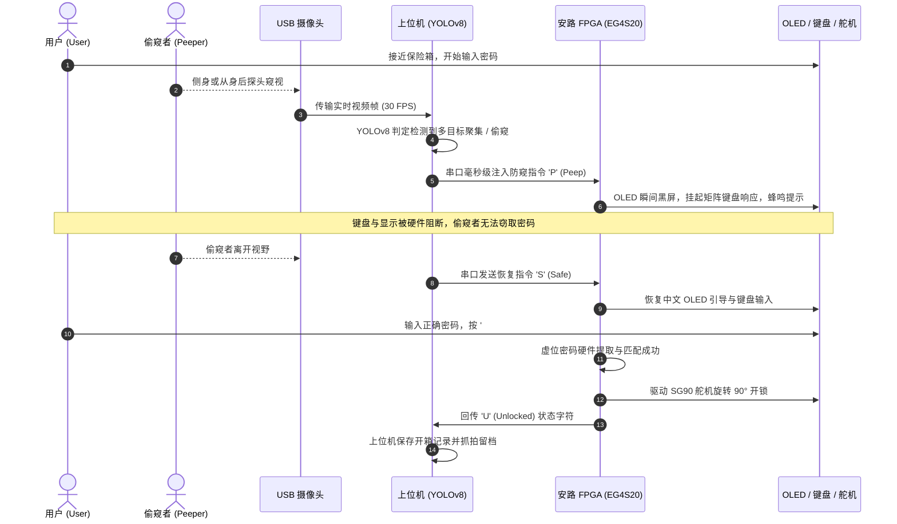

# 《基于 Edge AI 视觉防窥与 FPGA 硬件安全的异构智能保险箱》
> **Heterogeneous Smart Safe with Edge AI Visual Anti-Peeping and FPGA Hardware Security**

<div align="center">

[](https://www.anlogic.com/)
[](https://www.anlogic.com/)
[]()
[]()
[]()
[](./LICENSE)
[]()

**2026 年全国大学生 FPGA 创新设计竞赛参赛作品**  
*设计哲学：硬核底座保底，软硬异构升维，双轨设计进退自如*

[系统架构](#-系统架构与拓扑-system-architecture) •
[核心创新亮点](#-核心创新亮点-key-innovations) •
[硬件物料清单](#-硬件物料清单-bill-of-materials) •
[引脚分配表](#-核心引脚映射表-pin-assignment) •
[通信协议规范](#-串口通信协议标准-uart-protocol) •
[快速开始指南](#-快速上手指南-quick-start) •
[开发路线图](#-开发路线与阶段里程碑-roadmap)

</div>

---

## 📖 项目概述 (Project Overview)

传统的电子密码保险箱面临两大严峻安全威胁：**背后偷窥/旁路拍摄** 与 **受胁迫状态下的强制开门**。

本项目设计了一种基于**国产安路 EG4S20 FPGA 硬件安全内核**与 **PC 端轻量化 Edge AI 视觉模型**的软硬异构智能保险箱系统：
- **硬核底座（FPGA 下位机）**：脱离 PC 可作为独立的全功能高可靠物理密码箱运行。硬件全流水线驱动外设，实现 4×4 矩阵键盘、0.96 寸 I2C OLED 中文引导、JQ8900-16P 真人语音、板载数码管/蜂鸣器双显报警、SG90 物理锁舌驱动与门磁防开锁超时检测。
- **智能升维（PC 上位机 Edge AI）**：利用 USB 广角摄像头捕捉现场操作环境，运行轻量化 YOLOv8 视觉防窥引擎。一旦检测到侧后方有人探头、聚集偷窥，毫秒级通过工业级串口注入防御指令，触发 FPGA 瞬间熄屏阻断并留存抓拍证据。

---

## ✨ 核心创新亮点 (Key Innovations)

```
┌────────────────────────────────────────────────────────────────────────┐
│                          三大核心创新防御机制                          │
├────────────────────────────────────────────────────────────────────────┤
│ 1. 👁️ 毫秒级 Edge AI 视觉防窥与物理熄屏阻断                          │
│    - YOLOv8 多目标识别 + 空间距离动态滤波，检测偷窥即刻向 FPGA 注入 'P'│
│    - 下位机硬件级瞬间黑屏并挂起键盘输入，视野恢复安全 ('S') 自动复原  │
├────────────────────────────────────────────────────────────────────────┤
│ 2. 🛡️ 16 位物理级虚位密码硬件实时提取算法                             │
│    - 支持用户在真实 6 位密码前后任意填入虚位干扰数字（最长 16 位）    │
│    - Verilog 纯硬件状态滑窗提取与比对，杜绝按键留痕与旁路录像推演     │
├────────────────────────────────────────────────────────────────────────┤
│ 3. 🚨 双轨防御与反挟持静默报警机制 (Duress Mode)                      │
│    - 设置专用挟持密码：在遭受歹徒逼迫时输入该密码                      │
│    - 表面正常转动舵机开门并播报“开门成功”，麻痹歹徒保全人身安全       │
│    - 底层静默向 PC 注入 'D' 报警指令，上位机后台静默连拍、上传告警证据 │
└────────────────────────────────────────────────────────────────────────┘
```

---

## 🏗️ 系统架构与拓扑 (System Architecture)

### 1. 软硬异构总体架构


### 2. 视觉防窥与联动时序逻辑



---

## 🧰 硬件物料清单 (Bill of Materials)

| 设备 / 模块 | 型号 / 规格 | 通信接口 / 电平 | 功能定位与系统职责 |
| :--- | :--- | :--- | :--- |
| **FPGA 核心板** | 安路科技 EG4S20BG256 | LVCMOS33 | 系统核心运算与底层物理安全控制 |
| **矩阵键盘** | 4×4 薄膜矩阵键盘 | 4 行 + 4 列 GPIO | 用户密码输入与功能控制按键 |
| **主显示屏** | 0.96 寸 OLED (SSD1306) | 软件/硬件 I2C | 提供中文菜单、输入提示与防窥警告 |
| **状态监视器** | 板载 4 位共阴数码管 | 动态数码管扫描 | 实时显示底层 FSM 状态代码 (`IDLE`, `OPEN`, `LOCK`) |
| **真人语音模块** | JQ8900-16P 语音播放模块 | 单线串口 (One-Line) | 关键操作普通话真人语音交互提示 |
| **物理驱动执行器** | SG90 9g 微型舵机 | 50Hz PWM 控制 | 驱动机械连杆实现保险箱物理锁舌开闭 |
| **环境传感器** | 门磁开关 / 微动开关 | GPIO (上拉输入) | 实时感知箱门开闭状态，超时未关自动报警 |
| **串口交互模块** | CP2102 / CH340 USB-TTL | UART (115200 8-N-1) | 上位机与 FPGA 双向指令交互信道 |
| **视觉传感器** | 1080P USB 广角无畸变摄像头 | USB 2.0 | PC 上位机 AI 视频采集源 |

---

## 🔌 核心引脚映射表 (Pin Assignment)

| 信号名称 (Verilog) | FPGA 管脚 (EG4S20) | 电平标准 / 特性 | 硬件外设连接与说明 |
| :--- | :---: | :--- | :--- |
| `clk_50M` | **R7** | LVCMOS33 | 板载 50MHz 有源系统晶振 |
| `rst_n` | **E3** | LVCMOS33 (PULLUP) | 板载独立复位按键 KEY1（低电平复位） |
| `led[0]` | **B14** | LVCMOS33 | 板载 LED0（1Hz 运行心跳灯） |
| `led[1]` | **B15** | LVCMOS33 | 板载 LED1（复位释放 / 运行就绪指示） |
| `led[7:2]` | **B16, C15, C16, E13, E16, F16** | LVCMOS33 | 板载 LED2~7（系统安全等级指示能量条） |
| `UART_RX` | **H14** | LVCMOS33 | 接收上位机 PC 决策指令 (接 USB-TTL TXD) |
| `UART_TX` | **J13** | LVCMOS33 | 向上位机 PC 发送事件状态 (接 USB-TTL RXD) |

> 完整的外接外设（4×4 薄膜键盘、OLED、SG90 舵机、JQ8900-16P 语音模块、门磁开关等）管脚分配详见项目附带文档 [`docs/EG4S20_Pinout.xlsx`](./docs/EG4S20_Pinout.xlsx)。

---

## 📡 串口通信协议标准 (UART Protocol)

- **波特率**：`115200 bps`（降级备选 `9600 bps`）
- **数据帧格式**：`8 数据位, 无校验位 (None), 1 停止位 (8-N-1)`
- **双向单字节指令集规范**：

| 发送方 | 接收方 | 指令字符 | 协议语义 | 触发条件与动作响应 |
| :---: | :---: | :---: | :--- | :--- |
| **PC 上位机** | FPGA | `'S'` | **Safe (环境安全)** | 视野内恢复为单人正常操作；FPGA 恢复 OLED 界面并解挂键盘输入 |
| **PC 上位机** | FPGA | `'P'` | **Peep (窥视挂起)** | 检出背后聚集或侧后探头偷窥；FPGA 瞬间黑屏、挂起键盘并蜂鸣报警 |
| **PC 上位机** | FPGA | `'R'` | **Remote Unlock (远程开锁)** | PC 人脸核验通过或管理员远程授权开锁；FPGA 直接驱动舵机开锁 |
| **FPGA 下位机** | PC | `'U'` | **Unlocked (开锁成功)** | 密码正确或虚位密码提取合法；PC 上位机弹窗并在日志中记录留存 |
| **FPGA 下位机** | PC | `'L'` | **Locked (暴力破解锁定)** | 连续输错 3 次锁定系统 60 秒；PC 触发声光报警并启动连拍取证 |
| **FPGA 下位机** | PC | `'D'` | **Duress (反挟持静默报警)** | 用户输入特定胁迫密码，表面正常开锁麻痹歹徒，底层静默通知上位机报警取证 |
| **FPGA 下位机** | PC | `'A'` | **Door Alert (门未关好警报)** | 开锁后门磁处于打开状态超过 15 秒未关门；上位机记录超时告警 |

---

## 📂 规范化工程目录树 (Directory Structure)

```
FPGA/
├── .gitignore             # 忽略安路 TD 编译产物 (*_Runs/) 与 Python 临时缓存
├── LICENSE                # MIT 开源授权协议
├── README.md              # 项目主文档与快速使用指南
├── plan.md                # 20 天冲刺开发全景规划书
├── requirements.txt       # 上位机 Python 依赖环境清单
├── lock.al                # 安路 Tang Dynasty (TD) 主工程文件
├── lock.adc               # 物理引脚分配与 IO 属性约束文件
│
├── rtl/                   # 【FPGA 硬件源码】可综合 Verilog RTL
│   ├── top.v              # 系统顶层模块
│   └── clk_tick.v         # 多速率节拍使能发生器 (1kHz / 100Hz 同步脉冲)
│
├── sim/                   # 【仿真与验证】Testbench 激励与波形文件
│   ├── tb_top.v           # 顶层模块行为仿真激励
│   └── tb_clk_tick.v      # 节拍分频逻辑 Testbench
│
├── constraints/           # 【引脚约束备份】
│   └── lock.adc           # 管脚物理位置、IO 电平与上拉设定
│
├── tools/                 # 【联调治具与上位机工具】
│   └── serial_monitor.py  # 工业级双向串口监控与协议调试治具 (支持 --mock 模式)
│
└── docs/                  # 【设计文档与资料库】
    └── EG4S20_Pinout.xlsx # EG4S20 核心管脚速查与硬件引脚映射表
```

---

## 🚀 快速上手指南 (Quick Start)

### 1. 硬件端：安路 TD 工程构建与烧录

1. 启动 **Anlogic Tang Dynasty (TD)** 软件（推荐版本 TD 5.6+）。
2. 在主菜单点击 `Project` $\to$ `Open Project...`，选择本项目根目录下的 [`lock.al`](./lock.al)。
3. 在左侧 Project View 确认工程文件关联无误：
   - Design Files: `rtl/clk_tick.v`, `rtl/top.v`
   - Constraints: `lock.adc`
4. 双击运行 **Generate Bitstream** 生成比特流固件。
5. 使用 USB 下载线连接开发板 JTAG 接口，通过 **Download** 工具烧录至 FPGA。
6. **验证现象**：板载 `LED0` 以精确的 **1Hz**（0.5s 亮、0.5s 灭）平稳闪烁，`LED1` 常亮，说明硬件底座、基准时钟与引脚约束完全正常。

---

### 2. 软件端：串口调试治具与上位机启动

上位机调试治具不仅支持物理串口监听，还支持 `--mock` 模拟模式（无需硬件即可验证双向交互协议）：

#### 安装运行环境依赖
```bash
# 建议在 Python 3.9+ 虚拟环境中执行
pip install -r requirements.txt
```

#### 启动双向协议调试治具
```bash
# 模式 A: 自动扫描物理 COM 端口并连接
python tools/serial_monitor.py

# 模式 B: 无硬件脱机模拟模式 (用于在无开发板时验证交互协议)
python tools/serial_monitor.py --mock
```

---

## 📅 开发路线与阶段里程碑 (Roadmap)

- [x] **Day 1: 基础工程搭建与时钟分频验证** (已交付)
  - [x] EG4S20 管脚物理约束锁定 (`lock.adc`)
  - [x] 1kHz / 100Hz 单时钟域节拍使能模块 (`rtl/clk_tick.v`)
  - [x] 顶层 1Hz 心跳灯与状态就绪逻辑 (`rtl/top.v`)
  - [x] 双向串口监控治具与模拟测试平台 (`tools/serial_monitor.py`)
  - [x] 开源工程目录治理与标准化 README 建立
- [x] **Day 2: 4×4 矩阵键盘行列扫描与硬件消抖** (已交付)
  - [x] 行列轮询低电平扫描与 20ms 双向滤波消抖 (`rtl/keypad_scan.v`)
  - [x] 16键优先级译码（0~9数字, *清除, #确认, A~D功能键）
  - [x] 按键有效单周期脉冲与长按保持指示
- [x] **Day 3: 0.96 寸 I2C OLED 中文驱动与数码管双显** (已交付)
  - [x] SSD1306 纯硬件 I2C 控制器（200kHz SCL, 27字节上电初始化序列）(`rtl/oled_driver.v`)
  - [x] 16×16 汉字字模库与 8×16 ASCII 字符集（四行中文UI排版）(`rtl/oled_font.v`)
  - [x] 板载 4 位共阴极数码管 1kHz 动态扫描监控（`IdLE`/`P- n`/`OPEn`/`Err`/`L-60`）(`rtl/seg_display.v`)
- [x] **Day 4: 密码匹配状态机与输错锁定机制** (已交付)
  - [x] 6 位预设核心密码核验与输入暂存（支持退格清除、确认比对）(`rtl/safe_fsm.v`)
  - [x] 输错 3 次锁定 60 秒硬件倒计时，锁定期间键盘物理锁死
  - [x] 无源蜂鸣器 PWM 驱动（1kHz按键音、2.5kHz错误警告、4kHz锁定急促警报、Do-Mi-Sol开锁和弦）(`rtl/buzzer_driver.v`)
  - [x] 安路 TD 全流程综合、布局布线与比特流固化验证（LUT占用仅 8.61%）
- [ ] **Day 5: JQ8900-16P 语音芯片单线驱动与门磁检测**
- [ ] **Day 6: SG90 舵机 50Hz PWM 控制器**
- [ ] **Day 7: 【Milestone 1】硬件底座集成与单机联合验收**
- [ ] **Day 8~14: 【Milestone 2】软硬异构通信闭环与三大创新点落地**
- [ ] **Day 15~20: 【Milestone 3】实物封装总装、极限压测与答辩交付**

---

## 📜 许可证 (License)

本项目采用 [MIT License](./LICENSE) 开源协议，欢迎广大 FPGA 开发者与高校师生交流研讨。
