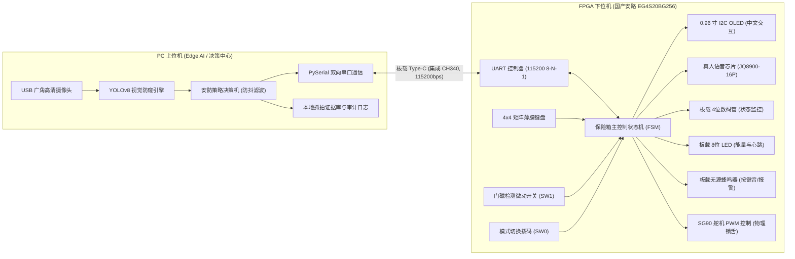
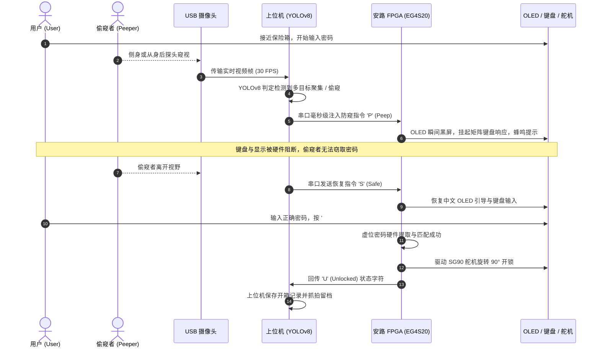

# 《基于 Edge AI 视觉防窥与 FPGA 硬件安全的异构智能保险箱》

> **PC 视觉与上位机入口**：详见 [pc/README.md](pc/README.md)，可运行人脸识别、YOLO 多人风险检测、串口联动、日志和取证。双击 `pc/run_demo.bat` 即可体验无硬件纯软件演示。通信协议标准见 [串口通信协议标准](#-串口通信协议标准-uart-protocol)，硬件引脚手册见 [docs/EG4S20_Pinout.md](docs/EG4S20_Pinout.md)，开发规划详见 [plan.md](plan.md)。
> **Heterogeneous Smart Safe with Edge AI Visual Anti-Peeping and FPGA Hardware Security**

<div align="center">

[](https://www.anlogic.com/)
[](https://www.anlogic.com/)
[]()
[]()
[]()
[](./LICENSE)
[]()

**2026 年全国大学生 FPGA 创新设计竞赛参赛作品**
*设计哲学：硬核底座保底，软硬异构升维，双轨设计进退自如*

[系统架构](#-系统架构与拓扑-system-architecture) •
[核心创新亮点](#-核心创新亮点-key-innovations) •
[硬件物料清单](#-硬件物料清单-bill-of-materials) •
[引脚分配表](#-核心引脚映射表-pin-assignment) •
[通信协议规范](#-串口通信协议标准-uart-protocol) •
[用户操作指南](#-快速上手与用户使用指南-quick-start--user-guide) •
[开发路线图](#-开发路线与阶段里程碑-roadmap)

</div>

---

## 📖 项目概述 (Project Overview)

传统的电子密码保险箱面临两大严峻安全威胁：**背后偷窥/旁路拍摄** 与 **受胁迫状态下的强制开门**。

本项目设计了一种基于**国产安路 EG4S20 FPGA 硬件安全内核**与 **PC 端轻量化 Edge AI 视觉模型**的软硬异构智能保险箱系统：
- **硬核底座（FPGA 下位机）**：脱离 PC 可作为独立的全功能高可靠物理密码箱运行。硬件全流水线驱动外设，实现 4×4 矩阵键盘、0.96 寸 I2C OLED 中文引导、JQ8900-16P 真人语音、板载数码管/蜂鸣器双显报警、SG90 物理锁舌驱动与门磁防开锁超时检测。
- **智能升维（PC 上位机 Edge AI）**：利用 USB 广角摄像头捕捉现场操作环境，运行轻量化 YOLOv8 视觉防窥引擎。一旦检测到侧后方有人探头、聚集偷窥，毫秒级通过工业级串口注入防御指令，触发 FPGA 瞬间熄屏阻断并留存抓拍证据。

---

## ✨ 核心创新亮点 (Key Innovations)

```
┌────────────────────────────────────────────────────────────────────────┐
│                          三大核心创新防御机制                          │
├────────────────────────────────────────────────────────────────────────┤
│ 1. 👁️ 毫秒级 Edge AI 视觉防窥与物理熄屏阻断                          │
│    - YOLOv8 多目标识别 + 空间距离动态滤波，检测偷窥即刻向 FPGA 注入 'P'│
│    - 下位机硬件级瞬间黑屏并挂起键盘输入，视野恢复安全 ('S') 自动复原  │
├────────────────────────────────────────────────────────────────────────┤
│ 2. 🛡️ 16 位物理级虚位密码硬件实时提取算法                             │
│    - 支持用户在真实 6 位密码前后任意填入虚位干扰数字（最长 16 位）    │
│    - Verilog 纯硬件状态滑窗提取与比对，杜绝按键留痕与旁路录像推演     │
├────────────────────────────────────────────────────────────────────────┤
│ 3. 🚨 双轨防御与反挟持静默报警机制 (Duress Mode)                      │
│    - 设置专用挟持密码：在遭受歹徒逼迫时输入该密码                      │
│    - 表面正常转动舵机开门并播报“开门成功”，麻痹歹徒保全人身安全       │
│    - 底层静默向 PC 注入 'D' 报警指令，上位机后台静默连拍、上传告警证据 │
└────────────────────────────────────────────────────────────────────────┘
```

---

## 🏗️ 系统架构与拓扑 (System Architecture)

### 1. 软硬异构总体架构



### 2. 视觉防窥与联动时序逻辑



---

## 🧰 硬件物料清单 (Bill of Materials)

| 设备 / 模块 | 型号 / 规格 | 通信接口 / 电平 | 功能定位与系统职责 |
| :--- | :--- | :--- | :--- |
| **FPGA 核心板** | 硬木课堂大拇指 DMZ-EG4S20 (EG4S20BG256) | LVCMOS33 | 系统核心运算与底层物理安全控制 |
| **矩阵键盘** | 4×4 薄膜矩阵键盘 (8针联排 2.54mm) | 4 行 + 4 列 GPIO | 用户密码输入与功能控制按键 (直插下方排母 P4 偶数排 8~22号针) |
| **主显示屏** | 0.96 寸 OLED (SSD1306, 4针联排) | 软件/硬件 I2C | 提供中文菜单、输入提示与防窥警告 (直插下方排母 P4 右端 60~54号针) |
| **状态监视器** | 板载 4 位共阴数码管 | 动态数码管扫描 | 实时显示底层 FSM 状态代码 (`IDLE`, `OPEN`, `LOCK`) |
| **真人语音模块** | JQ8900-16P 语音播放模块 | 单线串口 (One-Line) | 关键操作普通话真人语音交互提示 (接下方排母 P4 46,44,42号针) |
| **物理驱动执行器** | SG90 9g 微型舵机 (3针联排) | 50Hz PWM 控制 | 驱动机械连杆实现保险箱物理锁舌开闭 (直插下方排母 P4 左侧 2,4,6号针) |
| **环境传感器** | 门磁开关 / 板载拨码 SW1 | GPIO (上拉输入) | 实时感知箱门开闭状态，超时未关自动报警 |
| **串口交互通道** | 板载 USB (集成 CH340, UART2USB) | UART (115200 8-N-1) | 上位机与 FPGA 双向指令交互信道（一根 USB 线直连右下角 UART2USB 口，**彻底免外接 USB-TTL 模块**） |
| **视觉传感器** | PC 自带摄像头 (默认 `cv2.VideoCapture(0)`) / USB 摄像头 | 软件调用 | PC 上位机 AI 视频采集源 (无需额外采购) |

---

## 🔌 核心引脚映射表 (Pin Assignment)

> **联排直插优化**：所有外接排线模块（4针 OLED、8针薄膜键盘、3针 SG90 舵机、3针语音模块）均统一规划在开发板**下方双排插针 `P4` 的内侧一列（PCB 丝印为 P4，偶数引脚 `2 ~ 60`）**，无需跳线分叉，整排母头可直接插拔！

| 外设模块 | 信号名称 (Verilog) | FPGA 管脚 (EG4S20) | 开发板物理位置 (`P4` 排母针号) | 电平标准 / 特性 | 硬件连接与说明 |
| :--- | :--- | :---: | :---: | :--- | :--- |
| **系统时钟/复位** | `clk_50M` | **R7** | 板载有源晶振 | LVCMOS33 | 50MHz 系统主时钟 |
| **系统时钟/复位** | `rst_n` | **E3** | 板载按键 `RSTn` | LVCMOS33 (PULLUP) | 板载独立复位键（低电平有效） |
| **板载 USB 串口** | `uart_tx` | **D12** | 板载 UART2USB (CH340) | LVCMOS33 | FPGA 发送至 PC（**免外接 USB-TTL 模块**） |
| **板载 USB 串口** | `uart_rx` | **F12** | 板载 UART2USB (CH340) | LVCMOS33 (PULLUP) | FPGA 接收 PC 指令（**免外接 USB-TTL 模块**） |
| **0.96寸 OLED**<br>*(4针联排)* | `VCC` / `GND`<br>`oled_scl`<br>`oled_sda` | 硬件电源<br>**E15**<br>**D14** | **`P4-60` (3V3) / `P4-58` (GND)**<br>**`P4-56`**<br>**`P4-54`** | 3.3V / GND<br>LVCMOS33<br>LVCMOS33 (PULLUP) | **P4 下方排母最右侧 4 针 (`60,58,56,54`)**<br>依次对应 OLED 的 `VCC, GND, SCL, SDA` |
| **SG90 舵机**<br>*(3针联排)* | `VCC` / `GND`<br>`servo_pwm` | 硬件电源<br>**M11** | **`P4-2` (5V) / `P4-4` (GND)**<br>**`P4-6`** | 5V (VBUS) / GND<br>LVCMOS33 | **P4 下方排母最左侧 3 针 (`2,4,6`)**<br>依次对应舵机 红(`5V`)、棕(`GND`)、橙(`PWM`) |
| **4×4 薄膜键盘**<br>*(8针联排)* | `key_row[0:3]`<br>`key_col[0:3]` | **L12, P15, P16, N14**<br>**N16, M16, L16, P14** | **`P4-8, 10, 12, 14`**<br>**`P4-16, 18, 20, 22`** | LVCMOS33 (PULLUP)<br>LVCMOS33 | **P4 下方排母紧挨舵机往右连续 8 针 (`8~22`)**<br>整排 8P 母头直接连续插在 `P4` 偶数排 `8~22` |
| **JQ8900 语音**<br>*(3针联排)* | `voice_tx`<br>`GND`<br>`voice_busy` | **H16**<br>硬件地<br>**G16** | **`P4-46`**<br>**`P4-44` (GND)**<br>**`P4-42`** | LVCMOS33<br>GND<br>LVCMOS33 (PULLUP) | `H16` 串接 1kΩ 接模块 `IO1(P04)`，`G16` 接 `BUSY`，模块 `V5V` 接 `P4-2(5V)` |
| **门磁 / 拨码** | `door_gpio`<br>`sw_recovery` | **A10**<br>**A14** | 板载拨码 `SW1`<br>板载拨码 `SW7` | LVCMOS33 (PULLUP)<br>LVCMOS33 (PULLDOWN)| `SW1`: 门磁开闭检测 (`0`闭合/`1`打开)<br>`SW7`: 应急恢复码硬允许开关 |
| **板载声光外设** | `buzzer_out`<br>`led[7:0]`<br>`seg_out` / `seg_cs` | **H11**<br>**B14~F16**<br>**A4~C8 / C9~A3** | 板载蜂鸣器 `LS1`<br>板载 `LED0~LED7`<br>板载 4 位数码管 | LVCMOS33 | 内部已硬连线，无需外部插线 |

#### 板载 8 位 LED 状态指示分配（对齐 `rtl/top.v`）

| LED 编号 | 物理管脚 | 驱动信号 (`top.v`) | 默认状态 | 触发点亮条件与功能指示 |
| :---: | :---: | :--- | :---: | :--- |
| **LED0** | **B14** | `hb_led` | 1Hz 闪烁 | 系统运行心跳（0.5s 亮 / 0.5s 灭） |
| **LED1** | **B15** | `key_pressed` | 灭 | 矩阵键盘按键按下指示（按住常亮，松开熄灭） |
| **LED2** | **B16** | `unlock_all` | 灭 | 开锁驱动有效指示（密码/远程开锁 3 秒保持点亮） |
| **LED3** | **C15** | `(state_code == 4'd4) \| rec_locked` | 灭 | 系统锁定指示（连续输错 3 次锁定 60 秒常亮，含恢复模式锁定） |
| **LED4** | **C16** | `state_code == 4'd3` | 灭 | 密码错误报警指示（处于错误提示状态时点亮） |
| **LED5** | **E13** | `door_open` | 随门磁变化 | 门磁开闭实时指示（门开点亮，门闭熄灭） |
| **LED6** | **E16** | `err_count >= 1` | 灭 | 错误历史指示 1（累计输错 $\ge 1$ 次常亮） |
| **LED7** | **F16** | `(err_count >= 2) \| door_alert` | 灭 | 错误历史指示 2 或门超时未关报警（报警时常亮） |

#### JQ8900-16P 真人语音曲目表（标准普通话，对齐 `rtl/top.v`）

| 曲目编号 | 触发场景 | 语音播报内容 (普通话) | 触发源 (`top.v`) |
| :---: | :---: | :--- | :--- |
| **01 (00001)** | 敲击首位数字唤醒 | “请输入密码” / 按键提示音 | 待机态按下 `0~9` 数字键唤醒输入 |
| **02 (00002)** | 密码验证通过 / 远程开锁 | “密码正确，门已开启” | `unlock_rise`（本地开锁或 PC 远程 `'R'`） |
| **03 (00003)** | 密码比对错误 / 改密不一致 | “密码错误，请重新输入” | `beep_err` 或应急恢复输错 `rec_beep_err` |
| **04 (00004)** | 连续输错 3 次锁定 | “系统已锁定，请稍后再试” | `beep_lock` 进入 60 秒锁定 |
| **05 (00005)** | A/B/D 键密码修改或重置成功 | “密码修改成功” | `pwd_changed` 或应急恢复重置成功 `rec_ok` |
| **06 (00006)** | 开门超过 15 秒未关 | “箱门超时未关，请及时关门” | `door_alert_pulse` 超时报警脉冲 |
| **07 (00007)** | 收到 PC 'P' 防窥挂起 | “背后有人，请注意防窥” | `peep_rise` 上位机检测偷窥注入 `'P'` |

> 完整的硬木课堂大拇指开发板（DMZ-EG4S20）官方全引脚映射表与外接联排接线手册详见 [`docs/EG4S20_Pinout.md`](./docs/EG4S20_Pinout.md) 及 [`docs/EG4S20_Pinout.xlsx`](./docs/EG4S20_Pinout.xlsx)。

---

## 📡 串口通信协议标准 (UART Protocol)

- **波特率**：`115200 bps`（降级备选 `9600 bps`）
- **数据帧格式**：`8 数据位, 无校验位 (None), 1 停止位 (8-N-1)`
- **双向单字节指令集规范**：

| 发送方 | 接收方 | 指令字符 | 协议语义 | 触发条件与动作响应 |
| :---: | :---: | :---: | :--- | :--- |
| **PC 上位机** | FPGA | `'S'` | **Safe (环境安全)** | 视野内恢复为单人正常操作；FPGA 恢复 OLED 界面、解挂键盘并清除反挟持状态 |
| **PC 上位机** | FPGA | `'P'` | **Peep (窥视挂起)** | 检出背后聚集或侧后探头偷窥；FPGA 瞬间熄屏（仅显中间横杠）、挂起常规输入并语音告警（仍保留反挟持求救） |
| **PC 上位机** | FPGA | `'R'` | **Remote Unlock (远程开锁)** | PC 人脸核验通过或管理员远程授权开锁；FPGA 直接驱动舵机开锁 3 秒（锁定态下硬件拒绝响应） |
| **FPGA 下位机** | PC | `'U'` | **Unlocked (开锁成功)** | 密码正确或虚位密码提取合法；PC 上位机记录日志并抓拍开门者留存 |
| **FPGA 下位机** | PC | `'K'` | **Relocked (重新闭锁)** | 3 秒开锁倒计时结束或按 `C` 键手动提前闭锁；PC 数字孪生仪表盘同步恢复闭锁状态 |
| **FPGA 下位机** | PC | `'E'` | **Password Error (单次输错)** | 单次密码校验不通过；PC 上位机记录错误告警日志 |
| **FPGA 下位机** | PC | `'L'` | **Locked (暴力破解锁定)** | 连续输错 3 次锁定系统 60 秒；PC 触发声光报警并启动连拍取证 |
| **FPGA 下位机** | PC | `'T'` | **Lock Timeout End (锁定结束)** | 60 秒硬件锁定倒计时归零自动解封；PC 同步解除锁定告警状态 |
| **FPGA 下位机** | PC | `'D'` | **Duress (反挟持静默报警)** | 用户输入胁迫密码 `654321`，表面正常开锁麻痹歹徒，底层静默发 `'D'` 通知上位机后台连拍取证（已过滤 `'U'` 防止混发） |
| **FPGA 下位机** | PC | `'A'` | **Door Alert (门未关好警报)** | 开锁后门磁处于打开状态超过 15 秒未关门；上位机记录超时告警并抓拍 |

---

## ⌨️ 4×4 矩阵键盘按键映射与交互定义

外接 4×4 矩阵薄膜键盘共 16 个物理按键，系统为每个按键赋予了明确的安防与业务功能定义：

| 键位 | 编码 (Hex) | 键面字符 | 按键类型 | 核心功能与交互行为说明 |
| :---: | :---: | :---: | :---: | :--- |
| **0 ~ 9** | `0x0` ~ `0x9` | `0` ~ `9` | **数字输入** | 密码输入与新密码设置录入。按下一键蜂鸣器发 1kHz 提示音，OLED 动态更新掩码 `*`，数码管显示当前位数。 |
| **\*** | `0xE` | `*` | **退格 / 取消** | **双重容错逻辑**：<br>1. 正在输入字符（`len > 0`）：单步回退删除最后 1 位；<br>2. 缓冲区为空（`len == 0`）：直接**取消当前模式**（取消改密/取消录入/取消应急重置），安全平稳退回待机主界面。 |
| **#** | `0xF` | `#` | **确认 / 提交** | **多模式确认键**：<br>1. **开锁核验**：提交 6~16 位输入进行滑动窗口模式匹配判决（未满 6 位按 `#` 仅发提示音，不扣罚错误次数）；<br>2. **改密/录入/恢复**：提交当前 6 位密码，推进入下一步确认或写入。 |
| **A** | `0xA` | `A` | **新用户设置密码** | **首次录入通道**（仅在默认密码 `123456` 尚未修改时可用；改密后按 `A` 拒绝进入并提示音，防旁人直接篡改）：<br>`按 A` $\to$ OLED 提示 `输入新密码` $\to$ 输 6 位新密码按 `#` $\to$ 提示 `重复新密码` $\to$ 再次输入按 `#` $\to$ 写入密码寄存器生效。 |
| **B** | `0xB` | `B` | **修改密码 (改密)** | **老用户改密通道**（强权限闭环，验旧改新）：<br>`按 B` $\to$ OLED 提示 `输入旧密码` $\to$ 按 `#` 校验（输错扣罚并报警退回）$\to$ 验密通过后 `输入新密码` $\to$ 按 `#` $\to$ `重复新密码` $\to$ 按 `#` $\to$ 写入生效。 |
| **C** | `0xC` | `C` | **手动提前闭锁** | 开锁成功后若无需等待 3 秒自动回弹，按 `C` 可立即驱动舵机回弹至 0° 闭锁并向 PC 上报 `'K'`。 |
| **D** | `0xD` | `D` | **硬件应急恢复** | **忘记密码硬件重置通道**（需先将开发板拨码开关 `SW7 (A14)` 拨上开启硬授权）：<br>待机态 `按 D` $\to$ OLED 显示 `应急重置 / 请输入密码` $\to$ 输入 6 位硬件恢复码 `937158` 按 `#` $\to$ 密码强制恢复为初始值 `123456`（连续输错 3 次同样触发 60 秒锁定）。 |

> **防呆保护机制**：处于 `A`（录入）或 `B`（改密）模式时超过 **15 秒**无操作，或处于 `D`（应急重置）模式超过 **30 秒**无操作，硬件看门狗定时器自动超时放弃，安全退回待机，防止状态机被占死。

---

## 🖥️ 0.96 寸 OLED 中文显示屏各阶段排版规范（对齐 `rtl/oled_driver.v`）

主屏选用 0.96 寸 SSD1306 OLED（128×64 单色，四行 16×16 汉字 / 8×16 ASCII 字符，字库内置 53 个定制汉字），各业务状态实际渲染界面如下：

| 系统业务状态 | OLED 第一行 (Row 0) | OLED 第二行 (Row 1) | OLED 第三行 (Row 2) | OLED 第四行 (Row 3) | 状态联动声光与数码管表现 |
| :--- | :--- | :--- | :--- | :--- | :--- |
| **待机状态 (`S_IDLE`)** | `欢迎使用` | `请输入密码` | *(空白)* | `剩余: 3 次` | `LED0` 1Hz 心跳闪烁，数码管显示 `IdLE` |
| **密码输入 (`S_INPUT`)** | `欢迎使用` | `请输入密码` | `******` *(1~16位动态掩码)* | `剩余: 3 次` | 每次敲键 1kHz 按键音，数码管显示 `P- X` |
| **新用户录入 (`S_SET_NEW`)**<br>*(默认密码态按 A 键)* | `新用户录入` | `输入新密码` | `******` *(0~6位动态掩码)* | `# 确认   * 清除` | 数码管显示 `SEt1`，15 秒无操作自动回待机 |
| **密码二次确认 (`S_SET/CHG_CFM`)** | `请再次确认` | `重复新密码` | `******` *(0~6位动态掩码)* | `# 确认   * 清除` | 数码管显示 `CFn1`/`CFn2`，两次一致方可写入 |
| **修改密码验权 (`S_CHG_AUTH`)**<br>*(待机按 B 键)* | `修改密码` | `输入旧密码` | `******` *(0~6位动态掩码)* | `# 确认   * 清除` | 数码管显示 `ChG0`，旧密码输错扣罚容错次数 |
| **修改密码新密 (`S_CHG_NEW`)** | `输入新密码` | `输入新密码` | `******` *(0~6位动态掩码)* | `# 确认   * 清除` | 数码管显示 `ChG1`，支持 `*` 键退格或取消 |
| **设置/改密完成 (`S_OP_DONE`)** | `设置成功` | `密码已更新` | *(空白)* | `剩余: 3 次` | 蜂鸣器奏响和弦音，语音播报“修改成功” |
| **开锁成功 (`S_SUCCESS`)** | `欢迎使用` | `开锁成功` | *(空白)* | `门锁已开启` | 蜂鸣器和弦音，语音“门已开启”，舵机转 90°，数码管 `OPEn` |
| **密码错误 (`S_ERROR`)** | `欢迎使用` | `密码错误` | *(空白)* | `剩余: X 次` | 蜂鸣器 2.5kHz 报警音，语音“密码错误”，数码管 `Err` |
| **暴力锁定 (`S_LOCKED`)** | `欢迎使用` | `系统已锁定` | `倒计时: 58 秒` *(动态递减)* | `键盘已锁定` | 蜂鸣器 4kHz 急促警报，语音“系统已锁定”，数码管 `L-58` |
| **应急恢复输入 (`rec_active`)**<br>*(SW7 拨上后按 D 键)* | `应急重置` | `请输入密码` | `******` *(0~6位动态掩码)* | `# 确认   * 清除` | 数码管显示 `rEC`，验证通过将密码重置回 `123456` |
| **应急恢复锁定 (`rec_locked`)** | `应急重置` | `系统已锁定` | `倒计时: 58 秒` *(动态递减)* | `键盘已锁定` | 恢复码连续输错 3 次锁定 60 秒，数码管显示 `L-58` |
| **门磁超时未关 (`door_alert`)** | `箱门已开启` | `警告:箱门开` | *(当前输入掩码)* | `请确认门锁` | 蜂鸣器报警，语音播报“请及时关门”，数码管显示 `dOOr` |
| **视觉防窥挂起 (`peep_hang`)**<br>*(收到 PC 'P' 指令最高抢占)* | *(全黑熄屏)* | *(全黑熄屏)* | `----------------` *(16格横杠)* | *(全黑熄屏)* | 数码管同步全灭，常规输入挂起，语音告警“请注意防窥” |

---

## 💻 PC 上位机安防控制中枢与三层自适应防窥模型

PC 端基于 Python (PyQt6 + YOLOv8 + PySerial) 构建，定位为**“环境防窥天眼、设备数字孪生与取证黑匣子”**：

### 1. 监控面板大屏三大功能区
* **左半区：实时视觉画面与 AI 目标标注**
  * 直接复用笔记本自带摄像头（调用 `cv2.VideoCapture(0)`），以 30 FPS 高帧率呈现。
  * **目标标注框**：
    * **绿色框**：标注正前方的操作者本人（标记 `User: Active`）。
    * **红色告警框**：标注侧身探头、背后聚集逼近的偷窥者（标记 `Peeping Alert!` 及置信度，如 `91%`）。
  * **动态安全等级顶条**：
    * 正常时全屏绿标：`【 SYSTEM SAFE - 单人正常操作中 】`。
    * 偷窥时红光闪烁：`【 PEEPING DETECTED - 毫秒级熄屏防窥挂起中 】`。
* **右上区：保险箱数字孪生仪表盘**
  * 串口配置区（COM 口自动扫描、115200 波特率、连接心跳指示）。
  * 保险箱主状态机实时状态映射（待机 / 输入中 / 已开锁 / 输错报警 / 60s 倒计时 / 防窥挂起）。
  * 物理机构状态指示灯（舵机当前角度、门磁吸合状态、反挟持警报标志）。
  * 应急与测试控制按钮（`[远程开锁 'R']`、`[手动模拟防窥 'P']`、`[模拟恢复 'S']`，无需摄像头即可一键联调）。
* **右下区：审计日志黑匣子与抓拍证据库**
  * 带毫秒级时间戳的事件滚动审计列表（记录每一次串口交互、开锁事件、非法输错、反挟持警报）。
  * **抓拍证据瀑布流**：收到 `'U'` 自动抓拍开门者留存；收到 `'L'` 启动 5 连拍；收到 `'D'` 后台静默抓拍；收到 `'P'` 截取偷窥者人脸照片，全部自动归档至 `captures/` 文件夹。

### 2. 三层漏斗自适应防窥判决模型（彻底消除路过误触）
为了避免“背景里随便走过一个人就频繁误触熄屏”的体验痛点，PC 端采用三层空间与时间融合判决模型：
1. **第一层：空间几何 ROI 与距离过滤**：按检测框面积和位置，自动剔除 1.5 米外背景中走过的路人。
2. **第二层：面部偏角与视线估计（Gaze & Orientation）**：通过人脸关键点与偏航角（Yaw Angle），区分“侧身快步路过”与“探头注视键盘/屏幕”。
3. **第三层：时间滞后滑动窗口滤波（Temporal Hysteresis）**：危险目标必须在警戒区内**持续停留超过 15 帧（约 0.5 秒）**才触发熄屏 `'P'`；目标离开且连续 5 帧安全才下发 `'S'` 恢复，彻底杜绝状态频繁跳变。

---

## 🔐 密码认证规范与虚位密码机制

1. **日常开锁免录人脸**：
   * 人来到保险箱前，直接敲键盘输入密码即可开锁，无需预先录入人脸库。
   * PC 摄像头仅负责环境防窥与开门自动抓拍留底，不卡控开门权限，保障断网脱机时 100% 独立可用。
2. **6 ~ 16 位自适应虚位密码**：
   * 敲击长度在 **6 至 16 位** 任意浮动（例：`乱码 + 6位真密码 + 乱码 + #`），绝不强制凑满 16 位。
   * FPGA 内部移位 FIFO 永远保存最近 16 位输入，在按 `#` 的瞬间，通过内部 **11 组硬件并行比对器在 20 纳秒（单时钟周期）内全并行完成模式匹配**，纳秒级提取真密码，兼具防旁路推演与超高硬件实时性。

---

## 📂 规范化工程目录树 (Directory Structure)

```
FPGA/
├── .gitignore             # 忽略安路 TD 编译产物 (*_Runs/) 与 Python 临时缓存
├── LICENSE                # MIT 开源授权协议
├── README.md              # 项目主文档与快速使用指南
├── plan.md                # 20 天冲刺开发全景规划书 (基线与执行手册)
├── revision.md            # 全系统问题诊断与深度修改建议报告
├── requirements.txt       # 上位机 Python 依赖环境清单
├── lock.al                # 安路 Tang Dynasty (TD) 主工程文件
├── lock.adc               # 物理引脚分配与 IO 属性约束文件
│
├── constraints/           # 【时序约束】
│   └── lock.sdc           # 50MHz 系统时钟约束文件
│
├── rtl/                   # 【FPGA 硬件源码】可综合 Verilog RTL
│   ├── top.v              # 系统顶层模块 (外设互联/按键仲裁/声光联动)
│   ├── clk_tick.v         # 多速率节拍使能发生器 (1kHz / 100Hz 同步脉冲)
│   ├── keypad_scan.v      # 4×4 矩阵键盘扫描与 20ms 硬件消抖
│   ├── safe_fsm.v         # 密码状态机与 16 位自适应虚位密码滑窗提取比对
│   ├── recovery_mgr.v     # 应急恢复码独立硬件管理通道 (SW7 拨码使能)
│   ├── oled_driver.v      # SSD1306 0.96 寸 OLED I2C 纯硬件驱动
│   ├── oled_font.v        # 中文字模点阵库与四行多页面动态映射
│   ├── seg_display.v      # 板载 4 位共阴极数码管 1kHz 动态扫描显示
│   ├── buzzer_driver.v    # 无源蜂鸣器多音阶与报警音频发生器
│   ├── voice_player.v     # JQ8900-16P 单线串口真人语音驱动
│   ├── servo_driver.v     # SG90 舵机 50Hz PWM 控制器 (0°/90°/3秒回弹)
│   ├── door_sensor.v      # 门磁检测与 15 秒超时未关防盗报警
│   ├── uart_rx.v          # UART 接收模块 (115200 8-N-1)
│   ├── uart_tx.v          # UART 发送模块 (115200 8-N-1)
│   └── uart_mailman.v     # 串口事件邮差 (4 字节 FIFO 异步指令暂存与发送)
│
├── sim/                   # 【仿真与验证】Testbench 激励与波形文件
│   ├── tb_top.v           # 顶层系统行为联调仿真
│   ├── tb_clk_tick.v      # 节拍使能分频仿真
│   ├── tb_keypad_scan.v   # 键盘消抖与键值译码仿真
│   ├── tb_safe_fsm.v      # 密码核验与虚位滑窗提取仿真
│   ├── tb_servo_driver.v  # 舵机 PWM 控制器脉宽仿真
│   ├── tb_door_sensor.v   # 门磁消抖与超时警报仿真
│   ├── tb_voice_player.v  # 语音单线串口时序仿真
│   ├── tb_uart.v          # UART 串口收发仿真
│   └── tb_uart_mailman.v  # 邮件事件打包与防丢测试
│
├── pc/                    # 【PC 上位机 Edge AI 视觉与综合控制台】
│   ├── main.py            # 上位机可视化主控台 (PyQt6)
│   ├── security_monitor.py# 独立视觉安防监控守护进程
│   ├── config.json        # 上位机与防窥视觉策略配置
│   ├── yolov8n.pt         # YOLOv8n 轻量化视觉检测模型权重
│   ├── README.md          # 上位机架构与使用说明
│   ├── requirements.txt   # PC 端独享依赖项
│   ├── run_demo.bat       # 纯软件模拟演示一键运行脚本
│   ├── run_camera_demo.bat# 摄像头防窥联动一键运行脚本
│   ├── modules/           # 上位机核心模块 (视觉/人脸/策略/串口/证据库等)
│   ├── tools/             # 录入/环境自检工具 (enroll_face, check_env 等)
│   └── tests/             # 单元与集成测试 (test_core, test_io)
│
├── tools/                 # 【自动化脚本与联调治具】
│   ├── serial_monitor.py  # 串口调试与协议交互治具 (--mock 模式支持)
│   ├── gui_monitor.py     # 轻量级 GUI 串口监控工具
│   ├── build.bat / .tcl   # TD 自动编译与比特流生成脚本
│   ├── download.bat / .tcl# TD 比特流自动烧录脚本
│   ├── generate_pinout_xlsx.py # 引脚表 Excel 生成器
│   └── generate_wiring_diagram.py # 硬件接线示意图生成器
│
└── docs/                  # 【硬件手册与设计资料库】
    ├── EG4S20_Pinout.md   # 板载引脚与 P4 联排插针完全映射指南
    ├── EG4S20_Pinout.xlsx # Excel 版引脚定义与信号速查表
    ├── DMZ_EG4S20_Official_Pinout.png # 官方核心板引脚原理图
    └── Hardware_Wiring_Guide.png      # P4 联排外接模块接线实物示意图
```

---

## 🚀 快速上手指南 (Quick Start)

### 1. 硬件端：安路 TD 工程构建与烧录

1. 启动 **Anlogic Tang Dynasty (TD)** 软件（推荐版本 TD 5.6+）。
2. 在主菜单点击 `Project` $\to$ `Open Project...`，选择本项目根目录下的 [`lock.al`](./lock.al)。
3. 在左侧 Project View 确认工程文件关联无误：
   - Design Files: `rtl/clk_tick.v`, `rtl/top.v`
   - Constraints: `lock.adc`
4. 双击运行 **Generate Bitstream** 生成比特流固件。
5. 使用 USB 下载线连接开发板 JTAG 接口，通过 **Download** 工具烧录至 FPGA。
6. **验证现象**：板载 `LED0` 以精确的 **1Hz**（0.5s 亮、0.5s 灭）平稳闪烁，`LED1` 常亮，说明硬件底座、基准时钟与引脚约束完全正常。

---

### 2. 软件端：串口调试治具与上位机启动

上位机调试治具不仅支持物理串口监听，还支持 `--mock` 模拟模式（无需硬件即可验证双向交互协议）：

#### 安装运行环境依赖
```bash
# 建议在 Python 3.9+ 虚拟环境中执行
pip install -r requirements.txt
```

#### 启动双向协议调试治具
```bash
# 模式 A: 自动扫描物理 COM 端口并连接
python tools/serial_monitor.py

# 模式 B: 无硬件脱机模拟模式 (用于在无开发板时验证交互协议)
python tools/serial_monitor.py --mock
```

---

## 📅 开发路线与阶段里程碑 (Roadmap)

- [x] **Day 1: 基础工程搭建与时钟分频验证** (已交付)
  - [x] EG4S20 管脚物理约束锁定 (`lock.adc`)
  - [x] 1kHz / 100Hz 单时钟域节拍使能模块 (`rtl/clk_tick.v`)
  - [x] 顶层 1Hz 心跳灯与状态就绪逻辑 (`rtl/top.v`)
  - [x] 双向串口监控治具与模拟测试平台 (`tools/serial_monitor.py`)
  - [x] 开源工程目录治理与标准化 README 建立
- [x] **Day 2: 4×4 矩阵键盘行列扫描与硬件消抖** (已交付)
  - [x] 行列轮询低电平扫描与 20ms 双向滤波消抖 (`rtl/keypad_scan.v`)
  - [x] 16键优先级译码（0~9数字, *清除, #确认, A~D功能键）
  - [x] 按键有效单周期脉冲与长按保持指示
- [x] **Day 3: 0.96 寸 I2C OLED 中文驱动与数码管双显** (已交付)
  - [x] SSD1306 纯硬件 I2C 控制器（200kHz SCL, 27字节上电初始化序列）(`rtl/oled_driver.v`)
  - [x] 16×16 汉字字模库与 8×16 ASCII 字符集（四行中文UI排版）(`rtl/oled_font.v`)
  - [x] 板载 4 位共阴极数码管 1kHz 动态扫描监控（`IdLE`/`P- n`/`OPEn`/`Err`/`L-60`）(`rtl/seg_display.v`)
- [x] **Day 4: 密码匹配状态机与输错锁定机制** (已交付)
  - [x] 6 位预设核心密码核验与输入暂存（支持退格清除、确认比对）(`rtl/safe_fsm.v`)
  - [x] 输错 3 次锁定 60 秒硬件倒计时，锁定期间键盘物理锁死
  - [x] 无源蜂鸣器 PWM 驱动（1kHz按键音、2.5kHz错误警告、4kHz锁定急促警报、Do-Mi-Sol开锁和弦）(`rtl/buzzer_driver.v`)
  - [x] 安路 TD 全流程综合、布局布线与比特流固化验证（LUT占用仅 8.61%）
- [x] **Day 5: 底座加固收敛 + JQ8900-16P 语音驱动 + GPS-23 门磁超时防盗** (已交付)
  - [x] **底座加固与技术债务收敛**：OLED 初始化表消除 `initial` 警告（P0-A）、SDA 开漏三态改造消除对驱风险（P0-B）、建立 50MHz SDC 时序约束集（P0-C）、全工程 DSP 降为 0（P0-D）、异步复位双级同步释放与上电 POR（P1-H）、'#'键未满6位防呆免计错（P1-G）、反挟持粘滞锁存（P1-I）
  - [x] **JQ8900-16P 语音驱动**：单线串口 One-Line 协议微秒时序引擎、100ms 强制防重入冷却、BUSY 引脚极性自适应（`rtl/voice_player.v`）
  - [x] **GPS-23 门磁与 SW1 双轨防盗**：20ms 硬件数字消抖、开锁后 15 秒未关门急促声光/语音报警、关门秒级撤防恢复（`rtl/door_sensor.v`）
  - [x] **安路 TD 综合与时序收敛**：LUT 占用 8.85% (1734/19600)、REG 占用 1.69% (332/19600)、**DSP 0**、建立时间余量全部 Pass，实测收敛 **$F_{max} = 55.15\,\text{MHz}$** (时序负裕量 TNS = 0.000ns)，生成比特流 `lock.bit`
- [x] **Day 6: SG90 舵机 50Hz PWM 控制器与 A/B 键改密/录入业务全打通【提前达成 Milestone 1】** (已交付)
  - [x] **SG90 舵机 50Hz PWM 控制器**：50Hz 基准周期（20ms）、0.5ms（0° 闭锁）~ 1.5ms（90° 开锁）、3 秒自动回弹与 C 键手动提前闭锁（`rtl/servo_driver.v`）
  - [x] **A 键新用户录入与 B 键验旧改密闭环**：动态密码寄存器存储（默认 123456）、A 键双重录入确认防输错、B 键验旧改新权限闭环（输错旧密码扣罚错误次数）、15 秒无操作硬件看门狗超时强制放弃保护（`rtl/safe_fsm.v`）
  - [x] **0.96 寸 OLED 多页面交互与字模扩充**：增补 17 个 16×16 汉字字模（新、旧、改、设、置等）、四行多页面动态排版（`rtl/oled_font.v`, `rtl/oled_driver.v`）
  - [x] **底层隐患治理与顶层声光联动**：修复开门超时检测时序隐患（`rtl/door_sensor.v`）、`state_code` 升级为 4 位宽、数码管显示适配（`rtl/seg_display.v`）、舵机 PWM 信号引脚固化至 `M11`（`lock.adc`，接 P4-6 排针）
  - [x] **全流程 TD 编译收敛**：LUT 占用 12.05% (2362/19600)、REG 占用 2.59% (508/19600)、**DSP 0**、建立时间余量 Setup Slack = **+1.800ns** ($F_{max} = 54.95\,\text{MHz}$)，生成全新比特流 `lock.bit`
- [x] **Day 7: UART 115200 异步串口全双工收发与事件邮差队列** (已交付)
  - [x] 板载 CH340 虚拟串口全双工通信（`uart_tx.v`, `uart_rx.v`，16 倍波特率过采样，消除时钟抖动）
  - [x] 4 字节环形 FIFO 事件邮差（`uart_mailman.v`），实现脉冲锁存与异步防掉包
- [x] **Day 8: PC 端 Edge AI 视觉防窥引擎与数字孪生控制台** (已交付)
  - [x] 基于 YOLOv8n 的高帧率人脸/人体检测与三层时间-空间滞后滤波模型（`pc/modules/vision.py`, `pc/modules/policy.py`）
  - [x] PyQt6 工业级安防监控仪表盘、事件黑匣子审计与多场景自动抓拍取证库（`pc/modules/ui.py`, `pc/modules/evidence.py`）
- [x] **Day 9: 16 位物理虚位密码硬件提取引擎与双轨反挟持静默报警** (已交付)
  - [x] 16 位滑窗模式匹配，纳秒级提取有效 6 位核心密码（`safe_fsm.v`）
  - [x] 双轨反挟持静默报警机制（开锁麻痹歹徒 + 底层注入 'D' 连拍留证，`top.v`）
  - [x] 全工程综合布线通过：LUT 4019 (20.51%)、REG 754 (3.85%)、DSP 0、Setup Slack = +2.621ns ($F_{max} \approx 57.54\,\text{MHz}$)
- [ ] **Day 10: 【Milestone 2 贯通联调】软硬件跨模块协同与全系统问题诊断** (进行中 / In Progress)
  - [x] 全系统软硬件交互全链路排查，输出深度诊断与修改建议报告 [`revision.md`](./revision.md)
  - [ ] 修复反挟持双发/二次漏发、防窥挂起阻断反挟持、PC 锁定状态单向卡死等交互缺陷
- [ ] **Day 11~14: 硬件级应急恢复管理通道 (SW7 + D键) 与声光体验极致打磨**
  - [ ] `recovery_mgr.v` 声光反馈打通（数码管/OLED 倒计时与按键音）
  - [ ] 门未关持续蜂鸣提醒与日常改密防呆加固
- [ ] **Day 15~20: 【Milestone 3】实物封装总装、极限压测与答辩交付**

---

## 📜 许可证 (License)

本项目采用 [MIT License](./LICENSE) 开源协议，欢迎广大 FPGA 开发者与高校师生交流研讨。
