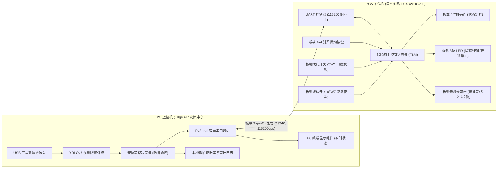
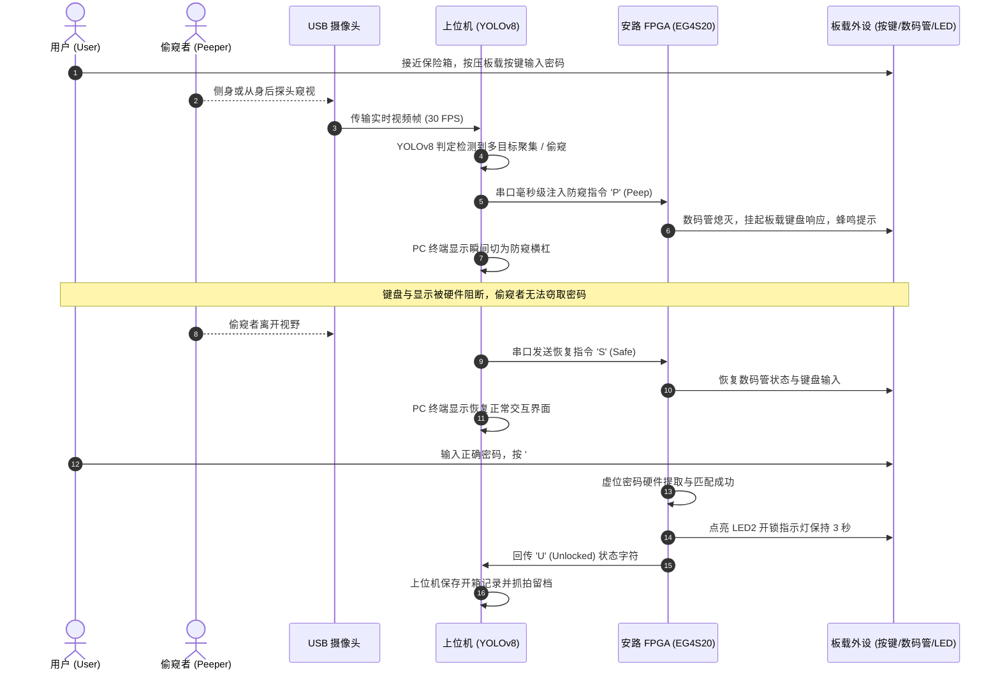

# 《基于 Edge AI 视觉防窥与 FPGA 硬件安全的异构智能保险箱》

> **PC 视觉与上位机入口**：详见 [pc/README.md](pc/README.md)，可运行人脸识别、YOLO 多人风险检测、串口联动、日志和取证。双击 `pc/run_demo.bat` 即可体验无硬件纯软件演示。通信协议标准见 [串口通信协议标准](#-串口通信协议标准-uart-protocol)，硬件引脚手册见 [docs/EG4S20_Pinout.md](docs/EG4S20_Pinout.md)，开发规划详见 [plan.md](plan.md)。
> **Heterogeneous Smart Safe with Edge AI Visual Anti-Peeping and FPGA Hardware Security**

<div align="center">

[](https://www.anlogic.com/)
[](https://www.anlogic.com/)
[]()
[]()
[]()
[](./LICENSE)
[]()

**2026 年全国大学生 FPGA 创新设计竞赛参赛作品**
*设计哲学：硬核底座保底，软硬异构升维，双轨设计进退自如*

[系统架构](#-系统架构与拓扑-system-architecture) •
[核心创新亮点](#-核心创新亮点-key-innovations) •
[硬件物料清单](#-硬件物料清单-bill-of-materials) •
[引脚分配表](#-核心引脚映射表-pin-assignment) •
[通信协议规范](#-串口通信协议标准-uart-protocol) •
[快速上手指南](#-快速上手指南-quick-start)

</div>

---

## 📖 项目概述 (Project Overview)

传统的电子密码保险箱面临两大严峻安全威胁：**背后偷窥/旁路拍摄** 与 **受胁迫状态下的强制开门**。

本项目设计了一种基于**国产安路 EG4S20 FPGA 硬件安全内核**与 **PC 端轻量化 Edge AI 视觉模型**的软硬异构智能保险箱系统：
- **硬核底座（FPGA 下位机）**：脱离 PC 可作为独立的全功能高可靠物理密码箱运行。硬件全流水线驱动开发板板载原生外设，实现板载 4×4 矩阵微动按键输入、板载 4 位数码管/8 路 LED/无源蜂鸣器多模式声光指示与报警、LED2 开锁状态指示与板载 SW1 门磁防开锁超时检测。
- **智能升维（PC 上位机 Edge AI）**：利用 USB 广角摄像头捕捉现场操作环境，运行轻量化 YOLOv8 视觉防窥引擎。一旦检测到侧后方有人探头、聚集偷窥，毫秒级通过工业级串口注入防御指令，触发 FPGA 瞬间熄屏阻断并留存抓拍证据。

---

## ✨ 核心创新亮点 (Key Innovations)

```
┌────────────────────────────────────────────────────────────────────────┐
│                          三大核心创新防御机制                          │
├────────────────────────────────────────────────────────────────────────┤
│ 1. 👁️ 毫秒级 Edge AI 视觉防窥与物理熄屏阻断                          │
│    - YOLOv8 多目标识别 + 空间距离动态滤波，检测偷窥即刻向 FPGA 注入 'P'│
│    - 下位机硬件级瞬间黑屏并挂起键盘输入，视野恢复安全 ('S') 自动复原  │
├────────────────────────────────────────────────────────────────────────┤
│ 2. 🛡️ 16 位物理级虚位密码硬件实时提取算法                             │
│    - 支持用户在真实 6 位密码前后任意填入虚位干扰数字（最长 16 位）    │
│    - Verilog 纯硬件状态滑窗提取与比对，杜绝按键留痕与旁路录像推演     │
├────────────────────────────────────────────────────────────────────────┤
│ 3. 🚨 双轨防御与反挟持静默报警机制 (Duress Mode)                      │
│    - 设置专用挟持密码：在遭受歹徒逼迫时输入该密码                      │
│    - 表面正常开锁（LED2 点亮 3 秒并奏响成功音效），麻痹歹徒保全人身安全 │
│    - 底层静默向 PC 注入 'D' 报警指令，上位机后台静默连拍、上传告警证据 │
└────────────────────────────────────────────────────────────────────────┘
```

---

## 🏗️ 系统架构与拓扑 (System Architecture)

### 1. 软硬异构总体架构



### 2. 视觉防窥与联动时序逻辑



---

## 🧰 硬件物料清单 (Bill of Materials)

本项目采用**纯板载原生外设与 PC 数字孪生协同架构**，全系统**仅需 2 根标准 USB 数据线**即可运行，彻底消除杜邦线接触不良、外接模块供电不足与硬件损坏风险：

| 设备 / 模块 | 型号 / 规格 | 通信接口 / 电平 | 功能定位与系统职责 |
| :--- | :--- | :--- | :--- |
| **FPGA 核心板** | 硬木课堂大拇指 DMZ-EG4S20 (EG4S20BG256) | LVCMOS33 | 系统核心运算与底层物理安全控制 |
| **输入按键矩阵** | 板载 4×4 微动轻触按键矩阵 (16 颗白色微动开关) | 4 行 + 4 列 GPIO | 用户密码输入与功能控制按键 (开发板原生板载，免外接) |
| **状态监视器** | 板载 4 位共阴数码管 | 动态数码管扫描 | 实时显示底层 FSM 状态代码 (`IdLE`, `P- X`, `OPEn`, `Err`, `L-XX`) |
| **开锁与声光外设** | 板载 8 路高亮 LED + 板载无源蜂鸣器 | GPIO / PWM | `LED2` 开锁状态指示（替代原外接舵机）、按键音与多模式和弦/报警音 |
| **环境与模式传感器** | 板载拨码开关 `SW1` (门磁模拟) / `SW7` (应急恢复) | GPIO (内部上下拉) | 实时感知箱门开闭状态与应急恢复码硬件使能 |
| **双向通信信道** | 板载 Type-C 串口 (板载集成 CH340, UART2USB) | UART (115200 8-N-1) | 上位机与 FPGA 双向指令交互信道（**彻底免外接 USB-TTL 模块**） |
| **视觉传感器** | PC 自带摄像头 (默认 `cv2.VideoCapture(0)`) / USB 摄像头 | 软件调用 | PC 上位机 AI 视频采集源 (无需额外采购) |
| **终端显示监视器** | PC 上位机终端显示组件 | 软件 GUI (Tkinter) | 实时呈现四行中文引导菜单、密码动态掩码与防窥横杠 |

---

## 🔌 核心引脚映射表 (Pin Assignment)

> **纯板载零接线设计**：全系统彻底拔除所有外接扩展模块（外接显示屏、SG90 舵机、JQ8900 语音模块、外接薄膜键盘），100% 依托 DMZ-EG4S20 开发板原生板载外设运行。全机仅需 2 根 USB 线（右上角 JTAG 负责供电与烧录，右下角 UART2USB 负责串口通信），无需杜邦线连接！

| 外设模块 | 信号名称 (Verilog) | FPGA 管脚 (EG4S20) | 开发板物理位置 | 电平标准 / 特性 | 硬件功能与说明 |
| :--- | :--- | :---: | :---: | :--- | :--- |
| **系统时钟/复位** | `clk_50M` | **R7** | 板载有源晶振 | LVCMOS33 | 50MHz 系统主时钟 |
| **系统时钟/复位** | `rst_n` | **E3** | 板载按键 `KEY1/RSTn` | LVCMOS33 (PULLUP) | 板载独立复位键（低电平有效） |
| **板载 USB 串口** | `uart_tx` | **D12** | 板载 UART2USB (CH340) | LVCMOS33 | FPGA 发送至 PC（**免外接 USB-TTL 模块**） |
| **板载 USB 串口** | `uart_rx` | **F12** | 板载 UART2USB (CH340) | LVCMOS33 (PULLUP) | FPGA 接收 PC 指令（**免外接 USB-TTL 模块**） |
| **板载 4×4 键盘 (行)** | `key_row[0:3]` | **E10, C10, F9, D9** | 板载 16 颗白色微动开关 | LVCMOS33 (PULLUP) | 4 行输入，对应按键行扫描与消抖 |
| **板载 4×4 键盘 (列)** | `key_col[0:3]` | **E11, D11, C11, F10**| 板载 16 颗白色微动开关 | LVCMOS33 | 4 列轮询低电平输出 |
| **板载 4位数码管段选** | `seg_out[7:0]` | **A4, A6, B8, E8, A7, B5, A8, C8** | 板载 4 位共阴数码管 | LVCMOS33 | 段码 DP, G, F, E, D, C, B, A 输出 |
| **板载 4位数码管位选** | `seg_cs[3:0]` | **C9, B6, A5, A3** | 板载 4 位共阴数码管 | LVCMOS33 | 位选 COM1~COM4（低电平有效选通） |
| **板载蜂鸣器** | `buzzer_out` | **H11** | 板载蜂鸣器 `LS1` | LVCMOS33 | 多音阶 PWM 音频输出（按键音/报警/和弦） |
| **门磁 / 模式拨码** | `door_gpio`<br>`sw_recovery` | **A10**<br>**A14** | 板载拨码 `SW1`<br>板载拨码 `SW7` | LVCMOS33 (PULLUP)<br>LVCMOS33 (PULLDOWN)| `SW1`: 门磁开闭模拟 (`0`闭合/`1`打开)<br>`SW7`: 应急恢复码硬允许开关 |
| **板载 8位 LED** | `led[7:0]` | **B14 ~ F16** | 板载 `LED0~LED7` | LVCMOS33 | 状态指示（含心跳、按键按下、开锁、锁定等） |

#### 板载 8 位 LED 状态指示分配（对齐 `rtl/top.v`）

| LED 编号 | 物理管脚 | 驱动信号 (`top.v`) | 默认状态 | 触发点亮条件与功能指示 |
| :---: | :---: | :--- | :---: | :--- |
| **LED0** | **B14** | `hb_led` | 1Hz 闪烁 | 系统运行心跳（0.5s 亮 / 0.5s 灭） |
| **LED1** | **B15** | `key_pressed` | 灭 | 矩阵键盘按键按下指示（按住常亮，松开熄灭） |
| **LED2** | **B16** | `unlock_all` | 灭 | 开锁驱动有效指示（密码/远程开锁 3 秒保持点亮） |
| **LED3** | **C15** | `(state_code == 4'd4) \| rec_locked` | 灭 | 系统锁定指示（连续输错 3 次锁定 60 秒常亮，含恢复模式锁定） |
| **LED4** | **C16** | `state_code == 4'd3` | 灭 | 密码错误报警指示（处于错误提示状态时点亮） |
| **LED5** | **E13** | `door_open` | 随门磁变化 | 门磁开闭实时指示（门开点亮，门闭熄灭） |
| **LED6** | **E16** | `err_count >= 1` | 灭 | 错误历史指示 1（累计输错 $\ge 1$ 次常亮） |
| **LED7** | **F16** | `(err_count >= 2) \| door_alert` | 灭 | 错误历史指示 2 或门超时未关报警（报警时常亮） |

> 完整的硬木课堂大拇指开发板（DMZ-EG4S20）官方全引脚映射与板载使用说明详见 [`docs/EG4S20_Pinout.md`](./docs/EG4S20_Pinout.md)。

---

## 📡 串口通信协议标准 (UART Protocol)

- **波特率**：`115200 bps`（降级备选 `9600 bps`）
- **数据帧格式**：`8 数据位, 无校验位 (None), 1 停止位 (8-N-1)`
- **双向单字节指令集规范**：

| 发送方 | 接收方 | 指令字符 | 协议语义 | 触发条件与动作响应 |
| :---: | :---: | :---: | :--- | :--- |
| **PC 上位机** | FPGA | `'S'` | **Safe (环境安全)** | 视野内恢复为单人正常操作；FPGA 恢复终端显示正常交互、解挂键盘并清除反挟持状态 |
| **PC 上位机** | FPGA | `'P'` | **Peep (窥视挂起)** | 检出背后聚集或侧后探头偷窥；FPGA 瞬间熄屏（仅显中间横杠）、挂起常规输入并蜂鸣告警（仍保留反挟持求救） |
| **PC 上位机** | FPGA | `'R'` | **Remote Unlock (远程开锁)** | PC 人脸核验通过或管理员远程授权开锁；FPGA 直接开锁 3 秒（LED2 高亮保持，锁定态下硬件拒绝响应） |
| **FPGA 下位机** | PC | `'U'` | **Unlocked (开锁成功)** | 密码正确或虚位密码提取合法；PC 上位机记录日志并抓拍开门者留存 |
| **FPGA 下位机** | PC | `'K'` | **Relocked (重新闭锁)** | 3 秒开锁倒计时结束或按 `C` 键手动提前闭锁；PC 数字孪生仪表盘同步恢复闭锁状态 |
| **FPGA 下位机** | PC | `'E'` | **Password Error (单次输错)** | 单次密码校验不通过；PC 上位机记录错误告警日志 |
| **FPGA 下位机** | PC | `'L'` | **Locked (暴力破解锁定)** | 连续输错 3 次锁定系统 60 秒；PC 触发声光报警并启动连拍取证 |
| **FPGA 下位机** | PC | `'T'` | **Lock Timeout End (锁定结束)** | 60 秒硬件锁定倒计时归零自动解封；PC 同步解除锁定告警状态 |
| **FPGA 下位机** | PC | `'D'` | **Duress (反挟持静默报警)** | 用户输入胁迫密码 `654321`，表面正常开锁麻痹歹徒，底层静默发 `'D'` 通知上位机后台连拍取证（已过滤 `'U'` 防止混发） |
| **FPGA 下位机** | PC | `'A'` | **Door Alert (门未关好警报)** | 开锁后门磁处于打开状态超过 15 秒未关门；上位机记录超时告警并抓拍 |

---

## ⌨️ 4×4 矩阵键盘按键映射与交互定义

开发板板载 4×4 白色微动轻触按键共 16 个物理按键，系统为每个按键赋予了明确的安防与业务功能定义（RTL 内部已适配 180° 旋转补偿，正面视角与丝印完全一致）：

| 键位 | 编码 (Hex) | 键面字符 | 按键类型 | 核心功能与交互行为说明 |
| :---: | :---: | :---: | :---: | :--- |
| **0 ~ 9** | `0x0` ~ `0x9` | `0` ~ `9` | **数字输入** | 密码输入与新密码设置录入。按下一键蜂鸣器发 1kHz 提示音，终端显示动态更新掩码 `*`，数码管显示当前位数。 |
| **\*** | `0xE` | `*` | **退格 / 取消** | **双重容错逻辑**：<br>1. 正在输入字符（`len > 0`）：单步回退删除最后 1 位；<br>2. 缓冲区为空（`len == 0`）：直接**取消当前模式**（取消改密/取消录入/取消应急重置），安全平稳退回待机主界面。 |
| **#** | `0xF` | `#` | **确认 / 提交** | **多模式确认键**：<br>1. **开锁核验**：提交 6~16 位输入进行滑动窗口模式匹配判决（未满 6 位按 `#` 仅发提示音，不扣罚错误次数）；<br>2. **改密/录入/恢复**：提交当前 6 位密码，推进入下一步确认或写入。 |
| **A** | `0xA` | `A` | **新用户设置密码** | **首次录入通道**（仅在默认密码 `123456` 尚未修改时可用；改密后按 `A` 拒绝进入并提示音，防旁人直接篡改）：<br>`按 A` $\to$ 终端显示提示 `输入新密码` $\to$ 输 6 位新密码按 `#` $\to$ 提示 `重复新密码` $\to$ 再次输入按 `#` $\to$ 写入密码寄存器生效。 |
| **B** | `0xB` | `B` | **修改密码 (改密)** | **老用户改密通道**（强权限闭环，验旧改新）：<br>`按 B` $\to$ 终端显示提示 `输入旧密码` $\to$ 按 `#` 校验（输错扣罚并报警退回）$\to$ 验密通过后 `输入新密码` $\to$ 按 `#` $\to$ `重复新密码` $\to$ 按 `#` $\to$ 写入生效。 |
| **C** | `0xC` | `C` | **手动提前闭锁** | 开锁成功后若无需等待 3 秒自动闭锁，按 `C` 可立即提前闭锁（熄灭 LED2 开锁指示灯）并向 PC 上报 `'K'`。 |
| **D** | `0xD` | `D` | **硬件应急恢复** | **忘记密码硬件重置通道**（需先将开发板拨码开关 `SW7 (A14)` 拨上开启硬授权）：<br>待机态 `按 D` $\to$ 终端显示 `应急重置 / 请输入密码` $\to$ 输入 6 位硬件恢复码 `937158` 按 `#` $\to$ 密码强制恢复为初始值 `123456`（连续输错 3 次同样触发 60 秒锁定）。 |

> **防呆保护机制**：处于 `A`（录入）或 `B`（改密）模式时超过 **15 秒**无操作，或处于 `D`（应急重置）模式超过 **30 秒**无操作，硬件看门狗定时器自动超时放弃，安全退回待机，防止状态机被占死。

---

## 🖥️ 终端显示排版规范（PC 端实时监视组件）

系统采用“下位机轻量化、上位机终端监视”架构，系统人机交互菜单完整由 PC 端上位机界面的“终端显示”组件实时呈现（对齐 `pc/modules/controller.py` 与 `ui.py`）。FPGA 底层通过 `@O<6位Hex>\n` 状态快照帧毫秒级同步至上位机，动态渲染如下各业务界面：

| 系统业务状态 | 终端显示 第一行 (Row 0) | 终端显示 第二行 (Row 1) | 终端显示 第三行 (Row 2) | 终端显示 第四行 (Row 3) | 状态联动声光与数码管表现 |
| :--- | :--- | :--- | :--- | :--- | :--- |
| **待机状态 (`S_IDLE`)** | `欢迎使用` | `请输入密码` | *(空白)* | `剩余: 3 次` | `LED0` 1Hz 心跳闪烁，数码管显示 `IdLE` |
| **密码输入 (`S_INPUT`)** | `欢迎使用` | `请输入密码` | `******` *(1~16位动态掩码)* | `剩余: 3 次` | 每次敲键 1kHz 按键音，数码管显示 `P- X` |
| **新用户录入 (`S_SET_NEW`)**<br>*(默认密码态按 A 键)* | `新用户录入` | `输入新密码` | `******` *(0~6位动态掩码)* | `# 确认   * 清除` | 数码管显示 `SEt1`，15 秒无操作自动回待机 |
| **密码二次确认 (`S_SET/CHG_CFM`)** | `请再次确认` | `重复新密码` | `******` *(0~6位动态掩码)* | `# 确认   * 清除` | 数码管显示 `CFn1`/`CFn2`，两次一致方可写入 |
| **修改密码验权 (`S_CHG_AUTH`)**<br>*(待机按 B 键)* | `修改密码` | `输入旧密码` | `******` *(0~6位动态掩码)* | `# 确认   * 清除` | 数码管显示 `ChG0`，旧密码输错扣罚容错次数 |
| **修改密码新密 (`S_CHG_NEW`)** | `输入新密码` | `输入新密码` | `******` *(0~6位动态掩码)* | `# 确认   * 清除` | 数码管显示 `ChG1`，支持 `*` 键退格或取消 |
| **设置/改密完成 (`S_OP_DONE`)** | `设置成功` | `密码已更新` | *(空白)* | `剩余: 3 次` | 蜂鸣器奏响和弦音，数码管更新 |
| **开锁成功 (`S_SUCCESS`)** | `欢迎使用` | `开锁成功` | *(空白)* | `门锁已开启` | 蜂鸣器 Do-Mi-Sol 和弦音，LED2 点亮 3 秒，数码管 `OPEn` |
| **密码错误 (`S_ERROR`)** | `欢迎使用` | `密码错误` | *(空白)* | `剩余: X 次` | 蜂鸣器 2.5kHz 报警音，LED4 亮，数码管 `Err` |
| **暴力锁定 (`S_LOCKED`)** | `欢迎使用` | `系统已锁定` | `倒计时: 58 秒` *(动态递减)* | `键盘已锁定` | 蜂鸣器 4kHz 急促警报，LED3 亮，数码管 `L-58` |
| **应急恢复输入 (`rec_active`)**<br>*(SW7 拨上后按 D 键)* | `应急重置` | `请输入密码` | `******` *(0~6位动态掩码)* | `# 确认   * 清除` | 数码管显示 `rEC`，验证通过将密码重置回 `123456` |
| **应急恢复锁定 (`rec_locked`)** | `应急重置` | `系统已锁定` | `倒计时: 58 秒` *(动态递减)* | `键盘已锁定` | 恢复码连续输错 3 次锁定 60 秒，数码管显示 `L-58` |
| **门磁超时未关 (`door_alert`)** | `箱门已开启` | `警告:箱门开` | *(当前输入掩码)* | `请确认门锁` | 蜂鸣器 2.5kHz 报警音，LED7 亮，数码管显示 `dOOr` |
| **视觉防窥挂起 (`peep_hang`)**<br>*(收到 PC 'P' 指令最高抢占)* | *(全黑熄屏)* | *(全黑熄屏)* | `----------------` *(16格横杠)* | *(全黑熄屏)* | 数码管同步全灭，常规输入挂起，蜂鸣提示 |

---

## 💻 PC 上位机安防控制中枢与三层自适应防窥模型

PC 端基于 Python (Tkinter + YOLOv8 + PySerial + OpenCV) 构建，定位为**“环境防窥天眼、设备状态监控与取证黑匣子”**：

### 1. 监控面板大屏功能区布局
* **左半区：实时视觉画面与 AI 目标标注**
  * 直接调用本地/USB 摄像头（`cv2.VideoCapture(0)`），以低延迟帧率呈现。
  * **目标标注框**：
    * **绿色框**：标注正前方的操作者本人（标记 `User: Active`）。
    * **红色告警框**：标注侧身探头、背后聚集逼近的偷窥者（标记 `Peeping Alert!`）。
  * **人脸识别状态指示**：白名单核验状态、单人稳定 2 秒核验开锁按钮引导。
* **右半区：终端显示与锁体环境控制**
  * **终端显示组件**：1:1 动态仿真呈现四行交互菜单、密码掩码与防窥横杠（`----------------`）。
  * **锁体与环境状态**：实时映射底层开锁、闭锁、60s 试错锁定倒计时与门未关严状态。
  * **交互与测试控制按钮**：`[测试 P · 防窥]`、`[测试 S · 解挂]`、`[测试 R · 开锁]`，支持无需摄像头一键模拟联调。
  * **取证存储状态**：一键打开本地数据存储目录。
* **底部区：多标签页管理中枢**
  * **运行日志**：带毫秒级时间戳的事件滚动审计列表，支持一键导出 CSV 报告。
  * **密码管理**：支持在线校验旧常规密码并提交修改新常规密码/胁迫密码。
  * **模拟验收**（`--demo` 模式）：内置全真软件模拟器，支持免硬件全流程演练。

### 2. 自适应防窥与取证判决模型
为了避免背景走动路人频繁误触，PC 端采用空间与时间融合判决模型：
1. **第一层：空间几何 ROI 与身高比例过滤**：设置 `min_person_height_ratio=0.25`，自动剔除背景远处走过的路人。
2. **第二层：双向时间滞后防抖滤波（Temporal Hysteresis）**：多人目标必须持续停留达到 `peep_enter_seconds`（默认 0.8 秒）才触发防窥熄屏 `'P'`；恢复单人/无人且持续达到 `peep_exit_seconds`（默认 1.2 秒）才下发 `'S'` 恢复，彻底杜绝状态频繁抖动。
3. **第三层：人脸核验与事件级自动取证**：单人白名单稳定识别 2.0 秒方可获得核验开锁资格；收到 `'U'`/`'D'`/`'L'`/`'A'`/`'P'` 等事件自动触发快照抓拍（归档至 `data/live/evidence/`）与 15 秒滚动录像（归档至 `data/live/recordings/`）。

---

## 🔐 密码认证规范与虚位密码机制

1. **日常开锁免录人脸**：
   * 人来到保险箱前，直接敲键盘输入密码即可开锁，无需预先录入人脸库。
   * PC 摄像头仅负责环境防窥与开门自动抓拍留底，不卡控开门权限，保障断网脱机时 100% 独立可用。
2. **6 ~ 16 位自适应虚位密码**：
   * 敲击长度在 **6 至 16 位** 任意浮动（例：`乱码 + 6位真密码 + 乱码 + #`），绝不强制凑满 16 位。
   * FPGA 内部移位 FIFO 永远保存最近 16 位输入，在按 `#` 的瞬间，通过内部 **11 组硬件并行比对器在 20 纳秒（单时钟周期）内全并行完成模式匹配**，纳秒级提取真密码，兼具防旁路推演与超高硬件实时性。

---

## 📂 规范化工程目录树 (Directory Structure)

```
FPGA/
├── .gitignore             # 忽略安路 TD 编译产物 (*_Runs/) 与 Python 临时缓存
├── LICENSE                # MIT 开源授权协议
├── README.md              # 项目主文档与快速使用指南
├── plan.md                # 20 天冲刺开发全景规划书 (基线与执行手册)
├── change.md              # 纯板载化改造方案与 PC 终端显示规范
├── requirements.txt       # 上位机 Python 依赖环境清单
├── lock.al                # 安路 Tang Dynasty (TD) 主工程文件
├── lock.adc               # 纯板载引脚分配与 IO 属性约束文件
│
├── constraints/           # 【时序约束】
│   └── lock.sdc           # 50MHz 系统时钟约束文件
│
├── rtl/                   # 【FPGA 硬件源码】可综合 Verilog RTL
│   ├── top.v              # 系统顶层模块 (板载外设互联/按键仲裁/声光联动)
│   ├── clk_tick.v         # 多速率节拍使能发生器 (1kHz / 100Hz 同步脉冲)
│   ├── keypad_scan.v      # 板载 4×4 矩阵微动按键扫描与 20ms 硬件消抖
│   ├── safe_fsm.v         # 密码状态机与 16 位自适应虚位密码滑窗提取比对
│   ├── recovery_mgr.v     # 应急恢复码独立硬件管理通道 (SW7 拨码使能)
│   ├── seg_display.v      # 板载 4 位共阴极数码管 1kHz 动态扫描显示
│   ├── buzzer_driver.v    # 板载无源蜂鸣器多音阶与报警音频发生器
│   ├── door_sensor.v      # 门磁检测与 15 秒超时未关防盗报警
│   ├── uart_rx.v          # UART 接收模块 (115200 8-N-1)
│   ├── uart_tx.v          # UART 发送模块 (115200 8-N-1)
│   └── uart_mailman.v     # 串口事件与 @O 状态快照邮差队列
│
├── sim/                   # 【仿真与验证】Testbench 激励与波形文件
│   ├── tb_top.v           # 顶层系统行为联调仿真
│   ├── tb_clk_tick.v      # 节拍使能分频仿真
│   ├── tb_keypad_scan.v   # 键盘消抖与键值译码仿真
│   ├── tb_safe_fsm.v      # 密码核验与虚位滑窗提取仿真
│   ├── tb_door_sensor.v   # 门磁消抖与超时警报仿真
│   ├── tb_uart.v          # UART 串口收发仿真
│   └── tb_uart_mailman.v  # 邮件事件与快照防丢测试
│
├── pc/                    # 【PC 上位机 Edge AI 视觉与综合控制台】
│   ├── main.py            # 上位机可视化主控台 (Tkinter + 终端显示)
│   ├── security_monitor.py# 独立视觉安防监控守护进程
│   ├── config.json        # 上位机与防窥视觉策略配置
│   ├── yolov8n.pt         # YOLOv8n 轻量化视觉检测模型权重
│   ├── README.md          # 上位机架构与使用说明
│   ├── requirements.txt   # PC 端独享依赖项
│   ├── run_demo.bat       # 纯软件模拟演示一键运行脚本
│   ├── run_camera_demo.bat# 摄像头防窥联动一键运行脚本
│   ├── modules/           # 上位机核心模块 (视觉/人脸/策略/串口/证据库等)
│   ├── tools/             # 录入/环境自检工具 (enroll_face, check_env 等)
│   └── tests/             # 单元与集成测试 (test_core, test_io)
│
├── tools/                 # 【自动化构建与烧录脚本】
│   ├── build.bat / .tcl   # TD 自动编译与比特流生成脚本
│   └── download.bat / .tcl# TD 比特流自动烧录脚本
│
└── docs/                  # 【设计手册与资料库】
    ├── EG4S20_Pinout.md   # 板载引脚与原生外设完全映射指南
    └── DMZ_EG4S20_Official_Pinout.png # 官方核心板引脚原理图
```

---

## 🚀 快速上手指南 (Quick Start)

### 1. 硬件端：安路 TD 工程构建与烧录

1. 启动 **Anlogic Tang Dynasty (TD)** 软件（推荐版本 TD 5.6+）。
2. 在主菜单点击 `Project` $\to$ `Open Project...`，选择本项目根目录下的 [`lock.al`](./lock.al)。
3. 在左侧 Project View 确认工程文件关联无误：
   - Design Files: `rtl/clk_tick.v`, `rtl/top.v`
   - Constraints: `lock.adc`
4. 双击运行 **Generate Bitstream** 生成比特流固件。
5. 使用 USB 下载线连接开发板 JTAG 接口，通过 **Download** 工具烧录至 FPGA。
6. **验证现象**：板载 `LED0` 以精确的 **1Hz**（0.5s 亮、0.5s 灭）平稳闪烁，说明硬件底座、基准时钟与引脚约束完全正常。

---

### 2. 软件端：上位机启动与联调

上位机支持物理串口连接与脱机模拟运行两种模式：

#### 安装运行环境依赖
```bash
# 建议在 Python 3.9+ 虚拟环境中执行
pip install -r requirements.txt
```

#### 启动 PC 上位机监控主控台
```bash
# 启动可视化安防主控台 (支持自动扫描物理 COM 口与一键联调)
python pc/main.py

# 或双击运行一键演示脚本
pc/run_demo.bat
```

---

## 📜 许可证 (License)

本项目采用 [MIT License](./LICENSE) 开源协议，欢迎广大 FPGA 开发者与高校师生交流研讨。
