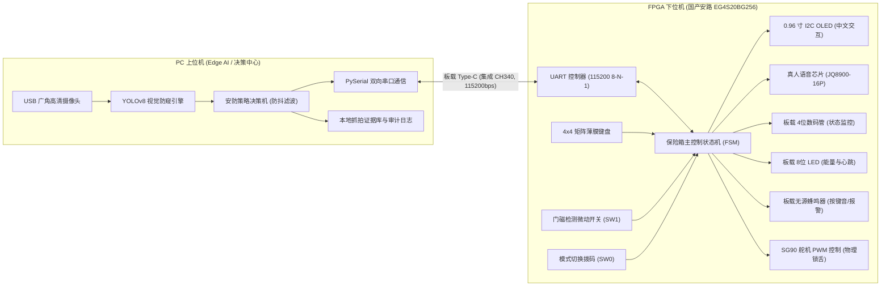
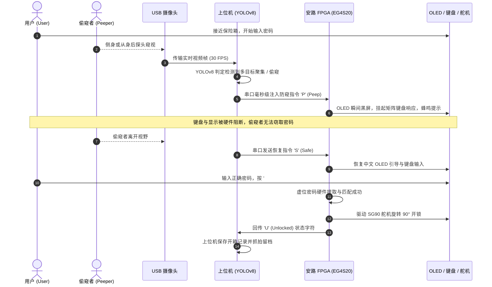

# 《基于 Edge AI 视觉防窥与 FPGA 硬件安全的异构智能保险箱》

> **PC 视觉与上位机入口**：新增 [pc/README.md](pc/README.md)，可运行人脸识别、YOLO 多人风险检测、串口联动、日志和取证。双击 pc/run_demo.bat 即可体验无硬件纯软件演示。FPGA 对接接口见 [docs/PC_FPGA_Protocol.md](docs/PC_FPGA_Protocol.md)，验证报告见 [docs/PC_Test_Report.md](docs/PC_Test_Report.md)。
> **Heterogeneous Smart Safe with Edge AI Visual Anti-Peeping and FPGA Hardware Security**

<div align="center">

[](https://www.anlogic.com/)
[](https://www.anlogic.com/)
[]()
[]()
[]()
[](./LICENSE)
[]()

**2026 年全国大学生 FPGA 创新设计竞赛参赛作品**
*设计哲学：硬核底座保底，软硬异构升维，双轨设计进退自如*

[系统架构](#-系统架构与拓扑-system-architecture) •
[核心创新亮点](#-核心创新亮点-key-innovations) •
[硬件物料清单](#-硬件物料清单-bill-of-materials) •
[引脚分配表](#-核心引脚映射表-pin-assignment) •
[通信协议规范](#-串口通信协议标准-uart-protocol) •
[快速开始指南](#-快速上手指南-quick-start) •
[开发路线图](#-开发路线与阶段里程碑-roadmap)

</div>

---

## 📖 项目概述 (Project Overview)

传统的电子密码保险箱面临两大严峻安全威胁：**背后偷窥/旁路拍摄** 与 **受胁迫状态下的强制开门**。

本项目设计了一种基于**国产安路 EG4S20 FPGA 硬件安全内核**与 **PC 端轻量化 Edge AI 视觉模型**的软硬异构智能保险箱系统：
- **硬核底座（FPGA 下位机）**：脱离 PC 可作为独立的全功能高可靠物理密码箱运行。硬件全流水线驱动外设，实现 4×4 矩阵键盘、0.96 寸 I2C OLED 中文引导、JQ8900-16P 真人语音、板载数码管/蜂鸣器双显报警、SG90 物理锁舌驱动与门磁防开锁超时检测。
- **智能升维（PC 上位机 Edge AI）**：利用 USB 广角摄像头捕捉现场操作环境，运行轻量化 YOLOv8 视觉防窥引擎。一旦检测到侧后方有人探头、聚集偷窥，毫秒级通过工业级串口注入防御指令，触发 FPGA 瞬间熄屏阻断并留存抓拍证据。

---

## ✨ 核心创新亮点 (Key Innovations)

```
┌────────────────────────────────────────────────────────────────────────┐
│                          三大核心创新防御机制                          │
├────────────────────────────────────────────────────────────────────────┤
│ 1. 👁️ 毫秒级 Edge AI 视觉防窥与物理熄屏阻断                          │
│    - YOLOv8 多目标识别 + 空间距离动态滤波，检测偷窥即刻向 FPGA 注入 'P'│
│    - 下位机硬件级瞬间黑屏并挂起键盘输入，视野恢复安全 ('S') 自动复原  │
├────────────────────────────────────────────────────────────────────────┤
│ 2. 🛡️ 16 位物理级虚位密码硬件实时提取算法                             │
│    - 支持用户在真实 6 位密码前后任意填入虚位干扰数字（最长 16 位）    │
│    - Verilog 纯硬件状态滑窗提取与比对，杜绝按键留痕与旁路录像推演     │
├────────────────────────────────────────────────────────────────────────┤
│ 3. 🚨 双轨防御与反挟持静默报警机制 (Duress Mode)                      │
│    - 设置专用挟持密码：在遭受歹徒逼迫时输入该密码                      │
│    - 表面正常转动舵机开门并播报“开门成功”，麻痹歹徒保全人身安全       │
│    - 底层静默向 PC 注入 'D' 报警指令，上位机后台静默连拍、上传告警证据 │
└────────────────────────────────────────────────────────────────────────┘
```

---

## 🏗️ 系统架构与拓扑 (System Architecture)

### 1. 软硬异构总体架构



### 2. 视觉防窥与联动时序逻辑



---

## 🧰 硬件物料清单 (Bill of Materials)

| 设备 / 模块 | 型号 / 规格 | 通信接口 / 电平 | 功能定位与系统职责 |
| :--- | :--- | :--- | :--- |
| **FPGA 核心板** | 硬木课堂大拇指 DMZ-EG4S20 (EG4S20BG256) | LVCMOS33 | 系统核心运算与底层物理安全控制 |
| **矩阵键盘** | 4×4 薄膜矩阵键盘 (8针联排 2.54mm) | 4 行 + 4 列 GPIO | 用户密码输入与功能控制按键 (直插下方排母 P4 偶数排 8~22号针) |
| **主显示屏** | 0.96 寸 OLED (SSD1306, 4针联排) | 软件/硬件 I2C | 提供中文菜单、输入提示与防窥警告 (直插下方排母 P4 右端 60~54号针) |
| **状态监视器** | 板载 4 位共阴数码管 | 动态数码管扫描 | 实时显示底层 FSM 状态代码 (`IDLE`, `OPEN`, `LOCK`) |
| **真人语音模块** | JQ8900-16P 语音播放模块 | 单线串口 (One-Line) | 关键操作普通话真人语音交互提示 (接下方排母 P4 46,44,42号针) |
| **物理驱动执行器** | SG90 9g 微型舵机 (3针联排) | 50Hz PWM 控制 | 驱动机械连杆实现保险箱物理锁舌开闭 (直插下方排母 P4 左侧 2,4,6号针) |
| **环境传感器** | 门磁开关 / 板载拨码 SW1 | GPIO (上拉输入) | 实时感知箱门开闭状态，超时未关自动报警 |
| **串口交互通道** | 板载 USB (集成 CH340, UART2USB) | UART (115200 8-N-1) | 上位机与 FPGA 双向指令交互信道（一根 USB 线直连右下角 UART2USB 口，**彻底免外接 USB-TTL 模块**） |
| **视觉传感器** | PC 自带摄像头 (默认 `cv2.VideoCapture(0)`) / USB 摄像头 | 软件调用 | PC 上位机 AI 视频采集源 (无需额外采购) |

---

## 🔌 核心引脚映射表 (Pin Assignment)

> **联排直插优化**：所有外接排线模块（4针 OLED、8针薄膜键盘、3针 SG90 舵机、3针语音模块）均统一规划在开发板**下方双排插针 `P4` 的内侧一列（PCB 丝印为 P4，偶数引脚 `2 ~ 60`）**，无需跳线分叉，整排母头可直接插拔！

| 外设模块 | 信号名称 (Verilog) | FPGA 管脚 (EG4S20) | 开发板物理位置 (`P4` 排母针号) | 电平标准 / 特性 | 硬件连接与说明 |
| :--- | :--- | :---: | :---: | :--- | :--- |
| **系统时钟/复位** | `clk_50M` | **R7** | 板载有源晶振 | LVCMOS33 | 50MHz 系统主时钟 |
| **系统时钟/复位** | `rst_n` | **E3** | 板载按键 `RSTn` | LVCMOS33 (PULLUP) | 板载独立复位键（低电平有效） |
| **板载 USB 串口** | `uart_tx` | **D12** | 板载 UART2USB (CH340) | LVCMOS33 | FPGA 发送至 PC（**免外接 USB-TTL 模块**） |
| **板载 USB 串口** | `uart_rx` | **F12** | 板载 UART2USB (CH340) | LVCMOS33 (PULLUP) | FPGA 接收 PC 指令（**免外接 USB-TTL 模块**） |
| **0.96寸 OLED**<br>*(4针联排)* | `VCC` / `GND`<br>`oled_scl`<br>`oled_sda` | 硬件电源<br>**E15**<br>**D14** | **`P4-60` (3V3) / `P4-58` (GND)**<br>**`P4-56`**<br>**`P4-54`** | 3.3V / GND<br>LVCMOS33<br>LVCMOS33 (PULLUP) | **P4 下方排母最右侧 4 针 (`60,58,56,54`)**<br>依次对应 OLED 的 `VCC, GND, SCL, SDA` |
| **SG90 舵机**<br>*(3针联排)* | `VCC` / `GND`<br>`servo_pwm` | 硬件电源<br>**M11** | **`P4-2` (5V) / `P4-4` (GND)**<br>**`P4-6`** | 5V (VBUS) / GND<br>LVCMOS33 | **P4 下方排母最左侧 3 针 (`2,4,6`)**<br>依次对应舵机 红(`5V`)、棕(`GND`)、橙(`PWM`) |
| **4×4 薄膜键盘**<br>*(8针联排)* | `key_row[0:3]`<br>`key_col[0:3]` | **L12, P15, P16, N14**<br>**N16, M16, L16, P14** | **`P4-8, 10, 12, 14`**<br>**`P4-16, 18, 20, 22`** | LVCMOS33 (PULLUP)<br>LVCMOS33 | **P4 下方排母紧挨舵机往右连续 8 针 (`8~22`)**<br>整排 8P 母头直接连续插在 `P4` 偶数排 `8~22` |
| **JQ8900 语音**<br>*(3针联排)* | `voice_tx`<br>`GND`<br>`voice_busy` | **H16**<br>硬件地<br>**G16** | **`P4-46`**<br>**`P4-44` (GND)**<br>**`P4-42`** | LVCMOS33<br>GND<br>LVCMOS33 (PULLUP) | `H16` 串接 1kΩ 接模块 `IO1(P04)`，`G16` 接 `BUSY`，模块 `V5V` 接 `P4-2(5V)` |
| **门磁 / 拨码** | `door_gpio`<br>`sw_recovery` | **A10**<br>**A14** | 板载拨码 `SW1`<br>板载拨码 `SW7` | LVCMOS33 (PULLUP)<br>LVCMOS33 (PULLDOWN)| `SW1`: 门磁开闭检测 (`0`闭合/`1`打开)<br>`SW7`: 应急恢复码硬允许开关 |
| **板载声光外设** | `buzzer_out`<br>`led[7:0]`<br>`seg_out` / `seg_cs` | **H11**<br>**B14~F16**<br>**A4~C8 / C9~A3** | 板载蜂鸣器 `LS1`<br>板载 `LED0~LED7`<br>板载 4 位数码管 | LVCMOS33 | 内部已硬连线，无需外部插线 |

> 完整的硬木课堂大拇指开发板（DMZ-EG4S20）官方全引脚映射表与外接联排接线手册详见 [`docs/EG4S20_Pinout.md`](./docs/EG4S20_Pinout.md) 及 [`docs/EG4S20_Pinout.xlsx`](./docs/EG4S20_Pinout.xlsx)。

---

## 📡 串口通信协议标准 (UART Protocol)

- **波特率**：`115200 bps`（降级备选 `9600 bps`）
- **数据帧格式**：`8 数据位, 无校验位 (None), 1 停止位 (8-N-1)`
- **双向单字节指令集规范**：

| 发送方 | 接收方 | 指令字符 | 协议语义 | 触发条件与动作响应 |
| :---: | :---: | :---: | :--- | :--- |
| **PC 上位机** | FPGA | `'S'` | **Safe (环境安全)** | 视野内恢复为单人正常操作；FPGA 恢复 OLED 界面并解挂键盘输入 |
| **PC 上位机** | FPGA | `'P'` | **Peep (窥视挂起)** | 检出背后聚集或侧后探头偷窥；FPGA 瞬间黑屏、挂起键盘并蜂鸣报警 |
| **PC 上位机** | FPGA | `'R'` | **Remote Unlock (远程开锁)** | PC 人脸核验通过或管理员远程授权开锁；FPGA 直接驱动舵机开锁 |
| **FPGA 下位机** | PC | `'U'` | **Unlocked (开锁成功)** | 密码正确或虚位密码提取合法；PC 上位机弹窗并在日志中记录留存 |
| **FPGA 下位机** | PC | `'L'` | **Locked (暴力破解锁定)** | 连续输错 3 次锁定系统 60 秒；PC 触发声光报警并启动连拍取证 |
| **FPGA 下位机** | PC | `'D'` | **Duress (反挟持静默报警)** | 用户输入特定胁迫密码，表面正常开锁麻痹歹徒，底层静默通知上位机报警取证 |
| **FPGA 下位机** | PC | `'A'` | **Door Alert (门未关好警报)** | 开锁后门磁处于打开状态超过 15 秒未关门；上位机记录超时告警 |

---

## ⌨️ 4×4 矩阵键盘按键映射与交互定义

外接 4×4 矩阵薄膜键盘共 16 个物理按键，系统为每个按键赋予了明确的安防与业务功能定义：

| 键位 | 编码 (Hex) | 键面字符 | 按键类型 | 核心功能与交互行为说明 |
| :---: | :---: | :---: | :---: | :--- |
| **0 ~ 9** | `0x0` ~ `0x9` | `0` ~ `9` | **数字输入** | 密码输入与新密码设置录入。按下一键蜂鸣器发 1kHz 提示音，OLED 动态更新掩码 `*`，数码管显示当前位数。 |
| **\*** | `0xE` | `*` | **退格 / 取消** | **双重容错逻辑**：<br>1. 正在输入字符（`len > 0`）：单步回退删除最后 1 位；<br>2. 缓冲区为空（`len == 0`）：直接**取消当前模式**（取消改密/取消录入），安全平稳退回待机主界面。 |
| **#** | `0xF` | `#` | **确认 / 提交** | **多模式确认键**：<br>1. **开锁核验**：提交 6~16 位输入进行滑动窗口模式匹配判决（未满 6 位按 `#` 仅发提示音，不扣罚错误次数）；<br>2. **改密/录入**：提交当前密码，推进入下一步确认或写入。 |
| **A** | `0xA` | `A` | **新用户设置密码** | **开荒 / 首次录入通道**（无需输入旧密码）：<br>`按 A` $\to$ OLED 提示输 6 位新密码 $\to$ `按 #` $\to$ 再次输入确认 $\to$ `按 #` $\to$ 写入密码寄存器生效（带二次确认防输错）。 |
| **B** | `0xB` | `B` | **修改密码 (改密)** | **老用户改密通道**（强权限闭环，验旧改新）：<br>`按 B` $\to$ OLED 提示输当前旧密码 $\to$ `按 #` 校验（输错扣罚并报警退回）$\to$ 验密通过后输 6 位新密码 $\to$ `按 #` $\to$ 再次确认 $\to$ `按 #` $\to$ 写入生效。 |
| **C** | `0xC` | `C` | **手动闭锁 / 清屏** | 开锁成功后若无需等待 3 秒自动回弹，按 `C` 可立即驱动舵机回弹至 0° 闭锁；待机态下按 `C` 强刷清屏。 |
| **D** | `0xD` | `D` | **管理扩展** | 预留作为底层状态查询或管理模式切换。 |

> **防呆保护机制**：处于 `A`（录入）或 `B`（改密）模式时，若用户中途离开超过 **15 秒**无按键操作，硬件定时器自动超时放弃，安全退回待机，防止状态机被占死。

---

## 🖥️ 0.96 寸 OLED 中文显示屏各阶段排版规范

主屏选用 0.96 寸 SSD1306 OLED（128×64 单色，四行 16×16 汉字 / 8×16 ASCII 字符），按业务状态机精准规划显示内容：

| 系统业务状态 | OLED 第一行 (16px) | OLED 第二行 (16px) | OLED 第三行 (16px) | OLED 第四行 (16px) | 状态联动声光表现 |
| :--- | :--- | :--- | :--- | :--- | :--- |
| **待机状态 (S_IDLE)** | **智能防窥保险箱** | 系统就绪 门锁已闭 | 请敲击输入密码 | `A:录入 B:改密 #:开锁` | 心跳灯 1Hz 平稳闪烁，数码管显示 `IDLE` |
| **密码输入 (S_INPUT)** | **密码输入中:** | `* * * _ _ _` *(动态掩码)* | 虚位支持6-16位输入 | 剩余容错机会: 3 次 | 每次敲键 1kHz 按键音，数码管显示 `In- X` |
| **新用户录入 (S_SET_NEW)**<br>*(按 A 键触发)* | **【 新用户录入 】** | 请输入 6 位新密码: | `* * * * * _` *(掩码)* | 按 # 提交，按 * 取消 | 15 秒超时无操作自动放弃回待机 |
| **新密码确认 (S_SET_CFM)** | **【 请再次确认 】** | 请重复输入新密码: | `* * * * * *` *(掩码)* | 按 # 校验是否一致 | 一致报成功并和弦音；不一致报 `两次输入不符` |
| **修改密码验权 (S_CHG_AUTH)**<br>*(按 B 键触发)* | **【 修改密码 】** | 请输入当前旧密码: | `* * * * * *` *(掩码)* | 验证身份后方可修改 | 验证失败蜂鸣器长鸣，错误计数+1，退出回待机 |
| **修改密码新密 (S_CHG_NEW/CFM)**| **【 权限已核验 】** | 输新密码 $\to$ 再次确认 | 两次一致方可更新 | 写入生效，语音播报 | 成功后播报语音“修改成功”，更新密码寄存器 |
| **开锁成功 (S_SUCCESS)** | **【 验证通过 】** | 锁舌已旋转 90° 开启 | 请在 3 秒内开箱门 | 欢迎使用 (或静默告警) | 蜂鸣器 Do-Mi-Sol 和弦音，语音“门已开”，舵机转动 |
| **密码错误 (S_ERROR)** | **【 密码错误 】** | 密码不匹配请核对 | 累计输错: 1/3 次 | 1.5 秒后自动复位 | 蜂鸣器 2.5kHz 报警音，LED 输错计数灯亮起 |
| **暴力锁定 (S_LOCKED)** | **【 系统已锁定 】** | 连续输错 3 次报警 | **倒计时: 58 秒** *(递减)* | 键盘已全面物理屏蔽！ | 蜂鸣器 4kHz 间歇刺耳报警，数码管显示 `L-58` |
| **视觉防窥挂起 (S_SUSPEND)**<br>*(收到 PC 'P' 指令)* | **【 警告:防窥保护 】** | **==== 熄屏挂起 ====** | **检测到背后偷窥！** | 输入已冻结 保持警惕 | 屏幕大部黑屏横杠，键盘锁死吞键，喇叭播报防窥提醒 |
| **门磁超时未关 (DOOR_ALERT)** | **【 警告:门未关严 】** | 箱门敞开超过 15 秒 | 请及时将门锁闭严！ | 蜂鸣器急促提醒中 | 喇叭重复播报“请关门”，磁铁吸合后秒级恢复 |

---

## 💻 PC 上位机安防控制中枢与三层自适应防窥模型

PC 端基于 Python (PyQt6 + YOLOv8 + PySerial) 构建，定位为**“环境防窥天眼、设备数字孪生与取证黑匣子”**：

### 1. 监控面板大屏三大功能区
* **左半区：实时视觉画面与 AI 目标标注**
  * 直接复用笔记本自带摄像头（调用 `cv2.VideoCapture(0)`），以 30 FPS 高帧率呈现。
  * **目标标注框**：
    * **绿色框**：标注正前方的操作者本人（标记 `User: Active`）。
    * **红色告警框**：标注侧身探头、背后聚集逼近的偷窥者（标记 `Peeping Alert!` 及置信度，如 `91%`）。
  * **动态安全等级顶条**：
    * 正常时全屏绿标：`【 SYSTEM SAFE - 单人正常操作中 】`。
    * 偷窥时红光闪烁：`【 PEEPING DETECTED - 毫秒级熄屏防窥挂起中 】`。
* **右上区：保险箱数字孪生仪表盘**
  * 串口配置区（COM 口自动扫描、115200 波特率、连接心跳指示）。
  * 保险箱主状态机实时状态映射（待机 / 输入中 / 已开锁 / 输错报警 / 60s 倒计时 / 防窥挂起）。
  * 物理机构状态指示灯（舵机当前角度、门磁吸合状态、反挟持警报标志）。
  * 应急与测试控制按钮（`[远程开锁 'R']`、`[手动模拟防窥 'P']`、`[模拟恢复 'S']`，无需摄像头即可一键联调）。
* **右下区：审计日志黑匣子与抓拍证据库**
  * 带毫秒级时间戳的事件滚动审计列表（记录每一次串口交互、开锁事件、非法输错、反挟持警报）。
  * **抓拍证据瀑布流**：收到 `'U'` 自动抓拍开门者留存；收到 `'L'` 启动 5 连拍；收到 `'D'` 后台静默抓拍；收到 `'P'` 截取偷窥者人脸照片，全部自动归档至 `captures/` 文件夹。

### 2. 三层漏斗自适应防窥判决模型（彻底消除路过误触）
为了避免“背景里随便走过一个人就频繁误触熄屏”的体验痛点，PC 端采用三层空间与时间融合判决模型：
1. **第一层：空间几何 ROI 与距离过滤**：按检测框面积和位置，自动剔除 1.5 米外背景中走过的路人。
2. **第二层：面部偏角与视线估计（Gaze & Orientation）**：通过人脸关键点与偏航角（Yaw Angle），区分“侧身快步路过”与“探头注视键盘/屏幕”。
3. **第三层：时间滞后滑动窗口滤波（Temporal Hysteresis）**：危险目标必须在警戒区内**持续停留超过 15 帧（约 0.5 秒）**才触发熄屏 `'P'`；目标离开且连续 5 帧安全才下发 `'S'` 恢复，彻底杜绝状态频繁跳变。

---

## 🔐 密码认证规范与虚位密码机制

1. **日常开锁免录人脸**：
   * 人来到保险箱前，直接敲键盘输入密码即可开锁，无需预先录入人脸库。
   * PC 摄像头仅负责环境防窥与开门自动抓拍留底，不卡控开门权限，保障断网脱机时 100% 独立可用。
2. **6 ~ 16 位自适应虚位密码**：
   * 敲击长度在 **6 至 16 位** 任意浮动（例：`乱码 + 6位真密码 + 乱码 + #`），绝不强制凑满 16 位。
   * FPGA 内部移位 FIFO 永远保存最近 16 位输入，在按 `#` 的瞬间，通过内部 **11 组硬件并行比对器在 20 纳秒（单时钟周期）内全并行完成模式匹配**，纳秒级提取真密码，兼具防旁路推演与超高硬件实时性。

---

## 📂 规范化工程目录树 (Directory Structure)

```
FPGA/
├── .gitignore             # 忽略安路 TD 编译产物 (*_Runs/) 与 Python 临时缓存
├── LICENSE                # MIT 开源授权协议
├── README.md              # 项目主文档与快速使用指南
├── plan.md                # 20 天冲刺开发全景规划书
├── requirements.txt       # 上位机 Python 依赖环境清单
├── lock.al                # 安路 Tang Dynasty (TD) 主工程文件
├── lock.adc               # 物理引脚分配与 IO 属性约束文件
│
├── rtl/                   # 【FPGA 硬件源码】可综合 Verilog RTL
│   ├── top.v              # 系统顶层模块
│   └── clk_tick.v         # 多速率节拍使能发生器 (1kHz / 100Hz 同步脉冲)
│
├── sim/                   # 【仿真与验证】Testbench 激励与波形文件
│   ├── tb_top.v           # 顶层模块行为仿真激励
│   └── tb_clk_tick.v      # 节拍分频逻辑 Testbench
│
├── constraints/           # 【引脚约束备份】
│   └── lock.adc           # 管脚物理位置、IO 电平与上拉设定
│
├── tools/                 # 【联调治具与上位机工具】
│   └── serial_monitor.py  # 工业级双向串口监控与协议调试治具 (支持 --mock 模式)
│
└── docs/                  # 【设计文档与资料库】
    └── EG4S20_Pinout.xlsx # EG4S20 核心管脚速查与硬件引脚映射表
```

---

## 🚀 快速上手指南 (Quick Start)

### 1. 硬件端：安路 TD 工程构建与烧录

1. 启动 **Anlogic Tang Dynasty (TD)** 软件（推荐版本 TD 5.6+）。
2. 在主菜单点击 `Project` $\to$ `Open Project...`，选择本项目根目录下的 [`lock.al`](./lock.al)。
3. 在左侧 Project View 确认工程文件关联无误：
   - Design Files: `rtl/clk_tick.v`, `rtl/top.v`
   - Constraints: `lock.adc`
4. 双击运行 **Generate Bitstream** 生成比特流固件。
5. 使用 USB 下载线连接开发板 JTAG 接口，通过 **Download** 工具烧录至 FPGA。
6. **验证现象**：板载 `LED0` 以精确的 **1Hz**（0.5s 亮、0.5s 灭）平稳闪烁，`LED1` 常亮，说明硬件底座、基准时钟与引脚约束完全正常。

---

### 2. 软件端：串口调试治具与上位机启动

上位机调试治具不仅支持物理串口监听，还支持 `--mock` 模拟模式（无需硬件即可验证双向交互协议）：

#### 安装运行环境依赖
```bash
# 建议在 Python 3.9+ 虚拟环境中执行
pip install -r requirements.txt
```

#### 启动双向协议调试治具
```bash
# 模式 A: 自动扫描物理 COM 端口并连接
python tools/serial_monitor.py

# 模式 B: 无硬件脱机模拟模式 (用于在无开发板时验证交互协议)
python tools/serial_monitor.py --mock
```

---

## 📅 开发路线与阶段里程碑 (Roadmap)

- [x] **Day 1: 基础工程搭建与时钟分频验证** (已交付)
  - [x] EG4S20 管脚物理约束锁定 (`lock.adc`)
  - [x] 1kHz / 100Hz 单时钟域节拍使能模块 (`rtl/clk_tick.v`)
  - [x] 顶层 1Hz 心跳灯与状态就绪逻辑 (`rtl/top.v`)
  - [x] 双向串口监控治具与模拟测试平台 (`tools/serial_monitor.py`)
  - [x] 开源工程目录治理与标准化 README 建立
- [x] **Day 2: 4×4 矩阵键盘行列扫描与硬件消抖** (已交付)
  - [x] 行列轮询低电平扫描与 20ms 双向滤波消抖 (`rtl/keypad_scan.v`)
  - [x] 16键优先级译码（0~9数字, *清除, #确认, A~D功能键）
  - [x] 按键有效单周期脉冲与长按保持指示
- [x] **Day 3: 0.96 寸 I2C OLED 中文驱动与数码管双显** (已交付)
  - [x] SSD1306 纯硬件 I2C 控制器（200kHz SCL, 27字节上电初始化序列）(`rtl/oled_driver.v`)
  - [x] 16×16 汉字字模库与 8×16 ASCII 字符集（四行中文UI排版）(`rtl/oled_font.v`)
  - [x] 板载 4 位共阴极数码管 1kHz 动态扫描监控（`IdLE`/`P- n`/`OPEn`/`Err`/`L-60`）(`rtl/seg_display.v`)
- [x] **Day 4: 密码匹配状态机与输错锁定机制** (已交付)
  - [x] 6 位预设核心密码核验与输入暂存（支持退格清除、确认比对）(`rtl/safe_fsm.v`)
  - [x] 输错 3 次锁定 60 秒硬件倒计时，锁定期间键盘物理锁死
  - [x] 无源蜂鸣器 PWM 驱动（1kHz按键音、2.5kHz错误警告、4kHz锁定急促警报、Do-Mi-Sol开锁和弦）(`rtl/buzzer_driver.v`)
  - [x] 安路 TD 全流程综合、布局布线与比特流固化验证（LUT占用仅 8.61%）
- [x] **Day 5: 底座加固收敛 + JQ8900-16P 语音驱动 + GPS-23 门磁超时防盗** (已交付)
  - [x] **底座加固与技术债务收敛**：OLED 初始化表消除 `initial` 警告（P0-A）、SDA 开漏三态改造消除对驱风险（P0-B）、建立 50MHz SDC 时序约束集（P0-C）、全工程 DSP 降为 0（P0-D）、异步复位双级同步释放与上电 POR（P1-H）、'#'键未满6位防呆免计错（P1-G）、反挟持粘滞锁存（P1-I）
  - [x] **JQ8900-16P 语音驱动**：单线串口 One-Line 协议微秒时序引擎、100ms 强制防重入冷却、BUSY 引脚极性自适应（`rtl/voice_player.v`）
  - [x] **GPS-23 门磁与 SW1 双轨防盗**：20ms 硬件数字消抖、开锁后 15 秒未关门急促声光/语音报警、关门秒级撤防恢复（`rtl/door_sensor.v`）
  - [x] **安路 TD 综合与时序收敛**：LUT 占用 8.85% (1734/19600)、REG 占用 1.69% (332/19600)、**DSP 0**、建立时间余量全部 Pass，实测收敛 **$F_{max} = 55.15\,\text{MHz}$** (时序负裕量 TNS = 0.000ns)，生成比特流 `lock.bit`
- [x] **Day 6: SG90 舵机 50Hz PWM 控制器与 A/B 键改密/录入业务全打通【提前达成 Milestone 1】** (已交付)
  - [x] **SG90 舵机 50Hz PWM 控制器**：50Hz 基准周期（20ms）、0.5ms（0° 闭锁）~ 1.5ms（90° 开锁）、3 秒自动回弹与 C 键手动提前闭锁（`rtl/servo_driver.v`）
  - [x] **A 键新用户录入与 B 键验旧改密闭环**：动态密码寄存器存储（默认 123456）、A 键双重录入确认防输错、B 键验旧改新权限闭环（输错旧密码扣罚错误次数）、15 秒无操作硬件看门狗超时强制放弃保护（`rtl/safe_fsm.v`）
  - [x] **0.96 寸 OLED 多页面交互与字模扩充**：增补 17 个 16×16 汉字字模（新、旧、改、设、置等）、四行多页面动态排版（`rtl/oled_font.v`, `rtl/oled_driver.v`）
  - [x] **底层隐患治理与顶层声光联动**：修复开门超时检测时序隐患（`rtl/door_sensor.v`）、`state_code` 升级为 4 位宽、数码管显示适配（`rtl/seg_display.v`）、舵机 PWM 信号引脚固化至 `F14`（`lock.adc`）
  - [x] **全流程 TD 编译收敛**：LUT 占用 12.05% (2362/19600)、REG 占用 2.59% (508/19600)、**DSP 0**、建立时间余量 Setup Slack = **+1.800ns** ($F_{max} = 54.95\,\text{MHz}$)，生成全新比特流 `lock.bit`
- [ ] **Day 7~10: 【Milestone 2】软硬异构通信闭环与三大创新点落地 (UART 115200 / YOLOv8 防窥 / 虚位提取 / 反挟持)**
- [ ] **Day 15~20: 【Milestone 3】实物封装总装、极限压测与答辩交付**

---

## 📜 许可证 (License)

本项目采用 [MIT License](./LICENSE) 开源协议，欢迎广大 FPGA 开发者与高校师生交流研讨。
