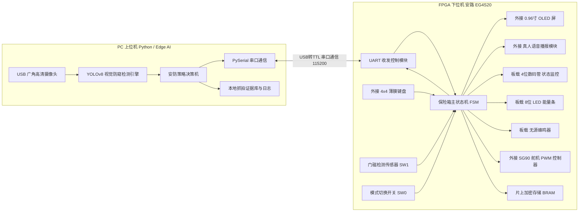
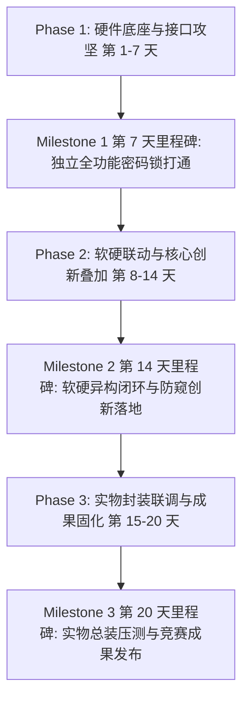
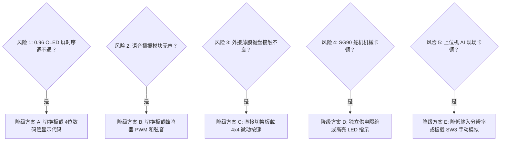

# 《基于 Edge AI 视觉防窥与 FPGA 硬件安全的异构智能保险箱》20天冲刺开发计划

> **竞赛目标**：2026年全国大学生FPGA创新设计竞赛（安路 EG4S20 平台）  
> **设计哲学**：**硬核底座保底，软硬异构升维，双轨设计进退自如**。
> - **底座**：FPGA 独立实现高可靠物理电子保险箱（外接 4x4 薄膜键盘 + 0.96 寸 OLED 中文交互 + 真人语音播报 + 虚位密码 + 门磁防盗 + 舵机闭锁，板载数码管与蜂鸣器双重兜底）。
> - **升维**：PC 端 Edge AI（YOLOv8）视觉动态捕捉背后窥视者，通过高速 UART 实时注入防御指令，毫秒级熄屏防窥与后台静默留证。

---

## 一、 系统架构与通信协议设计

### 1.1 异构系统架构拓扑

---

### 1.2 工业级 UART 串口双向通信协议标准

* **波特率**：`115200 bps`（降级备选 `9600 bps`）
* **数据格式**：`8 数据位, 无校验 (None), 1 停止位 (8-N-1)`
* **字符指令集规范**：

| 发送方 | 接收方 | 指令字符 | 协议语义 | 触发条件与动作响应 |
| :--- | :--- | :---: | :--- | :--- |
| **PC 上位机** | FPGA | `'S'` | **Safe（环境安全）** | 视野内恢复为单人正常操作；FPGA 恢复 OLED 中文界面与键盘输入。 |
| **PC 上位机** | FPGA | `'P'` | **Peep（窥视挂起）** | 检测到身后有人聚集或侧后方偷窥；FPGA 立即挂起输入、OLED 黑屏显示警告横杠、语音播报防窥提醒。 |
| **PC 上位机** | FPGA | `'R'` | **Remote Unlock（远程开锁）** | PC 人脸核验成功或管理员授权远程开锁；FPGA 直接驱动舵机开锁并语音提示。 |
| **FPGA 下位机** | PC | `'U'` | **Unlocked（开锁成功）** | 键盘密码匹配成功或虚位密码提取合法；PC 同步弹窗并抓拍开箱留档。 |
| **FPGA 下位机** | PC | `'L'` | **Locked（暴力破解锁定）** | 连续输错 3 次锁定系统 60s；PC 触发高音警报并启动连拍取证。 |
| **FPGA 下位机** | PC | `'D'` | **Duress（反挟持静默报警）** | 输入预设“挟持胁迫密码”；**表面正常开门麻痹歹徒**，同时向 PC 发送 `'D'`，PC 静默抓拍告警。 |
| **FPGA 下位机** | PC | `'A'` | **Door Alert（门未关严警报）** | 开锁后门磁开启超过 15s 未关；PC 记录未关门告警事件。 |

---

## 二、 20天冲刺阶段划分与核心里程碑

---

## 三、 详细任务拆解表（硬件组 vs 软件组）

### Phase 1: 硬件底座与接口攻坚（第 1 - 7 天）
> **目标**：不依赖 PC 算法，实现一款高可靠、带中文 OLED 交互与真人语音的独立物理密码锁，完成底层所有外设的电气连线与逻辑驱动验证。

| 日程 | 硬件组任务（FPGA / Verilog / 电路调试） | 软件组任务（PC / Python / 算法环境） | 阶段对齐与交付物 (Deliverable) |
| :---: | :--- | :--- | :--- |
| **Day 1** | **安路 TD 工程搭建与时钟分频** • 配置 `EG4S20` 引脚约束表（`.adc`） • 编写系统时钟分频模块（产生 1kHz/100Hz 节拍时钟） • 点亮板载 LED0 心跳灯（1Hz） | **开发环境与串口联调治具准备** • 配置 Python 虚拟环境（PyTorch, OpenCV, Ultralytics, PySerial） • 编写串口调试与数据监控脚本（带时间戳打印） | 基础工程跑通，板载 LED0 心跳灯闪烁，Python 串口调试环境就绪。 |
| **Day 2** | **4×4 矩阵键盘扫描驱动与硬件消抖** • 编写行列反转法键盘扫描逻辑 • 加入 20ms 延时滤波消抖计数器 • 验证外接 4x4 薄膜键盘与板载矩阵按键的兼容性 | **上位机 UI 框架雏形搭建** • 基于 PyQt6 搭建极简安防监控面板 • 预留串口连接配置与状态指示灯（红/黄/绿） | 敲击薄膜键盘任意键，板载 LED 准确显示键值二进制，按键无连击抖动。 |
| **Day 3** | **0.96寸 I2C OLED 驱动与数码管双显** • 编写简易 I2C 主机控制器（SCL 100kHz） • 移植 16×16 中文字模库与 8×16 ASCII 字符集 • 同步点亮板载 4 位数码管作为底层状态代码监控 | **摄像头视频流采集与多线程管道** • OpenCV 线程安全获取 1080P/720P 实时视频流 • 解决高帧率低延迟缓冲积压问题（Queue 优化） | OLED 屏清晰显示“欢迎使用”、“请输入密码”，数码管显示 `IDLE`。 |
| **Day 4** | **密码匹配状态机与错误锁定机制** • 编写密码比对逻辑（预设 6 位核心密码） • 连续输错 3 次锁定状态机（硬件定时器锁定 60s） • 编写无源蜂鸣器 PWM 驱动（1kHz 按键音、4kHz 报警音） | **YOLOv8 模型选型与防窥逻辑预研** • 下载测试 YOLOv8n 轻量级模型 • 编写检测头逻辑：统计画面内人头/人脸数量与纵深距离 • 设定检测判定区域（ROI 边界框） | 输错密码触发蜂鸣器报警，输错 3 次 OLED 显示“系统锁定 60 秒”倒计时。 |
| **Day 5** | **语音播报模块驱动与门磁检测** • 编写 DY-SV17F 语音芯片单线串口控制模块 • 录制并烧录 5 段标准普通话语音 • 挂接 `SW1` 门磁检测：开锁后 15 秒未关门触发语音提醒 | **模拟串口联动测试脚本** • 编写 Mock 脚本，通过虚拟串口向上位机注入模拟 `'U'/'L'/'D'` 字符，测试 PC 响应逻辑 | 敲击按键语音提示“请输入密码”，开锁成功播报“门已开”，门磁超时报警。 |
| **Day 6** | **SG90 舵机 PWM 控制器实现** • 编写 50Hz 基准周期 PWM 发生器 • 调试 $0.5\text{ms}$（0°锁定）至 $2.5\text{ms}$（180°开门）脉宽切换 • 落实舵机外部 5V 独立供电与共地排针连接 | **视觉防窥核心判决算法** • 实现状态防抖滤波：连续 $N$ 帧检测到多人偷窥时触发判定 • 区分单人正常操作 vs 侧方探头/后方偷窥模式 | 密码正确后舵机平滑转动开锁，3秒后自动回弹上锁，外接供电稳定无发热。 |
| **Day 7** | **硬件底座集成与单机联合验收** • 整合键盘、OLED、数码管、舵机、语音、蜂鸣器与门磁 • 优化顶层时钟域与引脚约束，固化烧录 Flash | **阶段 1 综合评审与上位机连通准备** • 完成 PC 侧独立测试报告，准备接管真实串口通信 | **【Milestone 1 达成】** 离线单机密码锁 100% 跑通，具备高水准声光电完整交互。 |

---

### Phase 2: 软硬联动与核心创新叠加（第 8 - 14 天）
> **目标**：全面叠加创新亮点，打通 16 位虚位密码、反挟持静默报警机制与 YOLOv8 视觉防窥闭环。

| 日程 | 硬件组任务（FPGA / Verilog / 电路调试） | 软件组任务（PC / Python / 算法优化） | 阶段对齐与交付物 (Deliverable) |
| :---: | :--- | :--- | :--- |
| **Day 8** | **UART 发送/接收模块与主状态机挂接** • 编写 115200 波特率过采样串口接收/发送模块 • 实现 `'S'`, `'P'`, `'R'` 字符解码与 `'U'`, `'L'`, `'D'` 发送 | **PC 串口通信中枢与通信协议落地** • 实现多线程串口监听与心跳/异常重连逻辑 • 绑定字符事件调度器与 UI 状态同步 | PC 与 FPGA 完成串口握手，键盘按键与状态能够实时双向透传。 |
| **Day 9** | **创新点 1：16 位虚位密码核心状态机** • 实现基于移位寄存器的滑动窗口模式匹配 • 只要在最多 16 位输入中连续包含正确 6 位密码即判定开锁（乱码+真密码+乱码） | **创新点 2：PC 抓拍取证与证据归档模块** • 收到 `'U'`：自动截取当前操作者面部头像留档 • 收到 `'L'`：启动高清连拍（5连拍）并记录非法入侵告警 | 虚位密码在 FPGA 内部实时完成硬件级模式匹配，抗旁路偷窥。 |
| **Day 10** | **创新点 3：反挟持静默报警逻辑实现** • 设置专用胁迫密码（如常规密码为 `123456`，胁迫密码为 `654321`） • 验证通过后**舵机表面正常开锁**，底层静默触发 UART 发送 `'D'` | **反挟持静默响应系统设计** • 收到 `'D'` 指令：PC 屏幕**无任何声光异常**（避免歹徒察觉） • 后台静默抓拍劫持者，触发自动化警报推送（邮件/本地暗存） | 模拟挟持场景，表面正常开合门锁，上位机后台悄无声息捕获警情。 |
| **Day 11** | **防窥挂起与远程开锁受控逻辑** • 接收 `'P'`：进入 `SUSPEND` 状态，OLED 瞬间黑屏显示警告横杠，锁死按键，语音提醒 • 接收 `'S'`：唤醒系统恢复输入 • 接收 `'R'`：执行远程开锁时序 | **视觉防窥模型轻量化与边缘加速** • 优化 YOLOv8 推理管线，锁定输入尺寸（如 320x320）以确保 $\ge 30\text{ FPS}$ • 调试探头/侧窥判定置信度与状态滞后防抖门限 | 上位机检测到背后有人靠近，下发 `'P'`，FPGA 瞬间熄屏挂起，人走后秒恢复。 |
| **Day 12** | **软硬件全协议闭环联合调试** • 现场验证 7 类字符指令的高频交叉响应 • 修复指令粘包、接收超时及状态死锁 | **上位机全功能一体化监控界面整合** • 实时绘制摄像头画面、检测框、安全等级仪表盘 • 实时显示保险箱状态（已锁/已开/防窥挂起/报警） | 视觉系统与硬件保险箱实现毫秒级联动响应，防窥防护顺畅自然。 |
| **Day 13** | **极端边界条件与时序优化** • 虚位密码超长输入溢出处理 • 视觉挂起时强行敲击键盘的过滤抑制 • 拔掉串口线时自动平滑回退至单机工作模式 | **误检抑制与弱光环境调优** • 测试弱光、背光、佩戴口罩与侧脸角度下的检测稳定性 • 优化状态滞后判定（Hysteresis），防止状态频繁抖动跳变 | 软硬件全系统具备鲁棒性，长时间运行无死机、内存泄漏或逻辑卡死。 |
| **Day 14** | **阶段 2 系统集成验收与功能锁定** • 锁定 FPGA 代码版本，备份工程代码与 bit 流文件 | **上位机软件打包与测试** • 将 Python 脚本打包装配或形成一键启动运行脚本 | **【Milestone 2 达成】** 完整展示三大核心创新，异构全链路顺畅贯通。 |

---

### Phase 3: 实物封装、联调压测与成果固化（第 15 - 20 天）
> **目标**：完成实物装配、测试端到端时延、录制高水平演示视频、撰写完备技术报告并排练答辩。

| 日程 | 硬件组任务（FPGA / Verilog / 电路调试） | 软件组任务（PC / Python / 算法优化） | 阶段对齐与交付物 (Deliverable) |
| :---: | :--- | :--- | :--- |
| **Day 15** | **实物箱体装配与硬件走线固化** • 将 EG4S20 板卡、键盘、OLED、舵机固定于亚克力/3D打印箱体 • 机械锁舌机构微调，确保舵机开关不卡滞 | **摄像头固定与视场角标定** • 摄像头固定于保险箱正上方，调整俯仰角 • 现场标定检测有效防窥距离（1~2米）与警戒盲区 | 实物保险箱成型，外观整洁，无杂乱飞线，机械开合顺滑。 |
| **Day 16** | **FPGA 资源消耗与时序收敛报告导出** • 统计 LUT、FF、BRAM、PLL 资源占用率 • 生成时序收敛报告与最大工作频率（$F_{max}$）图表 | **端到端时延分解与极限压力测试** • 连续模拟输入 100 次开锁测试（正向、虚位、胁迫、暴力） • 测量时延链条：视觉识别（10ms）+ 串口传输（1ms）+ 硬件响应（<1ms）+ 机械动作（50ms） | 形成第一手实测性能数据表格与时延分解图（美研申请硬核素材）。 |
| **Day 17** | **技术设计报告（硬件设计章节）** • 绘制核心状态机转移图（FSM Visio/Draw.io） • 整理各模块 RTL 原理图与关键 Verilog 代码注释 | **技术设计报告（算法与系统架构章节）** • 撰写系统设计方案、Edge AI 视觉检测原理、通信协议规范 • 汇总软硬件对比与创新点总结 | 完成初版技术设计报告（`Design_Report.pdf`）。 |
| **Day 18** | **演示环境搭建与演练配合** • 配合模拟各种攻击与正常开锁场景 • 准备备用备件（板卡、杜邦线、舵机备用件） | **演示视频脚本规划与分镜拍摄** • 设计视频脚本：痛点提出 $\to$ 架构创新 $\to$ 场景实测演示 $\to$ 成果总结 • 高清机位录制：实物细节、屏幕UI、多角色防窥实测 | 完成所有分镜视频素材高清采集（涵盖反挟持与视觉防窥特色）。 |
| **Day 19** | **答辩 PPT 制作（硬件与芯片特长）** • 重点突出安路 EG4S20 资源利用与硬件低功耗/高实时性优势 • 提炼硬件级密码学与虚位匹配算法亮点 | **视频后期剪辑与 PPT 整合** • 剪辑 3-5 分钟竞赛演示视频（配字幕、画中画特写与背景音） • 统一 PPT 视觉风格，提炼评委关注的创新度指标 | 演示视频成片导出，答辩 PPT 终稿完成。 |
| **Day 20** | **代码规整与 GitHub 开源仓库发布** • 清理编译中间文件，代码规范审查与开源文档打包 • 编写全英文 `README.md`、架构动图与实验数据表 | **最终检查、模拟答辩与成果物提交** • 全流程模拟专家问辩（攻防推演、延时质疑、降级方案） • 核对竞赛组委会文件格式规范，完成正式在线提交 | **【Milestone 3 达成】** 成果物全部归档打包，系统封箱，准备现场答辩！ |

---

## 四、 动态降级兜底方案（确保做不出也能稳拿高水准省奖）

针对竞赛提交倒计时 20 天的高压环境，必须设立严格的**熔断与降级机制**。任何创新模块卡壳超过 **48 小时**，立即触发对应的预设降级方案：

### 终极单机解耦准则（立于不败之地）
* **断网/断上位机可用**：FPGA 下位机在断开 PC 串口线的情况下，**必须能够通过拨动 `SW0=0` 独立作为一台高规格电子密码锁工作**（具备按键消抖、虚位密码识别、状态显示、声光报警、舵机开合、锁定倒计时）。
* **答辩宣讲优势**：即使比赛现场 PC 宕机，单机状态下依然能向评委展示：“FPGA 本地硬件兼具纳秒级确定性时延与自主安全性，上位机作为智能防窥扩展通道”。进退自如，立于不败之地。

---

## 五、 硬件采购清单（BOM 清单与避坑指南）

以下所有硬件均可在淘宝/立创商城采购，预计总成本 **约 80~120 元**：

| 模块名称 | 推荐型号 / 规格 | 参考单价 | 采购数量 | 核心作用 | 接线与供电避坑提示 (极重要) |
| :--- | :--- | :---: | :---: | :--- | :--- |
| **0.96寸 OLED 屏幕** | SSD1306 驱动，I2C 接口，4 针（白光/蓝光均可） | 7~9 元 | 2 块（1用1备） | 箱门正面主屏，中文显示交互引导与防窥警告 | **必须接 3.3V 供电**！严禁接 5V 避免烧毁。引脚仅需 4 根杜邦线（VCC, GND, SCL, SDA）。 |
| **4×4 薄膜矩阵键盘** | 16 键柔性薄膜键盘，带不干胶背胶，8P 间距 2.54mm | 3~5 元 | 2 张（1用1备） | 贴在箱门外侧，供用户敲击输入密码 | 撕开背胶直接平整贴在箱体外表面。8 根排线对应 4 行 4 列，直接复用板载键盘引脚。 |
| **USB 转 TTL 串口模块** | CH340G 或 CP2102 芯片（带杜邦线） | 4~6 元 | 2 个（1用1备） | PC 上位机 AI 算法与 FPGA 之间的高速通信纽带 | **必须与 FPGA 共地（GND 连一起）**！连接时 TX 接 RX，RX 接 TX（交叉连接）。 |
| **SG90 9g 舵机** | 180 度标准舵机（塑料齿或铜齿均可） | 6~10 元 | 2 个（1用1备） | 物理驱动锁舌开合伸缩 | **高危注意**：舵机启动电流极大，**绝对严禁接 FPGA 的 3.3V 供电**！红色电源线必须接外部独立 5V（如充电宝），负极必须与 FPGA 共地！ |
| **真人语音播报模块** | DY-SV17F（板载存储）或 JQ8900 语音模块 | 8~12 元 | 1 套 | 清脆普通话播报状态、警告与反制提示 | 选配自带小喇叭（8Ω 0.5W/1W）。支持通过 Micro-USB 连电脑直接像 U 盘一样拖入 MP3 语音音频。 |
| **微动开关 / 门磁传感器** | 滚轮微动开关（带摇臂）或 常开型干簧管磁敏门磁 | 2~3 元 | 2 个 | 物理检测箱门是否真正关好 | 一端接地（GND），另一端接 FPGA 输入引脚（配置内部上拉）。门关严时压合导通为低电平。可直接先用板载 `SW1` 模拟替代。 |
| **杜邦线套包** | 20cm 公对母、母对母各 1 排（各 40P） | 5~8 元 | 1 套 | 连接各外接模块与开发板排针 | 尽量选择红黑黄绿彩排线，方便按电源（红）、地（黑）、信号分色，防止接错短路。 |
| **独立 5V 电池盒 / 电源线** | 4 节 5 号电池盒带开关（输出 5V~6V）或 USB 取电线 | 5~8 元 | 1 个 | 专为舵机和语音模块提供动力电源 | 避免直接从电脑 USB 或 FPGA 板取电拖垮系统。 |

---

### ✅ 实际采购确认（2026-10-18 已下单）
以下为实际下单的具体型号，后续接线、写驱动代码以此为准：

| 模块名称 | 实际购买型号 | 数量 | 购买店铺 | 备注 |
| :--- | :--- | :---: | :--- | :--- |
| FPGA核心板 | 安路 EG4S20 大拇指核心板（已焊好排针） | 1 | 已有 | 用户自有，无需采购 |
| 0.96寸OLED屏 | 蓝色 0.96寸 SSD1306驱动 4针I2C 已焊排针 | 1 | 菡诚旗舰店 | 注意：未买备件，调试时小心接反电源 |
| 4×4薄膜键盘 | 柔性薄膜4*4矩阵键盘，8P杜邦头，间距2.54mm | 2 | Zave欣薇旗舰店 | 1用1备 |
| USB转TTL串口模块 | 土豪金 CH340G，自带杜邦线 | 1 | Zave欣薇旗舰店 | 注意：未买备件，调试时小心静电 |
| SG90舵机 | SG90 9g经典180度舵机，带小6孔配件 | 2 | Zave欣薇旗舰店 | 1用1备 |
| 语音播报模块 | JQ8900-16P MP3语音模块（送数据线）+ 8欧3W喇叭 | 1 | Zave欣薇旗舰店 | 替换原计划DY-SV17F，3W喇叭音量更大，Micro-USB直连电脑拷MP3 |
| 门磁传感器 | GPS-23 常开型右出线门磁开关 + GPS-23配套磁铁 | 1套 | Zave欣薇旗舰店 | 干簧管常开型，门关时磁铁吸合导通 |
| 杜邦线 | 21cm三款组合（公对母40根+母对母40根+公对公40根，共120根） | 1套 | 途格斯旗舰店 | 长度足够箱内走线 |
| 独立5V供电 | 2000mAh 5V可充电锂电池组，送2A充电线 | 1 | Zave欣薇旗舰店 | 替换原计划4节电池盒，持续放电2A，足够驱动舵机 |

**实际总花费**：约 ¥93.73（未含之前已有的核心板）
