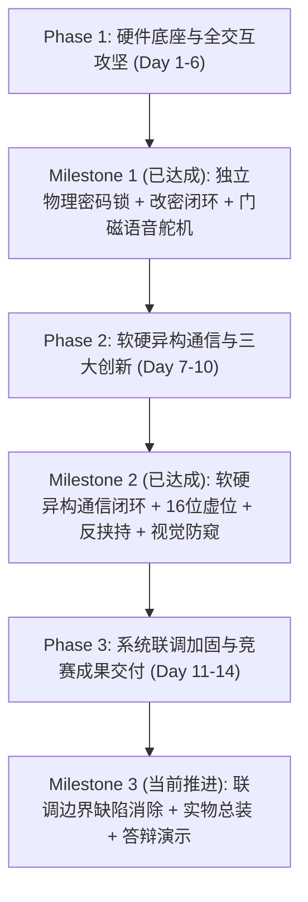

# 《基于 Edge AI 视觉防窥与 FPGA 硬件安全的异构智能保险箱》冲刺开发与系统技术规范

> **竞赛目标**：2026年全国大学生FPGA创新设计竞赛（安路 EG4S20 平台）  
> **设计哲学**：**硬核底座保底，软硬异构升维，双轨设计进退自如**。  
> - **底座**：FPGA 独立实现高可靠物理电子保险箱（外接 4x4 薄膜键盘 + 0.96 寸 OLED 中文交互 + 7段真人语音播报 + 16位虚位密码 + 门磁防盗 + 舵机闭锁 + 应急恢复码，板载数码管与蜂鸣器双重兜底）。  
> - **升维**：PC 端 Edge AI（YOLOv8 + 白名单人脸核验）视觉动态捕捉背后窥视者与操作者，通过工业级 UART 实时注入防御指令，毫秒级熄屏防窥、远程人脸开锁与后台静默留证。  

---

## 一、 系统架构与通信协议设计

### 1.1 异构系统架构拓扑

```mermaid
flowchart LR
    subgraph PC_Side ["PC 上位机 Python / Edge AI 监控中枢"]
        USB_CAM["笔记本自带摄像头 / USB 摄像头"] --> YOLO["YOLOv8 视觉防窥检测引擎"]
        USB_CAM --> FaceAuth["LBPH 白名单人脸核验模块"]
        YOLO --> Decision["安防策略决策机 (时空滞回滤波)"]
        FaceAuth --> Decision
        Decision --> PY_UART["PySerial 双向串口通信"]
        Decision --> Logger["本地抓拍证据库与 SQLite 黑匣子审计"]
    end

    subgraph FPGA_Side ["FPGA 下位机 (国产安路 EG4S20BG256)"]
        FPGA_UART["UART 收发控制与事件排队调度 (uart_mailman)"] <--> MainFSM["保险箱主状态机 (safe_fsm)"]

        Keypad_Ext["外接 4x4 薄膜键盘 (P4-8~22)"] --> MainFSM
        Door_Sensor["门磁检测 (板载 SW1 / 外接干簧管)"] --> MainFSM
        Rec_SW["应急恢复开关 SW7 (A14)"] --> RecMgr["恢复码管理 (recovery_mgr)"]
        RecMgr -->|重置信号| MainFSM

        MainFSM --> OLED["外接 0.96寸 I2C OLED 屏 (P4-54~60)"]
        MainFSM --> Voice["外接 JQ8900 真人语音模块 (P4-42~46)"]
        MainFSM --> Digitron["板载 4位数码管 底层状态代码"]
        MainFSM --> LED_Bar["板载 8位 LED 状态能量指示"]
        MainFSM --> Buzzer["板载无源蜂鸣器 (按键音/错误/锁定/和弦)"]

        MainFSM --> PWM_Servo["外接 SG90 舵机 PWM 控制器 (P4-6: M11)"]
    end

    PY_UART <-->|板载 Type-C CH340 虚拟串口 115200 8-N-1 (D12/F12)| FPGA_UART
```

---

### 1.2 工业级 UART 串口双向通信协议标准

* **物理接口**：板载 Type-C 接口（内置独立 CH340 芯片直连 FPGA `D12 (TX)` / `F12 (RX)`，**彻底免外接 USB-TTL 模块**）
* **波特率**：`115200 bps`（单比特采样周期 434 时钟 @50MHz，过采样中点判定）
* **数据格式**：`8 数据位, 无校验位 (None), 1 停止位 (8-N-1)`
* **双向单字节指令集规范**：

| 发送方 | 接收方 | 指令字符 | 协议语义 | 触发条件与动作响应 |
| :--- | :--- | :---: | :--- | :--- |
| **PC 上位机** | FPGA | `'S'` | **Safe（环境安全恢复）** | 视野内恢复为单人正常操作；FPGA 恢复 OLED 界面显示，解挂键盘输入，清除反挟持粘滞告警。 |
| **PC 上位机** | FPGA | `'P'` | **Peep（窥视挂起阻断）** | 检出背后聚集逼近或探头偷窥；FPGA 立即挂起输入、OLED 熄屏横杠保护、数码管灭屏、语音播报防窥提醒。 |
| **PC 上位机** | FPGA | `'R'` | **Remote Unlock（远程开锁）** | PC 人脸核验通过或管理员授权远程开锁；FPGA 直接驱动舵机旋转 90° 开锁（保持 3 秒回弹）并播报开门。 |
| **FPGA 下位机** | PC | `'U'` | **Unlocked（开锁成功）** | 键盘密码匹配成功、虚位提取通过或远程开锁；PC 同步弹窗并抓拍开门者留存。 |
| **FPGA 下位机** | PC | `'L'` | **Locked（暴力破解锁定）** | 连续输错 3 次锁定系统 60 秒；PC 触发高音警报并启动 5 连拍与录像取证。 |
| **FPGA 下位机** | PC | `'D'` | **Duress（反挟持静默报警）** | 输入预设“挟持胁迫密码”；**表面正常转舵机开门麻痹歹徒**，同时向 PC 发送 `'D'`，PC 静默抓拍取证。 |
| **FPGA 下位机** | PC | `'A'` | **Door Alert（门未关严警报）** | 开锁后门磁处于打开状态超过 15 秒未关；PC 记录未关门告警事件并启动事件录像。 |
| **扩展规划** | - | `'T'` / `'K'` | **Timer Expire / Lock Closed** | `'T'` 为 60s 试错锁定结束恢复正常；`'K'` 为锁舌自动回弹闭锁完成事件。 |

---

### 1.3 4×4 矩阵键盘全键位语义与交互映射规范

系统采用外接 4×4 薄膜矩阵键盘（直插下方排母 `P4-8 ~ P4-22`），全 16 键具体语义与行为定义如下：

| 键位 | 键值编码 (Hex) | 键面字符 | 功能类型 | 核心行为与业务流转说明 |
| :---: | :---: | :---: | :---: | :--- |
| **0 ~ 9** | `0x0` ~ `0x9` | `0` ~ `9` | **数字输入** | 密码输入与新密码设置录入。敲键时蜂鸣器发出 1kHz 清脆按键音（50ms），OLED 动态更新掩码 `*`，数码管显示当前输入位数。 |
| **\*** | `0xE` | `*` | **退格 / 取消** | **双重容错逻辑**：<br>1. 当前缓冲区有字符（`len > 0`）：单步回退删除最后输入的 1 位数字；<br>2. 当前缓冲区已清空（`len == 0`）：直接**取消当前模式**（如取消改密/取消录入），安全平稳退回 `IDLE` 待机主界面。 |
| **#** | `0xF` | `#` | **确认比对 / 提交** | **多模式确认键**：<br>1. **日常开锁**：触发 6~16 位滑动窗口虚位提取与密码判决（**不足 6 位仅提示按键音，不扣罚错误次数**）；<br>2. **改密/录入**：作为当前输入阶段的提交键，推进至二次密码确认或写入生效。 |
| **A** | `0xA` | `A` | **新用户设置密码** | **开荒 / 首次录入通道**（无需输入旧密码）：<br>`按 A` $\to$ OLED 提示输 6 位新密码 $\to$ `按 #` $\to$ 再次输入确认 $\to$ `按 #` $\to$ 写入密码寄存器生效（**安全门控：仅在密码为出厂默认值时允许免密录入**；改密后自动闭锁只能走 B 键）。 |
| **B** | `0xB` | `B` | **修改密码 (改密)** | **老用户安全改密通道**（强权限闭环，验旧改新）：<br>`按 B` $\to$ OLED 提示输当前旧密码 $\to$ `按 #` 校验（输错扣罚并报警退回）$\to$ 验密通过后输 6 位新密码 $\to$ `按 #` $\to$ 再次确认 $\to$ `按 #` $\to$ 写入生效。 |
| **C** | `0xC` | `C` | **手动闭锁 / 清屏** | 开锁成功后若无需等待 3 秒自动回弹，按 `C` 可立即驱动舵机回弹至 0° 闭锁；待机态下按 `C` 强刷清屏。 |
| **D** | `0xD` | `D` | **应急恢复码通道** | **遗忘密码硬件恢复通道**（需将板载拨码 `SW7 / A14` 拨至高电平使能）：<br>待机按 `D` $\to$ 输入 6 位专用恢复码（默认 `937158`） $\to$ `按 #` 核验 $\to$ 通过后一键将密码重置回出厂初始值（`123456`）；连续输错 3 次锁定恢复通道 60 秒。 |

> **超时自动放弃保护**：在按 `A` 或 `B` 处于设置/修改流程时，若用户中途走开超过 **15 秒**无任何按键操作，硬件看门狗定时器自动超时放弃并强制退回 `IDLE` 待机，彻底杜绝状态机卡死挂起。

---

### 1.4 0.96寸 I2C OLED 屏幕全阶段多页面显示排版规范

主显示屏为 0.96 寸 SSD1306 OLED（128×64 单色，四行 16×16 汉字 / 8×16 ASCII 字符排版，I2C 开漏三态驱动），按主状态机流转规划专属显示界面：

| 系统业务状态 | OLED 第一行 (16px) | OLED 第二行 (16px) | OLED 第三行 (16px) | OLED 第四行 (16px) | 状态联动声光表现 |
| :--- | :--- | :--- | :--- | :--- | :--- |
| **1. 待机状态 (S_IDLE)** | **欢 迎 使 用** | 请 输 入 密 码 | *(留空)* | `剩 余 : 3 次` | 心跳灯 1Hz 闪烁，数码管显示 `IdLE` |
| **2. 密码输入 (S_INPUT)** | **欢 迎 使 用** | 请 输 入 密 码 | `* * * _ _ _` *(动态掩码)* | `剩 余 : 3 次` | 每次敲键 1kHz 按键音，数码管显示 `P- X` (X为0~16) |
| **3. 新用户录入 (S_SET_NEW)**<br>*(按 A 键触发)* | **新 用 户 录 入** | 输 入 新 密 码 | `* * * * * _` *(掩码)* | `# 确 认   * 取 消` | 15 秒超时无操作自动放弃回待机，数码管 `SEt n` |
| **4. 新密码确认 (S_SET_CFM)** | **请 再 次 确 认** | 重 复 输 入 新 密 | `* * * * * *` *(掩码)* | `# 确 认   * 取 消` | 一致报成功并和弦音；不一致报错误，数码管 `CFn n` |
| **5. 修改密码验权 (S_CHG_AUTH)**<br>*(按 B 键触发)* | **修 改 密 码** | 输 当 前 旧 密 码 | `* * * * * *` *(掩码)* | `# 确 认   * 取 消` | 验证失败蜂鸣器长鸣，错误计数+1，退出回待机，数码管 `Aut n` |
| **6. 修改密码新密 (S_CHG_NEW/CFM)**| **输 入 新 密 码** | 输 新 密 $\to$ 再 次 确 认 | `* * * * * *` *(掩码)* | `# 确 认   * 取 消` | 成功后播报语音“修改成功”，更新密码寄存器 |
| **7. 开锁成功 (S_SUCCESS)** | **欢 迎 使 用** | 开 锁 成 功 | *(留空)* | 门 锁 已 开 启 | 蜂鸣器 Do-Mi-Sol 和弦音，语音“门已开”，舵机转90°，数码管 `OPEn` |
| **8. 密码错误 (S_ERROR)** | **欢 迎 使 用** | 密 码 错 误 | *(留空)* | `剩 余 : X 次` | 蜂鸣器 2.5kHz 报警音，LED 输错计数灯亮起，数码管 `ErrX` |
| **9. 暴力锁定 (S_LOCKED)** | **欢 迎 使 用** | 系 统 已 锁 定 | **倒 计 时 : 58 秒** | 键 盘 已 锁 定 | 蜂鸣器 4kHz 间歇刺耳报警，数码管显示 `L-58` |
| **10. 视觉防窥挂起 (S_SUSPEND)**<br>*(收到 PC 'P' 指令)* | *(熄灭)* | *(熄灭)* | **----------------** *(横杠)* | *(熄灭)* | 屏幕大部熄灭仅留中线，数码管灭屏，语音播报“背后有人请防窥” |
| **11. 门磁超时未关 (DOOR_ALERT)** | **欢 迎 使 用** | 门 磁 告 警 | 箱门超时未关严 | 请 关 闭 箱 门 | 喇叭播报“门未关严请关门”，蜂鸣器急促提醒，led[7] 常亮 |

---

### 1.5 板载 8 位 LED 状态映射定义

| LED 序号 | FPGA 引脚 | 电平标准 | 状态指示定义 | 物理意义与行为说明 |
| :---: | :---: | :---: | :--- | :--- |
| **`led[0]`** | **`B14`** | LVCMOS33 | **系统运行心跳灯** | 1Hz 精确闪烁（0.5s 亮、0.5s 灭），指示 50MHz 时钟与系统存活 |
| **`led[1]`** | **`B15`** | LVCMOS33 | **物理按键按下指示** | 矩阵键盘按键按下时高电平点亮，松开熄灭（硬件消抖与按压手感指示） |
| **`led[2]`** | **`B16`** | LVCMOS33 | **开锁成功指示灯** | 密码核验通过或收到 PC 远程开锁指令 `'R'` 时高电平点亮（保持 3 秒） |
| **`led[3]`** | **`C15`** | LVCMOS33 | **系统硬件锁定指示** | 连续输错 3 次后在 60s 硬件锁定期间常亮 |
| **`led[4]`** | **`C16`** | LVCMOS33 | **密码错误提示指示** | 处于密码错误提示状态时点亮（保持 1.5 秒） |
| **`led[5]`** | **`E13`** | LVCMOS33 | **箱门物理状态指示** | 门打开点亮（读 1），门关严吸合熄灭（读 0） |
| **`led[6]`** | **`E16`** | LVCMOS33 | **输错累计指示 1** | 累计输错满 1 次点亮 |
| **`led[7]`** | **`F16`** | LVCMOS33 | **输错累计 2 / 门磁超时** | 累计输错满 2 次点亮；门未关超过 15 秒超时警报时常亮 |

---

### 1.6 JQ8900-16P 真人语音播报标准曲目清单 (7段普通话语音)

| 曲目编号 (Hex) | 语音播报内容 | 触发时机与业务场景 | 硬件驱动特性 |
| :---: | :--- | :--- | :--- |
| **`Track 1` (0x01)** | **“请输入密码”** | 待机状态下用户首次敲击数字按键唤醒系统 | 100ms 强制防重入冷却 |
| **`Track 2` (0x02)** | **“门已开 / 欢迎使用”** | 键盘密码匹配成功 / 虚位提取通过 / PC 远程开锁 `'R'` | 开锁上升沿触发 |
| **`Track 3` (0x03)** | **“密码错误”** | 密码比对不匹配（未达到 3 次前） | 伴随 2.5kHz 蜂鸣警告 |
| **`Track 4` (0x04)** | **“系统已锁定”** | 连续输错 3 次触发 60 秒硬件锁死 | 伴随 4kHz 间歇报警 |
| **`Track 5` (0x05)** | **“修改成功”** | A 键首次录入或 B 键安全改密二次确认写入成功 | 单周期脉冲触发 |
| **`Track 6` (0x06)** | **“门未关严，请关门”** | 开锁后箱门打开超过 15 秒未关严 | 超时脉冲触发急促声光 |
| **`Track 7` (0x07)** | **“背后有人，请注意防窥”**| PC 端 Edge AI 视觉检测到窥视注入 `'P'` 指令 | 熄屏横杠保护同时播报 |

---

### 1.7 16位自适应虚位密码与开锁认证规范

* **日常开锁免录人脸**：人来到保险箱前，直接敲键盘输入密码即可开锁，无需预先录入人脸库。PC 摄像头仅负责环境防窥与开门自动抓拍留证，不卡控开门权限，保障断网脱机时 100% 可用。
* **6 ~ 16 位自适应虚位密码**：
  * 系统允许敲击长度在 **6 至 16 位** 任意浮动（例：`乱码 + 6位真密码 + 乱码 + #`），绝不强制凑满 16 位。
  * FPGA 内部 64 位移位寄存器 (`vbuf`) 永远保存最近输入的 16 位数字，在按 `#` 的瞬间，通过内部 **11 组并行比较器在同一个时钟周期（20 纳秒）内全并行完成模式匹配**，纳秒级提取真密码。
  * **胁迫优先比对规则**：11 组窗口中只要有任意一组匹配到反挟持密码 `654321`，一律优先判定为反挟持报警开锁，表面正常开门，底层静默向 PC 注入 `'D'`。

---

## 二、 详细任务拆解与当前交付状态

整体研发周期分为 3 个核心阶段，当前工程已提前全面完成 Phase 1 与 Phase 2 核心 RTL 代码开发与时序收敛：



### 交付清单对照表

| 阶段 / 模块 | 涉及 RTL 模块 / 文件 | 当前完成状态 | 核心技术指标与验收情况 |
| :--- | :--- | :---: | :--- |
| **Day 1: 基础底座与时钟** | `rtl/clk_tick.v`<br>`rtl/top.v` | **已交付** | 50MHz 时钟驱动，产生 1kHz/100Hz 同步使能脉冲；`led[0]` 1Hz 心跳闪烁。 |
| **Day 2: 4x4 矩阵键盘** | `rtl/keypad_scan.v` | **已交付** | 行列反转轮询扫描，20ms 硬件双向延时滤波消抖，键值稳定无连击。 |
| **Day 3: OLED 与数码管双显** | `rtl/oled_driver.v`<br>`rtl/oled_font.v`<br>`rtl/seg_display.v` | **已交付** | SSD1306 硬件 I2C 控制器（开漏驱动），四行多页面中文 UI；4位数码管 1kHz 动态扫描监控。 |
| **Day 4: 密码匹配与状态机** | `rtl/safe_fsm.v`<br>`rtl/buzzer_driver.v` | **已交付** | 连续输错 3 次锁定 60s 倒计时；蜂鸣器 1kHz 按键音、2.5kHz 错误音、4kHz 锁定音、开锁和弦（0 DSP）。 |
| **Day 5: 语音播报与门磁防盗** | `rtl/voice_player.v`<br>`rtl/door_sensor.v` | **已交付** | JQ8900 单线串口微秒时序引擎（100ms 防重入）；门磁 20ms 消抖与 15s 未关门超时报警。 |
| **Day 6: 舵机闭锁与 A/B 键改密** | `rtl/servo_driver.v`<br>`rtl/safe_fsm.v` | **已交付** | 50Hz PWM 舵机驱动（0.5ms~1.5ms，3 秒回弹，C 键提前闭锁）；A 键首次录入与 B 键验旧改新。 |
| **Day 7: UART 双向通信调度** | `rtl/uart_rx.v`<br>`rtl/uart_tx.v`<br>`rtl/uart_mailman.v` | **已交付** | 115200 8-N-1 串口过采样；优先级事件仲裁队列（`D > L > A > U`）；板载 CH340 直连免小板。 |
| **Day 8: 视觉防窥熄屏阻断** | `rtl/top.v`<br>`rtl/oled_driver.v`<br>`pc/modules/vision.py` | **已交付** | 收到 PC `'P'` 瞬态熄灭 OLED 显示、屏幕中央呈现防窥保护横杠、数码管灭屏、语音防窥警示。 |
| **Day 9: 16位虚位与反挟持** | `rtl/safe_fsm.v`<br>`rtl/recovery_mgr.v` | **已交付** | 11 组滑动窗口并行模式匹配（20ns 提取真密）；反挟持密码优先判定；SW7 恢复码通道。 |
| **综合收敛指标** | `lock_Runs/phy_1/` | **已收敛** | **LUT 4019 (20.51%)、REG 754 (3.85%)、DSP 0、BRAM 0**，时序建立余量 **Slack = +2.621ns** ($F_{max} = 57.54\,\text{MHz}$)。 |

---

## 三、 硬件物料实采清单 (BOM) 与引脚映射

所有外接模块统一规划在开发板**下方双排插针 `P4` 的内侧一列（PCB 丝印为 P4，偶数引脚 `2 ~ 60`）**，免飞线一排直插：

| 模块名称 | 规格型号 | 数量 | 推荐接线位置 (下方排母 P4) | FPGA 管脚 | 供电与电气红线 |
| :--- | :--- | :---: | :--- | :---: | :--- |
| **FPGA 核心板** | 安路 EG4S20BG256 (DMZ-EG4S20) | 1 | 系统核心运算与底层物理安全控制 | 详见引脚表 | 板载 50MHz 晶振 (`R7`)、独立复位 (`E3`)、板载 CH340 虚拟串口 (`D12/F12`) |
| **0.96寸 OLED 屏**| SSD1306 4针 I2C 蓝屏 (已焊排针) | 1 | **`P4-60 (3V3), 58 (GND), 56 (SCL), 54 (SDA)`** | **`E15, D14`** | **严禁接 5V！必须接 3.3V**；开漏三态总线，支持内部弱上拉 |
| **4×4 薄膜键盘** | 16键柔性薄膜键盘 (8P排线) | 1 | **`P4-8, 10, 12, 14, 16, 18, 20, 22`** | **`L12,P15,P16,N14` / `N16,M16,L16,P14`** | 8 联排整排顺插，4 行内部上拉，4 列低电平扫描 |
| **SG90 微型舵机** | 9g 微型舵机 180° (3P插头) | 1 | **`P4-2 (5V), 4 (GND), 6 (PWM)`** | **`M11`** | **红接 5V、棕接 GND、黄接 M11**；大负载时建议红线外接 5V 电池并共地 |
| **JQ8900 语音模块**| JQ8900-16P MP3 模块 + 喇叭 | 1 | **`P4-42 (BUSY), 44 (GND), 46 (TX)`** | **`G16, H16`** | 5V 供电，`H16` 经单线串口驱动，`G16` 检测忙信号 |
| **门磁开关** | GPS-23 干簧管门磁 / 板载 SW1 | 1 | 板载拨码开关 **`SW1`** 或外接干簧管至 **`A10`** | **`A10`** | 内部配置上拉，门关接地读 `0`，门开断开读 `1` |
| **应急恢复开关** | 板载拨码开关 **`SW7`** | 1 | 板载拨码开关 **`SW7`** | **`A14`** | 内部配置下拉，向上拨动使能 D 键输入 6 位恢复码重置 |
| **视觉传感器** | **PC 笔记本自带摄像头** | 1 | 笔记本摄像头 (`cv2.VideoCapture(0)`) | USB 软件调用 | **¥0 采购**，放在保险箱侧后方 30°~45° 视角最佳 |

---

## 四、 动态降级与单机高可靠保底准则

针对现场答辩的高可靠要求，系统具备完备的单机兜底保障能力：

1. **断网/脱机独立可用**：当 PC 离线或串口拔掉时，FPGA 下位机依靠内部 Verilog 状态机**独立完成所有物理开锁业务**（支持 6~16 位虚位输入、A 键开荒录入、B 键安全改密、D 键恢复码重置、连续输错锁定、门磁声光报警与舵机物理闭锁）。
2. **答辩展示优势**：即使比赛现场上位机 AI 产生波动，本地硬件依然具备纳秒级确定性时延与自主安全性，向评委展现硬核的底层工程韧性。
