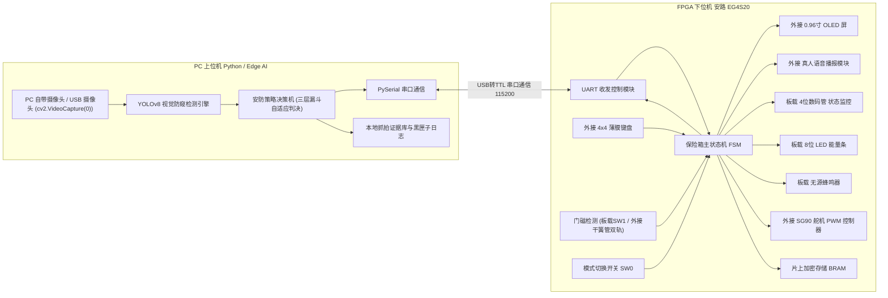
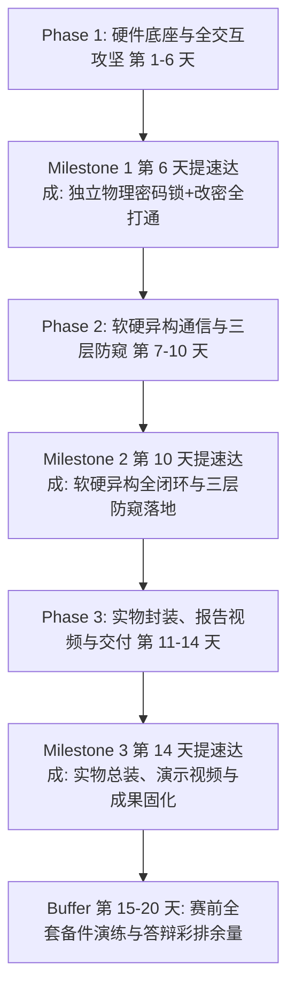
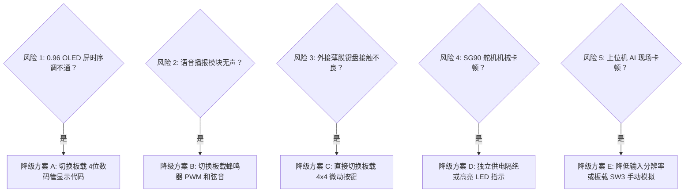

# 《基于 Edge AI 视觉防窥与 FPGA 硬件安全的异构智能保险箱》20天冲刺开发计划

> **竞赛目标**：2026年全国大学生FPGA创新设计竞赛（安路 EG4S20 平台）
> **设计哲学**：**硬核底座保底，软硬异构升维，双轨设计进退自如**。
> - **底座**：FPGA 独立实现高可靠物理电子保险箱（外接 4x4 薄膜键盘 + 0.96 寸 OLED 中文交互 + 真人语音播报 + 虚位密码 + 门磁防盗 + 舵机闭锁，板载数码管与蜂鸣器双重兜底）。
> - **升维**：PC 端 Edge AI（YOLOv8）视觉动态捕捉背后窥视者，通过高速 UART 实时注入防御指令，毫秒级熄屏防窥与后台静默留证。

---

## 一、 系统架构与通信协议设计

### 1.1 异构系统架构拓扑

---

### 1.2 工业级 UART 串口双向通信协议标准

* **波特率**：`115200 bps`（降级备选 `9600 bps`）
* **数据格式**：`8 数据位, 无校验 (None), 1 停止位 (8-N-1)`
* **字符指令集规范**：

| 发送方 | 接收方 | 指令字符 | 协议语义 | 触发条件与动作响应 |
| :--- | :--- | :---: | :--- | :--- |
| **PC 上位机** | FPGA | `'S'` | **Safe（环境安全）** | 视野内恢复为单人正常操作；FPGA 恢复 OLED 中文界面与键盘输入。 |
| **PC 上位机** | FPGA | `'P'` | **Peep（窥视挂起）** | 检测到身后有人聚集或侧后方偷窥；FPGA 立即挂起输入、OLED 黑屏显示警告横杠、语音播报防窥提醒。 |
| **PC 上位机** | FPGA | `'R'` | **Remote Unlock（远程开锁）** | PC 人脸核验成功或管理员授权远程开锁；FPGA 直接驱动舵机开锁并语音提示。 |
| **FPGA 下位机** | PC | `'U'` | **Unlocked（开锁成功）** | 键盘密码匹配成功或虚位密码提取合法；PC 同步弹窗并抓拍开箱留档。 |
| **FPGA 下位机** | PC | `'L'` | **Locked（暴力破解锁定）** | 连续输错 3 次锁定系统 60s；PC 触发高音警报并启动连拍取证。 |
| **FPGA 下位机** | PC | `'D'` | **Duress（反挟持静默报警）** | 输入预设“挟持胁迫密码”；**表面正常开门麻痹歹徒**，同时向 PC 发送 `'D'`，PC 静默抓拍告警。 |
| **FPGA 下位机** | PC | `'A'` | **Door Alert（门未关严警报）** | 开锁后门磁开启超过 15s 未关；PC 记录未关门告警事件。 |

---

### 1.3 4×4 矩阵键盘全键位语义与交互映射规范

系统采用外接 4×4 薄膜矩阵键盘（贴于箱门外表面），全 16 键具体语义与行为定义如下：

| 键位 | 键值编码 (Hex) | 键面字符 | 功能类型 | 核心行为与业务流转说明 |
| :---: | :---: | :---: | :---: | :--- |
| **0 ~ 9** | `0x0` ~ `0x9` | `0` ~ `9` | **数字输入** | 密码输入与新密码设置录入。每按一键蜂鸣器发出一声清脆按键音（1kHz），OLED 动态显示一个掩码 `*`，数码管更新当前输入位数。 |
| **\*** | `0xE` | `*` | **退格 / 取消** | **双重容错逻辑**： 1. 当前缓冲区有字符（`len > 0`）：单步回退删除最后输入的 1 位数字； 2. 当前缓冲区已清空（`len == 0`）：直接**取消当前模式**（如取消改密/取消录入），安全平稳退回 `IDLE` 待机主界面。 |
| **#** | `0xF` | `#` | **确认比对 / 提交** | **多模式确认键**： 1. **日常开锁**：触发 6~16 位滑动窗口虚位提取与密码判决（不足 6 位仅提示按键音，不扣罚错误次数）； 2. **改密/录入**：作为当前输入阶段的提交键，推进至二次密码确认或写入生效。 |
| **A** | `0xA` | `A` | **新用户设置密码** | **开荒 / 首次录入通道**（无需输入旧密码）： `按 A` $\to$ OLED 提示输 6 位新密码 $\to$ `按 #` $\to$ 再次输入确认 $\to$ `按 #` $\to$ 写入密码寄存器生效（带二次确认防输错，防呆保护）。 |
| **B** | `0xB` | `B` | **修改密码 (改密)** | **老用户安全改密通道**（强权限闭环，验旧改新）： `按 B` $\to$ OLED 提示输当前旧密码 $\to$ `按 #` 校验（输错扣罚并报警退回）$\to$ 验密通过后输 6 位新密码 $\to$ `按 #` $\to$ 再次确认 $\to$ `按 #` $\to$ 写入生效。 |
| **C** | `0xC` | `C` | **手动闭锁 / 清屏** | 开锁成功后若无需等待 3 秒回弹，按 `C` 可立即驱动舵机回弹至 0° 闭锁；待机态下按 `C` 强刷清屏。 |
| **D** | `0xD` | `D` | **备用管理 / 状态查询**| 预留作为管理员底层状态查询或模式切换功能扩展。 |

> **超时自动放弃保护**：在按 `A` 或 `B` 处于设置/修改流程时，若用户中途走开超过 **15 秒**无任何按键操作，硬件定时器自动超时放弃并强制退回 `IDLE` 待机，彻底杜绝状态机卡死挂起。

---

### 1.4 0.96寸 I2C OLED 屏幕全阶段多页面显示排版规范

主显示屏为 0.96 寸 SSD1306 OLED（128×64 单色，四行 16×16 汉字 / 8×16 ASCII 字符排版），按主状态机流转规划 **8 大专属显示页面**：

| 系统业务状态 | OLED 第一行 (16px) | OLED 第二行 (16px) | OLED 第三行 (16px) | OLED 第四行 (16px) | 状态联动声光表现 |
| :--- | :--- | :--- | :--- | :--- | :--- |
| **1. 待机状态 (S_IDLE)** | **智能防窥保险箱** | 系统就绪 门锁已闭 | 请敲击输入密码 | `A:录入 B:改密 #:开锁` | 心跳灯 1Hz 闪烁，数码管显示 `IDLE` |
| **2. 密码输入 (S_INPUT)** | **密码输入中:** | `* * * _ _ _` *(动态掩码)* | 虚位支持6-16位输入 | 剩余容错机会: 3 次 | 每次敲键 1kHz 按键音，数码管显示 `In- X` |
| **3. 新用户录入 (S_SET_NEW)** *(按 A 键触发)* | **【 新用户录入 】** | 请输入 6 位新密码: | `* * * * * _` *(掩码)* | 按 # 提交，按 * 取消 | 15 秒超时无操作自动放弃回待机 |
| **4. 新密码确认 (S_SET_CFM)** | **【 请再次确认 】** | 请重复输入新密码: | `* * * * * *` *(掩码)* | 按 # 校验是否一致 | 一致报成功并和弦音；不一致报 `两次输入不符` |
| **5. 修改密码验权 (S_CHG_AUTH)** *(按 B 键触发)* | **【 修改密码 】** | 请输入当前旧密码: | `* * * * * *` *(掩码)* | 验证身份后方可修改 | 验证失败蜂鸣器长鸣，错误计数+1，退出回待机 |
| **6. 修改密码新密 (S_CHG_NEW/CFM)**| **【 权限已核验 】** | 输新密码 $\to$ 再次确认 | 两次一致方可更新 | 写入生效，语音播报 | 成功后播报语音“修改成功”，更新密码寄存器 |
| **7. 开锁成功 (S_SUCCESS)** | **【 验证通过 】** | 锁舌已旋转 90° 开启 | 请在 3 秒内开箱门 | 欢迎使用 (或静默告警) | 蜂鸣器 Do-Mi-Sol 和弦音，语音“门已开”，舵机转动 |
| **8. 密码错误 (S_ERROR)** | **【 密码错误 】** | 密码不匹配请核对 | 累计输错: 1/3 次 | 1.5 秒后自动复位 | 蜂鸣器 2.5kHz 报警音，LED 输错计数灯亮起 |
| **9. 暴力锁定 (S_LOCKED)** | **【 系统已锁定 】** | 连续输错 3 次报警 | **倒计时: 58 秒** *(递减)* | 键盘已全面物理屏蔽！ | 蜂鸣器 4kHz 间歇刺耳报警，数码管显示 `L-58` |
| **10. 视觉防窥挂起 (S_SUSPEND)** *(收到 PC 'P' 指令)* | **【 警告:防窥保护 】** | **==== 熄屏挂起 ====** | **检测到背后偷窥！** | 输入已冻结 保持警惕 | 屏幕大部黑屏横杠，键盘锁死吞键，喇叭播报防窥提醒 |
| **11. 门磁超时未关 (DOOR_ALERT)** | **【 警告:门未关严 】** | 箱门敞开超过 15 秒 | 请及时将门锁闭严！ | 蜂鸣器急促提醒中 | 喇叭重复播报“请关门”，磁铁吸合后秒级恢复 |

---

### 1.5 PC 端 Edge AI 安防控制中枢与三层自适应防窥判决模型

PC 上位机（PyQt6 + YOLOv8 + PySerial）不占用开锁认证权限，定位于**“环境防窥天眼、设备数字孪生与取证黑匣子”**：

#### 1. 界面大屏显示与三区规划
* **左半区：实时视觉画面与 AI 防窥标注**
  * 直接复用笔记本自带摄像头（`cv2.VideoCapture(0)`），无需额外采购硬件，以 30 FPS 实时呈现。
  * **目标标注框**：
    * **绿色框**：标注正前方的操作者本人（标记 `User: Active` 及坐标）。
    * **红色告警框**：标注侧身探头、背后聚集逼近的偷窥者（标记 `Peeping Alert!` 及置信度，如 `91%`）。
  * **动态安全等级顶条**：
    * 正常时全屏绿标：`【 SYSTEM SAFE - 单人正常操作中 】`。
    * 偷窥时红光闪烁：`【 PEEPING DETECTED - 毫秒级熄屏防窥挂起中 】`。
* **右上区：保险箱数字孪生仪表盘**
  * 串口配置区（COM 口自动扫描、115200 波特率、心跳绿灯）。
  * 保险箱主状态机实时状态映射（待机 / 输入中 / 已开锁 / 输错报警 / 60s 倒计时 / 防窥挂起）。
  * 物理机构状态指示灯（舵机当前角度、门磁吸合状态、反挟持警报标志）。
  * 应急与测试控制按钮（`[远程开锁 'R']`、`[手动模拟防窥 'P']`、`[模拟恢复 'S']`，脱机测试一键闭环）。
* **右下区：审计日志黑匣子与抓拍证据库**
  * 带毫秒级时间戳的事件滚动审计列表（记录每一次串口交互、开锁事件、非法输错、反挟持警报）。
  * **抓拍证据瀑布流**：收到 `'U'` 自动抓拍开门者留存；收到 `'L'` 启动 5 连拍；收到 `'D'` 后台静默抓拍；收到 `'P'` 截取偷窥者人脸照片，全部自动归档至 `captures/` 文件夹。

#### 2. 三层漏斗自适应防窥判决模型（彻底消除路过误触）
为了避免“背景里随便走过一个人就频繁误触熄屏”的体验痛点，PC 端采用三层空间与时间融合判决模型：
1. **第一层：空间距离与几何 ROI 过滤**：设定操作者专属安全操作区与近景边界框面积门限，远处（>1.5 米）背景中走过的人体检测框过小，直接剔除忽略。
2. **第二层：面部偏角与视线估计（Gaze & Orientation）**：通过人脸两眼、鼻尖几何位置估算面部偏航角（Yaw Angle）。背对操作者或侧身（90°）快步路过的不判定；仅当面部朝向转向键盘或屏幕方向、形成实质注视时才计入威胁。
3. **第三层：时间滞后滑动窗口滤波（Temporal Hysteresis）**：危险目标必须在警戒区内**持续停留超过 15 帧（约 0.5 秒）**，才向串口注入 `'P'` 指令；目标离开且连续 5 帧安全才下发 `'S'` 恢复，彻底杜绝状态频繁抖动闪烁。

---

### 1.6 虚位密码与开锁认证规范

* **日常开锁免录人脸**：人来到保险箱前，直接敲键盘输入密码即可开锁，无需预先录入人脸库。PC 摄像头仅负责环境防窥与开门自动抓拍留证，不卡控开门权限，保障断网脱机时 100% 可用。
* **6 ~ 16 位自适应虚位密码**：
  * 系统允许敲击长度在 **6 至 16 位** 任意浮动（例：`乱码 + 6位真密码 + 乱码 + #`），绝不强制凑满 16 位。
  * FPGA 内部移位 FIFO 永远保存最近 16 位输入，在按 `#` 的瞬间，通过内部 **11 组并行比较器在同一个时钟周期（20 纳秒）内全并行完成模式匹配**，纳秒级提取真密码，兼具防偷窥旁路推演与超高硬件实时性。

---

## 二、 提速攻坚阶段划分与核心里程碑（14天全功能闭环 + 6天实物答辩余量）

为确保项目早日全面闭环、为实物装配与答辩录像留足从容余量，整体研发周期全面**提速重编为 14 天高效冲刺体系**（比原计划提前近一周锁定所有功能）：

---

## 三、 详细任务拆解表（硬件组 vs 软件组）

### Phase 1: 硬件底座与全交互攻坚（第 1 - 6 天 · 提速完成）
> **目标**：不依赖 PC 算法，全面实现一款高可靠、带多页面中文 OLED 交互、真人语音播报、舵机机械闭锁、门磁防盗、以及**A键首次录入与B键改密闭环**的独立物理密码锁。

| 日程 | 硬件组任务（FPGA / Verilog / 电路调试） | 软件组任务（PC / Python / 算法环境） | 阶段对齐与交付物 (Deliverable) |
| :---: | :--- | :--- | :--- |
| **Day 1** | **安路 TD 工程搭建与时钟分频** • 配置 `EG4S20` 引脚约束表（`.adc`） • 编写系统时钟分频模块（产生 1kHz/100Hz 节拍时钟） • 点亮板载 LED0 心跳灯（1Hz） | **开发环境与串口联调治具准备** • 配置 Python 虚拟环境（PyTorch, OpenCV, Ultralytics, PySerial） • 编写串口调试与数据监控脚本（带时间戳打印） | 基础工程跑通，板载 LED0 心跳灯闪烁，Python 串口调试环境就绪。 |
| **Day 2** | **4×4 矩阵键盘扫描驱动与硬件消抖** • 编写行列反转法键盘扫描逻辑 • 加入 20ms 延时滤波消抖计数器 • 验证外接 4x4 薄膜键盘与板载矩阵按键的兼容性 | **上位机 UI 框架雏形搭建** • 基于 PyQt6 搭建极简安防监控面板 • 预留串口连接配置与状态指示灯（红/黄/绿） | 敲击薄膜键盘任意键，板载 LED 准确显示键值二进制，按键无连击抖动。 |
| **Day 3** | **0.96寸 I2C OLED 驱动与数码管双显** • 编写简易 I2C 主机控制器（SCL 100kHz） • 移植 16×16 中文字模库与 8×16 ASCII 字符集 • 同步点亮板载 4 位数码管作为底层状态代码监控 | **摄像头视频流采集与多线程管道** • OpenCV 线程安全获取 1080P/720P 实时视频流 • 解决高帧率低延迟缓冲积压问题（Queue 优化） | OLED 屏清晰显示“欢迎使用”、“请输入密码”，数码管显示 `IDLE`。 |
| **Day 4** | **密码匹配状态机与错误锁定机制** • 编写密码比对逻辑（预设 6 位核心密码） • 连续输错 3 次锁定状态机（硬件定时器锁定 60s） • 编写无源蜂鸣器 PWM 驱动（1kHz 按键音、4kHz 报警音） | **YOLOv8 模型选型与防窥逻辑预研** • 下载测试 YOLOv8n 轻量级模型 • 编写检测头逻辑：统计画面内人头/人脸数量与纵深距离 • 设定检测判定区域（ROI 边界框） | 输错密码触发蜂鸣器报警，输错 3 次 OLED 显示“系统锁定 60 秒”倒计时。 |
| **Day 5 (合流攻坚)**| **【底座加固 + 语音与门磁合流攻坚】** • **加固收敛**：P0-A（OLED function 函数化消警告）+ P0-B（SDA 开漏三态）+ P0-C（新建 `lock.sdc` 50MHz 时钟约束）+ P0-D（蜂鸣器去 DSP）+ P1-H（复位双级同步释放） • **语音模块**：编写 JQ8900-16P 单线串口驱动（3.3V 安全驱动、内部防重入、BUSY 极性适配，拷入 5 段标准 MP3） • **门磁防盗**：挂接 GPS-23 干簧管门磁（内部上拉，门关接地）+ 板载 SW1 双轨检测，开锁后超 15s 未关门触发声光与语音急促警报 | **模拟串口联动测试与音频素材灌装** • 准备普通话清晰音频素材（欢迎、开锁、错误、锁定、防窥、改密、关门）并写入模块 • 完善反挟持与偷窥状态切换的时序推演 | **【Day 5 攻坚交付物】** • 综合无 `init_rom` 警告，DSP 占用降为 0 • 产出完整 SDC 时序报告与 Fmax 指标 • 敲键语音提示“请输入密码”，开锁成功播报“门已开”，门磁超时报警。 |
| **Day 6 (提前达成 M1)**| **SG90 舵机 PWM 闭锁与 A/B 键改密/录入业务全打通** • **舵机驱动**：编写 50Hz 基准 PWM 发生器（0.5ms~1.5ms 旋转开锁，3 秒自动回弹），独立 5V 锂电池供电与统一共地 • **A 键开荒录入**：按 A $\to$ 输 6 位新密码 $\to$ 按 # $\to$ 再次输入确认 $\to$ 按 # $\to$ 密码寄存器写入生效 • **B 键验旧改密**：按 B $\to$ 输旧密码验权 $\to$ 按 # $\to$ 输 6 位新密码 $\to$ 按 # $\to$ 再次确认 $\to$ 更新生效 • **防呆与超时**：`*` 键支持退格/清空取消，15 秒无操作硬件定时器强制超时退回待机 • **引脚固化**：更新 `lock.adc` 引脚，烧写板载 SPI Flash | **上位机通信中枢框架准备** • 完善 PyQt6 监控中枢界面组件布局 • 准备串口多线程读写架构与自定义协议编解码器 | **【Milestone 1 提前 1 天达成】** 完全脱离 PC 运行，独立物理密码锁 100% 跑通！具备声光电、舵机机械开合、门磁防盗、新用户录入与老用户改密全部核心业务！ |

---

### Phase 2: 软硬异构通信、虚位密码与三层视觉防窥（第 7 - 10 天 · 提速完成）
> **目标**：全面叠加创新亮点，打通 16 位虚位密码、反挟持静默报警机制与 PC 自带摄像头 YOLOv8 三层防窥闭环。

| 日程 | 硬件组任务（FPGA / Verilog / 电路调试） | 软件组任务（PC / Python / 算法优化） | 阶段对齐与交付物 (Deliverable) |
| :---: | :--- | :--- | :--- |
| **Day 7** | **UART 发送/接收模块与主状态机挂接** • 编写 115200 波特率过采样串口接收/发送模块 • 实现 `'S'`, `'P'`, `'R'` 字符解码与 `'U'`, `'L'`, `'D'`, `'A'` 发送 • 支持接收 PC 远程开锁指令 `'R'` 驱动舵机 | **PC 串口通信中枢与数字孪生大屏落地** • 实现多线程串口监听与心跳/异常重连逻辑 • 搭建数字孪生大屏（实时显示下位机待机/输入/开锁/锁定/门磁状态） • 集成一键应急控制与模拟测试按钮 | PC 与 FPGA 完成 115200 串口高速握手，按键与状态能够实时双向毫秒级透传。 |
| **Day 8** | **防窥挂起与毫秒级熄屏保护响应** • 接收 `'P'`：进入 `SUSPEND` 状态，OLED 瞬间熄屏横杠保护，物理锁死键盘吞键，语音播报“背后有人请防窥” • 接收 `'S'`：瞬间解冻恢复原界面与输入光标 • 纳秒级响应，旁人无法通过指法和位数推演密码 | **PC 自带摄像头接入与三层漏斗防窥模型** • 调用笔记本自带摄像头（`cv2.VideoCapture(0)`），无需额外采购 • **三层漏斗自适应防窥模型**：   1. 空间距离与几何 ROI 过滤（剔除 1.5 米外背景路人）   2. 面部偏角与视线估计（区分侧身路过 vs 探头直视键盘）   3. 15 帧（0.5s）时间滞后滤波防抖，杜绝频繁误触 | 上位机检测到背后有人靠近，下发 `'P'`，FPGA 瞬间熄屏挂起；偷窥者离开秒级恢复输入。 |
| **Day 9** | **16 位虚位密码硬件提取与反挟持静默取证** • **虚位密码**：实现基于移位 FIFO 与 11 组并行比较器的硬件滑动窗口模式匹配（6~16 位自适应，20ns 纳秒级提取真密码） • **反挟持报警**：输入专用胁迫密码，表面正常开锁麻痹歹徒，底层静默触发 UART 发送 `'D'` | **证据黑匣子与自动化抓拍归档模块** • 收到 `'U'`：自动截取当前开门者正脸留档 • 收到 `'D'`：后台静默连拍取证，屏幕无任何异样，写入加密告警日志 • 收到 `'L'`：启动 5 连拍并记录非法入侵告警 | 虚位密码在 FPGA 内部实时完成硬件级模式匹配；模拟挟持场景，表面正常开门，上位机悄然取证。 |
| **Day 10 (提前达成 M2)**| **软硬件全协议闭环极限联调与功能固化** • 现场验证 7 类字符指令的高频交叉并发响应 • 虚位密码超长输入溢出与键盘强行敲击过滤 • 拔掉串口线时自动平滑回退至单机工作模式，插回秒恢复 • 锁定 FPGA 代码版本与 bit 流文件 | **上位机全功能一体化监控界面封装** • 实时绘制摄像头画面、检测框、安全等级仪表盘 • 弱光环境与多角度检测稳定性调优 • 将 Python 脚本打包装配或形成一键启动运行批处理 | **【Milestone 2 提前 4 天达成】** 完整展示三大核心创新（三层防窥、虚位提取、反挟持静默），异构全链路毫秒级闭环。 |

---

### Phase 3: 实物封装、报告视频与竞赛成果发布（第 11 - 14 天 · 提前交付）
> **目标**：完成实物装配、测试端到端时延、撰写学术级技术报告、录制高质量演示视频、制作答辩 PPT。

| 日程 | 硬件组任务（FPGA / Verilog / 电路调试） | 软件组任务（PC / Python / 算法优化） | 阶段对齐与交付物 (Deliverable) |
| :---: | :--- | :--- | :--- |
| **Day 11** | **实物箱体总装与机械锁舌调校** • 将 EG4S20 板卡、键盘、OLED、舵机牢固装配于箱体 • 机械锁舌行程微调，确保舵机开关不卡滞打齿 • 强弱电走线绑扎与独立 5V 电池盒固定 | **笔记本摄像头视角标定与视场角优化** • 笔记本放置于保险箱侧后方 30°~45°，调整俯仰角 • 现场标定检测有效防窥距离（1~2米）与警戒盲区 | 实物保险箱成型，外观整洁，无杂乱飞线，机械开合顺滑。 |
| **Day 12** | **端到端时延分解实测与学术级性能报告导出** • 连续模拟输入 100 次开锁测试（正向、虚位、胁迫、暴力） • 实测测量时延链条：视觉识别（10ms）+ 串口传输（1ms）+ 硬件响应（<1ms）+ 机械动作（50ms） • 导出 FPGA 资源消耗表（LUT/FF/BRAM/0 DSP）与 SDC 50MHz 时序收敛报告 | **时延分解可视化图表生成** • 绘制端到端时延柱状分解图与可靠性压力测试统计图表（硬核学术素材） | 形成第一手实测性能数据表格与时延分解图（答辩评审核心杀手锏）。 |
| **Day 13** | **技术设计报告编制（初版完成）** • 绘制核心状态机转移图（FSM Visio/Draw.io） • 整理各模块 RTL 原理图与关键 Verilog 代码注释 | **演示视频脚本规划与分镜高清采集** • 设计视频脚本：痛点提出 $\to$ 架构创新 $\to$ 场景实测演示 $\to$ 成果总结 • 高清机位录制：实物细节、屏幕UI、多角色防窥实测、反挟持场景实录 | 完成初版技术设计报告（`Design_Report.pdf`），采集完毕所有分镜高清素材。 |
| **Day 14 (提前达成 M3)**| **答辩 PPT 制作（突出芯片特长与硬件级安全）** • 重点突出安路 EG4S20 资源利用与硬件低功耗/高实时性优势 • 提炼硬件级密码学、11组并行比对与虚位匹配算法亮点 | **竞赛演示视频后期剪辑与终稿成片** • 剪辑 3-5 分钟竞赛演示视频（配字幕、画中画特写与背景音） • 统一 PPT 视觉风格，提炼评委关注的创新度指标 | **【Milestone 3 提前 6 天达成】** 演示视频成片导出，答辩 PPT 终稿完成，技术报告定稿！ |

---

### Buffer: 赛前全套备件演练与答辩彩排余量（第 15 - 20 天 · 从容保底）
> **目标**：彻底摆脱赛前通宵熬夜风险，从容开展多轮模拟质询与实战推演。
* **备用备件复核**：核验备用板卡、备用杜邦线、备用舵机、备用键盘，做好赛场意外应急预案。
* **模拟答辩彩排**：针对评委可能提问的“串口断开怎么办”、“虚位密码原理”、“三层防窥如何抑误触”进行多轮模拟答辩与讲稿演练。
* **系统环境固化**：将 PC 上位机环境制作为一键运行安装包，固化板卡 Flash，以最完美、最从容的状态迎接竞赛评审！

---

### 3.4 专项攻坚：Day 4.5 硬件底座可靠性加固与验证闭环（实施细则）

> **实施原则**：**先固化计划与用例，再有序动代码**。消除“仿真能过、上板未知”与“静默失败”隐患，为 Day 5 叠加语音与舵机筑牢时序与功能防线。

#### 1. 任务分级清单与行动细则

| 级别 | 编号 | 涉及文件 | 核心问题与修改方案 | 预期成果与验收指标 |
| :---: | :---: | :--- | :--- | :--- |
| **P0** | **A** | `rtl/oled_driver.v` | **OLED 初始化表消除 `initial` 块** • 将 `init_rom[0:26]` 数组赋值替换为纯组合逻辑 `function [7:0] oled_init_cmd(input [4:0] idx)` • 使用点改为 `i2c_data <= oled_init_cmd(cmd_idx)` | 消除综合警告 `HDL-5007: net 'init_rom' does not have a driver`；确保安路 TD 不发生常量误折叠。 |
| **P0** | **B** | `rtl/oled_driver.v` | **`oled_sda` 推挽改为开漏（三态）驱动** • 端口改为 `inout wire oled_sda` • 内部逻辑：`assign oled_sda = sda_drive_low ? 1'b0 : 1'bz` • 状态机中原驱动 `0` 改为 `sda_drive_low <= 1`，释放或驱 `1` 改为 `sda_drive_low <= 0` | 消除从机 ACK 阶段 FPGA 强推高产生的直流通路（对驱短路隐患）；IO 标准符合 I2C 物理规范。 |
| **P0** | **C** | `constraints/lock.sdc` | **建立首版 SDC 时序约束集** • 新建 `constraints/lock.sdc` • 定义 50MHz 主时钟：`create_clock -name clk_50M -period 20.000 [get_ports {clk_50M}]` • 配置按键/复位异步 false path 及基础 output delay | 消除物理布局布线中 3 次报出的 `TMR-5001: No sdc constraints found`；产出第一张 Timing Summary 与准确 $F_{max}$ 报告。 |
| **P0** | **D** | `rtl/buzzer_driver.v` | **蜂鸣器 `% 200` 取模优化为自由计数器** • 增加 8 位 `lock_phase` 循环计数器（0~199） • `tone_en <= (lock_phase < 8'd100)` 替代除法/取模组合逻辑 | 面积报告中 `#dsp 1` 降为 **0**；大幅截断蜂鸣器模块关键时序路径，为系统提频释放裕量。 |
| **P1** | **E** | `rtl/oled_driver.v` | **I2C 请求改用保持锁存握手机制** • 增加 `i2c_req_hold` 信号，在发起后保持为 1，直到 `i2c_busy` 置位才撤回 • 修改 `SCL_DIV` 注释，消除 125 与 250 注释代码漂移 | 彻底根除因 `SCL_DIV` 变动为偶数而引发的采样相位永久错开与 IDLE 状态机死锁问题。 |
| **P1** | **G** | `rtl/safe_fsm.v` | **密码位数不足 6 位按 `#` 免计错误** • 敲击 `#` 键时，仅当 `pwd_len == 3'd6` 时才跳转 `S_CHECK` • 位数不足时只响按键音，不加 `err_count`，不跳 ERROR | 杜绝现场误触 3 次 `#` 导致系统硬性锁机 60 秒的演示灾难，符合真实保险箱交互习惯。 |
| **P1** | **H** | `rtl/top.v` | **引入异步复位-双级同步释放与上电 POR** • 在 `top.v` 中例化两级同步触发器产生 `rst_sync_n` • 7 处子模块复位引脚接入 `rst_sync_n` | 消除机械复位按键释放沿亚稳态导致的状态机跳变隐患；确保未按复位键直接冷启动时寄存器可靠复位。 |
| **P1** | **I** | `rtl/safe_fsm.v` | **反挟持报警信号 `duress_alarm` 改为粘滞锁存** • 触发后持续置 1，增加显式清除信号（复位或后续串口接收指令清除） • 不随 3 秒开锁保持定时器超时而自动消隐 | 确保底层反制告警事件具备可溯源性，防止 Day 10 串口未能在 3 秒窗口内采到信号而永久漏报。 |
| **P1** | **J** | `sim/tb_safe_fsm.v` | **补齐状态机 4 项核心测试覆盖率** • 增补用例：连续输错 3 次进 60s 锁定、锁定期间吞键、倒计时归零恢复、正确开锁、反挟持触发 | 消除主逻辑验证盲区，形成 100% 覆盖状态转移树的自动化回归基准。 |
| **P1** | **K** | `sim/tb_top.v` | **顶层集成测试移植真实键盘物理模型** • 引入矩阵扫描联动模型与消抖等待机制 • 端到端验证：上电心跳 $\to$ 敲键输入 $\to$ 蜂鸣器响应 $\to$ 开锁/锁定信号输出 | 终结 1µs 假跑历史，实现一键回归顶层接线与模块间握手逻辑。 |
| **P2** | **L/M/O** | `tools/` `lock.adc` `README.md` | **工程卫生与文档一致性治理** • 明确以 `tools/build.tcl` 为标准，防范 `lock.prj` 副本漏源文件 • 清理重复 `lock.adc`，对齐 `README.md` 与实际板载 LED 定义 | 消除多入口构建混乱与评审文档不一致问题。 |

#### 2. 分步实施路线图（执行时遵循）
1. **第 1 阶段（局部无风险收敛）**：P0-A（OLED 初始化函数化）+ P0-D（蜂鸣器去 DSP）$\to$ 编译核查 Warning 清除与 DSP 归零。
2. **第 2 阶段（时序与接口开漏）**：P0-C（加 `lock.sdc`）+ P0-B（SDA 开漏化）+ P1-E（I2C 握手保持）$\to$ 查看 Timing 报告与 Fmax。
3. **第 3 阶段（逻辑与交互安全）**：P1-G（`#` 键保护）+ P1-H（复位同步器）+ P1-I（反挟持粘滞）。
4. **第 4 阶段（仿真覆盖率建立）**：P1-J（FSM 完整测试用例）+ P1-K（顶层集成端到端回归）。
5. **第 5 阶段（工程卫生清理）**：P2-L/M/O 构建与文档对齐。

---

## 四、 动态降级兜底方案（确保做不出也能稳拿高水准省奖）

针对竞赛提交倒计时 20 天的高压环境，必须设立严格的**熔断与降级机制**。任何创新模块卡壳超过 **48 小时**，立即触发对应的预设降级方案：

### 终极单机解耦准则（立于不败之地）
* **断网/断上位机可用**：FPGA 下位机在断开 PC 串口线的情况下，**必须能够通过拨动 `SW0=0` 独立作为一台高规格电子密码锁工作**（具备按键消抖、虚位密码识别、状态显示、声光报警、舵机开合、锁定倒计时）。
* **答辩宣讲优势**：即使比赛现场 PC 宕机，单机状态下依然能向评委展示：“FPGA 本地硬件兼具纳秒级确定性时延与自主安全性，上位机作为智能防窥扩展通道”。进退自如，立于不败之地。

---

## 五、 硬件物料实采清单（BOM、实物规格与接线供电避坑指南）

> **采购状态**：全套硬件已于 2026-10-18 下单就绪，实测总花费 **约 ¥93.73**。无需额外采购外接摄像头（直接复用笔记本自带摄像头），后续代码编写与引脚接线严格以此为准：

| 模块名称 | 实际购买型号 / 规格 | 数量 | 采购店铺 | 实付单价 | 核心系统定位 | 接线与供电避坑红线 (极重要) |
| :--- | :--- | :---: | :--- | :---: | :--- | :--- |
| **FPGA 核心板** | 安路 EG4S20BG256 大拇指核心板 (已焊排针) | 1 | 用户自有 | ¥0 | 系统主控核心与硬件安全状态机底座 | 板载 50MHz 晶振 (R7)、独立复位键 (E3)、4位数码管与8位LED。 |
| **0.96寸 OLED 屏幕** | 蓝色 0.96寸 SSD1306 驱动 4针 I2C (已焊排针) | 1 | 菡诚旗舰店 | 约 ¥8.5 | 箱门正面交互主屏，多页面中文引导与防窥警告 | **必须接 3.3V 供电**！严禁接 5V 避免烧屏。仅需 4 根杜邦线（VCC, GND, SCL-J14, SDA-H13）。 |
| **4×4 薄膜矩阵键盘** | 16 键柔性薄膜键盘，8P 间距 2.54mm，带不干胶背胶 | 2 | Zave欣薇旗舰店 | 约 ¥4.2 | 贴于箱门外侧，支持密码输入、A录入、B改密、#确认 | 1用1备。8 根排线对应 4 行 4 列（行输入必须内部上拉 `PULLUP`）。撕开背胶直接平整贴在箱体。 |
| **USB 转 TTL 串口模块** | 土豪金 CH340G（附赠杜邦线） | 1 | Zave欣薇旗舰店 | 约 ¥5.0 | PC 上位机 AI 视觉与 FPGA 之间的高速串口通信纽带 | **必须与 FPGA 物理共地（GND 连一起）**！TX 接 RX、RX 接 TX 交叉连接。注意防静电。 |
| **SG90 舵机** | SG90 9g 经典 180 度微型舵机，附带小 6 孔摇臂 | 2 | Zave欣薇旗舰店 | 约 ¥8.0 | 驱动物理锁舌开合，50Hz PWM 控制（开锁 90° 保持 3 秒回弹） | 1用1备。**极度高危：严禁接开发板 3.3V/5V**！启动瞬间抽拉电流达 1A，**必须接外部独立 5V 锂电池供电**，仅信号线接 FPGA，棕色地线与开发板共地！ |
| **真人语音播报模块** | JQ8900-16P MP3 语音模块 (送数据线) + 8Ω 3W 喇叭 | 1套 | Zave欣薇旗舰店 | 约 ¥11.5 | 清脆普通话播报状态、开门、改密成功与防窥警告 | 3W 喇叭音量充足。FPGA 3.3V 单向串口驱动 5V 模块安全无倒灌；BUSY 极性参数化，内部定时器防重入。 |
| **门磁传感器** | GPS-23 常开型右出线干簧管门磁开关 + 配套磁铁 | 1套 | Zave欣薇旗舰店 | 约 ¥2.8 | 物理检测箱门是否真正关严，超时 15 秒未关急促报警 | 门关磁铁吸合导通。一端接独立 GPIO（配置内部上拉），另一端接地。门关读 `0`，门开读 `1`。 |
| **杜邦线套包** | 21cm 三款组合（公对母40根+母对母40根+公对公40根） | 1套 | 途格斯旗舰店 | 约 ¥6.5 | 连接所有外设模块与核心板排针 | 120 根长度充裕。务必按颜色规范接线（红电源、黑地、绿黄信号），避免接反短路。 |
| **独立 5V 动力电源** | 2000mAh 5V 可充电锂电池组 (送 2A 充电线) | 1 | Zave欣薇旗舰店 | 约 ¥18.0 | 专为舵机和语音喇叭提供独立强劲动力电源 | 避免从电脑 USB 或 FPGA 核心板取电导致电压瞬变死机重启。带物理开关。 |
| **视觉传感器** | **PC 笔记本自带摄像头 (OpenCV 默认 `0` 号设备)** | 1 | 现有硬件 | **¥0 (无需采购)** | 实时捕捉操作者与身后环境，执行 YOLOv8 视觉防窥 | 直接调用 `cv2.VideoCapture(0)`，无需多占 USB 口和飞线，摆在侧后方 30°~45° 视角最佳。 |

**实付总花费**：约 **¥93.73**（低成本、高质量打造国赛级硬核作品）

---

### 终极电气避坑双铁律（调试前必读）
1. **全系统统一共地（Common Ground）**：独立 5V 锂电池负极（GND）、FPGA 核心板 GND、USB 转 TTL 串口 GND、语音模块 GND **必须全部用杜邦线物理短接在一起**！不共地将导致舵机剧烈抽搐、串口严重乱码、电平漂移击穿芯片。
2. **强弱电动力电源隔离**：SG90 舵机的电源正极（红线）只能接 5V 锂电池，绝对不能插在 FPGA 板上的 3.3V 或 5V 引脚上，防止舵机启停浪涌拉低 FPGA 供电电压造成静默死机重启。
