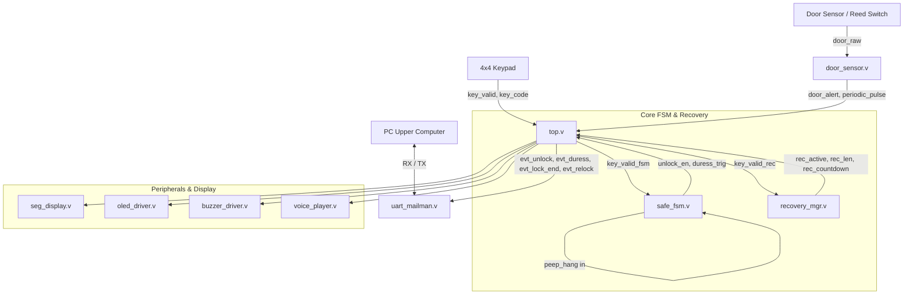

# Smart Safe 硬件工程重构与缺陷修复方案 (revision.md)

> **修订对象**：FPGA 硬件组 RTL 源码 (`rtl/*.v`) 与 仿真验证 (`sim/tb_*.v`)  
> **设计约束**：
> 1. **仅修改硬件组**：不修改上位机 PC Python 源码，硬件侧主动对齐上位机已有协议规范。
> 2. **全同步设计与单时钟域**：保持全局 `clk_50M` + `tick_1k`，严格杜绝多时钟域与亚稳态隐患。
> 3. **算力与资源约束**：维持 `0 DSP` 原则，所有除法/取模采用移位、减法或位拼接。

---

## 一、 工作区代码与缺陷一致性审查结论

经过对 `rtl/top.v`、`rtl/safe_fsm.v`、`rtl/uart_mailman.v`、`rtl/recovery_mgr.v`、`rtl/door_sensor.v`、`rtl/oled_driver.v` 以及 PC 端 `pc/modules/policy.py`、`controller.py`、`protocol.py` 的逐行静态比对，**工作区现状与排查出的 6 大系统级缺陷 100% 吻合**。

同时，排查确认了另外 3 处硬件边界隐患：
1. **试错锁定 (`S_LOCKED`) 下反挟持失效**：当歹徒逼迫连续输错锁定后，再逼迫人质输入反挟持密码，现版 FSM 在 `S_LOCKED` 忽略一切按键，无法紧急开门与报警。
2. **远程开锁 `'R'` 无条件执行**：`uart_mailman.v` 收到 `'R'` 直接产生 `remote_unlock`，未受 `is_locked` 与 `peep_hang` 门控。
3. **字模缺失**：`oled_font.v` 仅包含 47 个汉字，门未关报警与恢复模式的多字提示需要字模支持或合理复用。

---

## 二、 6 大核心缺陷根因与硬件修复方案

### 🚨 缺陷 1：反挟持静默报警双发与二次漏发

#### 1. 根因分析
- **双发覆盖**：`safe_fsm.v:288-295` 在检测到反挟持密码时，同时拉高 `unlock_en` 与粘滞的 `duress_alarm`。`top.v` 产生单拍脉冲 `unlock_rise` 和 `duress_rise` 并同时输入 `uart_mailman`。串口邮差发送完 `'D'` 紧接着发送 `'U'`，上位机收到 `'U'` 将安全状态刷新为普通开门，冲掉了报警标志。
- **二次漏发**：`duress_alarm` 为粘滞电平（直到复位或特殊操作才清零），人质若被二次逼迫再次输入反挟持密码，因无新的上升沿，`duress_rise` 为 0，第二次只发送 `'U'`，反挟持报警彻底被吞。

#### 2. RTL 修复方案
- **`safe_fsm.v`**：
  - 新增单拍脉冲输出 `duress_trig`：在 `S_CHECK` 状态下匹配到 `match_duress` 时拉高 1 个时钟周期；
  - 区分普通开锁与挟持开锁脉冲，或者在 `top.v` 区分事件。
- **`top.v`**：
  - 抑制挟持时的 `'U'` 事件：`wire evt_unlock = unlock_rise && !duress_active_pulse;`
  - 串口发送 `'D'` 具有最高优先级，且不与 `'U'` 连发；上位机收到 `'D'` 后本身会自动执行静默报警并执行开锁逻辑。
- **`uart_mailman.v`**：
  - 保证发送 `'D'` 时清除/阻断同周期的 `pend_u`。

---

### 🚨 缺陷 2：防窥挂起与反挟持严重死锁（人质丧失报警能力）

#### 1. 根因分析
- `top.v:122`：
  ```verilog
  wire key_valid_fsm = key_valid && !peep_hang && !rec_active;
  ```
  当 PC 检测到多人防窥风险下发 `'P'` 时，`peep_hang = 1` 物理切断了键盘输入。人质在歹徒胁迫下按键全部被丢弃，无法输入反挟持密码 `654321#`，屏幕持续显示横线，人质失去求救手段。

#### 2. RTL 修复方案
- **`top.v`**：
  - 将 `peep_hang` 直接输入到 `safe_fsm.v`，按键使能改为：
    ```verilog
    wire key_valid_fsm = key_valid && !rec_active; // 不再被 peep_hang 硬切断
    ```
- **`safe_fsm.v`**：
  - 在 `peep_hang == 1` 期间，键盘输入仍然正常移入虚位密码缓冲区 `vbuf`；
  - 按下 `#` 确认时：
    - 若匹配到**反挟持密码 (`match_duress`)**：**无条件放行**，产生 `unlock_en` 与 `duress_trig`，实现紧急开锁并静默报警；
    - 若匹配到普通密码：阻断开锁，维持防窥挂起提示或提示错误；
    - 屏蔽 `A` / `B` / `D` 模式切换键，防止在防窥期间误入改密模式。

---

### 🚨 缺陷 3：输错锁定与开锁后 PC 单向通信断链

#### 1. 根因分析
- 上位机 `policy.py` 与 `controller.py` 在收到 `'L'` 后进入锁定，等待 `'T'` (0x54, Lockout Timeout) 解除锁定；开门收到 `'U'` 后等待 `'K'` (0x4B, Relocked) 复位舵机锁定状态。
- 原版 `uart_mailman.v` 仅实现了 `'U'`、`'L'`、`'D'`、`'A'`，根本没有 `'T'`、`'K'`、`'E'` 的发送逻辑，导致上位机锁定后永久变灰、开锁后界面永远停留在“开锁中”。

#### 2. RTL 修复方案
- **`safe_fsm.v` / `top.v`**：
  - 产生锁定超时脉冲 `lock_timeout_pulse`：在 `S_LOCKED` 倒计时归零跳回 `S_IDLE` 时产生 1 拍脉冲；
  - 产生重新上锁脉冲 `relock_pulse`：在 `unlock_all` 的下降沿（开门保持时间结束、舵机回弹上锁时）产生 1 拍脉冲；
  - 产生密码单次错误脉冲 `err_pulse`（对应 `beep_err`）。
- **`uart_mailman.v`**：
  - 扩充输入端口：
    ```verilog
    input  wire evt_lock_end, // 发送 'T' (8'h54)
    input  wire evt_relock,   // 发送 'K' (8'h4B)
    input  wire evt_pwd_err   // 发送 'E' (8'h45)
    ```
  - 扩充发送缓冲器与优先级仲裁逻辑，支持所有协议字符全双工可靠上报。

---

### 🚨 缺陷 4：应急恢复通道（SW7 + D键）处于“全盲打”状态

#### 1. 根因分析
- `recovery_mgr.v` 缺乏蜂鸣器按键音提示；
- `top.v:114-119` 中 `rec_len`、`rec_try`、`rec_locked`、`rec_countdown` 全部悬空，未连入 `oled_driver` 与 `seg_display`；
- 用户拨动 SW7 按 D 进入恢复模式时，按键无声、屏幕无字、数码管不显示输入位数和倒计时，全凭盲打。

#### 2. RTL 修复方案
- **`recovery_mgr.v`**：
  - 增加按键触发提示脉冲 `rec_beep_key` 和错误/锁定提示脉冲 `rec_beep_err`；
  - 保持 `rec_active` 状态在输入与等待时的稳定输出。
- **`top.v`**：
  - 汇聚蜂鸣器信号：`wire buzzer_key = fsm_beep_key | rec_beep_key;`
  - 显示数据多路复用（Mux）：
    - 当 `rec_active == 1` 或 `rec_locked == 1` 时，数码管切换显示 `rec_len`、剩余次数 `rec_try` 或锁定倒计时 `rec_countdown`；
    - 将 `rec_active`、`rec_len`、`rec_locked`、`rec_countdown` 连接至 `oled_driver.v`。
- **`oled_driver.v`**：
  - 新增恢复模式专有显示页面：第一行显示“应急恢复模式”，第二行显示星号掩码 `* * *` 或输入位数。

---

### 🚨 缺陷 5：门未关报警只有“昙花一现”的一拍

#### 1. 根因分析
- `door_sensor.v:157-159` 在门开达到 15 秒后仅产生 1 个时钟周期的 `alert_pulse`；
- 蜂鸣器只响一次 300ms，语音只报一次，随后系统静止；`oled_driver.v` 和 `seg_display.v` 没有任何门未关警报状态输入，无法起到督促关门的作用。

#### 2. RTL 修复方案
- **`door_sensor.v`**：
  - 在 `door_alert == 1` 期间，通过内部计数器产生周期性脉冲（如每 1.5 秒产生一次蜂鸣脉冲，每 6 秒触发一次语音报警脉冲）；
  - 输出持续的高电平告警信号 `door_alert`。
- **`top.v`**：
  - 将 `door_alert` 连接至 `oled_driver`、`seg_display` 和报警灯逻辑。
- **`oled_driver.v` 与 `seg_display.v`**：
  - 接收 `door_alert`：当门未关超时告警时，OLED 弹窗警告“箱门超时未关 请速关门！”，数码管闪烁显示 `AL-dr` 或当前开门秒数。

---

### 🚨 缺陷 6：日常改密允许被设为反挟持密码

#### 1. 根因分析
- `safe_fsm.v` 在初次设置密码 (`S_SET_NEW`, `S_SET_CFM`) 和日常改密 (`S_CHG_NEW`, `S_CHG_CFM`) 中，仅检查了两次输入是否一致，未将 `assembled_input` 与 `DURESS_PWD` (654321) 进行黑名单比对。
- 一旦用户将主密码改为 `654321`，后续每一次正常开门均会触发 `match_duress`，导致静默报警误报频发。

#### 2. RTL 修复方案
- **`safe_fsm.v`**：
  - 增加黑名单比对逻辑：
    ```verilog
    wire is_duress_conflict = (assembled_input == DURESS_PWD);
    ```
  - 在 `S_SET_NEW`、`S_SET_CFM`、`S_CHG_NEW`、`S_CHG_CFM` 的 `#` 确认分支中，若 `is_duress_conflict` 为真，则拒绝保存，直接跳转至 `S_ERROR`，拉高 `beep_err`，并在 OLED 显示密码非法提示。

---

## 三、 硬件接口与各模块重构清单



### 1. 模块接口修改明细

| 模块 | 修改属性 | 信号名 | 位宽 | 作用说明 |
|---|---|---|---|---|
| `safe_fsm.v` | **新增 Input** | `peep_hang` | 1 | 接收防窥挂起状态，在挂起下保留反挟持能力 |
| `safe_fsm.v` | **新增 Output** | `duress_trig` | 1 | 反挟持单拍脉冲（替代粘滞电平导致的二次漏发） |
| `safe_fsm.v` | **新增 Output** | `lock_timeout_pulse` | 1 | 60s 试错锁定结束脉冲，用于通知 PC 解锁 |
| `recovery_mgr.v` | **新增 Output** | `rec_beep_key` | 1 | 恢复模式按键提示脉冲 |
| `recovery_mgr.v` | **新增 Output** | `rec_beep_err` | 1 | 恢复模式输错/锁定提示脉冲 |
| `door_sensor.v` | **修改 Output** | `alert_pulse` | 1 | 由单次一拍脉冲改为周期性重复提示脉冲 |
| `uart_mailman.v` | **新增 Input** | `evt_lock_end` | 1 | 触发发送 `'T'` (0x54, Lockout Clear) |
| `uart_mailman.v` | **新增 Input** | `evt_relock` | 1 | 触发发送 `'K'` (0x4B, Servo Relocked) |
| `uart_mailman.v` | **新增 Input** | `evt_pwd_err` | 1 | 触发发送 `'E'` (0x45, Single Password Error) |
| `oled_driver.v` | **新增 Input** | `rec_active` | 1 | 恢复模式激活状态 |
| `oled_driver.v` | **新增 Input** | `rec_len` | 3 | 恢复模式当前输入长度 |
| `oled_driver.v` | **新增 Input** | `rec_locked` | 1 | 恢复模式锁定状态 |
| `oled_driver.v` | **新增 Input** | `rec_countdown` | 6 | 恢复模式倒计时 |
| `oled_driver.v` | **新增 Input** | `door_alert` | 1 | 门未关超时报警提示使能 |
| `seg_display.v` | **新增 Input** | `door_alert` | 1 | 门未关数码管报警使能 |

---

## 四、 详细修改方案实施步骤

### 步骤 1：`rtl/safe_fsm.v` 重构
1. 端口加入 `input wire peep_hang`、`output reg duress_trig`、`output reg lock_timeout_pulse`。
2. 在 `S_LOCKED` 状态下：
   - 当 `lock_timer == 1`（倒计时结束即将切回 `S_IDLE`）时拉高 `lock_timeout_pulse <= 1'b1`。
   - **支持锁定下的反挟持求救**：允许在 `S_LOCKED` 下按键移入 `vbuf`，检测到 `match_duress` 时立即退出锁定进入 `S_OP_DONE` 并拉高 `unlock_en` 和 `duress_trig`。
3. 在 `S_CHECK` 状态下：
   - 匹配到 `match_duress` 时：拉高 `duress_trig <= 1'b1`，同时 `unlock_en <= 1'b1`。
   - 在 `peep_hang == 1` 时：若未命中 `match_duress`，则不管是否命中普通密码，一律阻断开锁并报警。
4. 改密黑名单：
   - 增加 `wire is_duress_conflict = (assembled_input == DURESS_PWD);`
   - 在 `S_SET_CFM` 与 `S_CHG_CFM` 的 `#` 确认逻辑中，如果 `is_duress_conflict` 为真，则进入 `S_ERROR` 并置 `beep_err <= 1'b1`。

### 步骤 2：`rtl/uart_mailman.v` 重构
1. 端口加入 `evt_lock_end`、`evt_relock`、`evt_pwd_err`。
2. 发送缓冲寄存器扩充：
   ```verilog
   reg pend_d; // 'D' Duress
   reg pend_l; // 'L' Lockout
   reg pend_t; // 'T' Lockout Clear
   reg pend_k; // 'K' Relocked
   reg pend_a; // 'A' Alarm (Door/Tamper)
   reg pend_u; // 'U' Normal Unlock
   reg pend_e; // 'E' Error
   ```
3. 发送状态机与优先级裁决：
   - 发送优先级：`'D'` > `'L'` > `'T'` > `'K'` > `'A'` > `'U'` > `'E'`。
   - 互斥保护：当 `pend_d` 置位时，直接清除或压制同周期可能置位的 `pend_u`。
4. 远程开锁安全门控：
   - 将 `remote_unlock` 与系统的 `!is_locked && !peep_hang` 相与后再输出。

### 步骤 3：`rtl/door_sensor.v` 重构
1. 在 `ST_DOOR_OPENED` 状态下，当 `sec_cnt >= TIMEOUT_SEC` 时持续输出 `door_alert = 1'b1`。
2. 内部增加间歇告警脉冲分频计数器 `alert_timer`（基于 `tick_1k`）：
   - 每 1 秒输出一拍脉冲供蜂鸣器鸣叫；
   - 每 5 秒输出一拍脉冲供语音芯片播报。
3. 关门后（`door_stable == 1'b0`）立即清除 `door_alert` 与计数器。

### 步骤 4：`rtl/recovery_mgr.v` 重构
1. 增加 `output reg rec_beep_key` 和 `output reg rec_beep_err`。
2. 当在恢复模式下接收到有效按键输入时产生 1 拍 `rec_beep_key`；输错或进入锁定后产生 1 拍 `rec_beep_err`。
3. 在恢复模式锁定时保持 `rec_active` 状态位或专用 `rec_locked` 标志，以便上层模块感知锁定倒计时。

### 步骤 5：`rtl/oled_driver.v` 与 `rtl/seg_display.v` 交互升级
1. `seg_display.v`：
   - 增加对 `door_alert` 与 `rec_active` 的显示裁决：
     - 若 `door_alert == 1`：数码管显示 `AL-dr`；
     - 若 `rec_active == 1`：数码管前两位显示 `rE`，后两位显示已输入长度 `rec_len` 或剩余次数；
     - 若 `rec_locked == 1`：数码管显示恢复锁定倒计时 `rec_countdown`。
2. `oled_driver.v`：
   - 加入门未关报警弹窗界面逻辑；
   - 加入应急恢复模式界面显示（显示已输入星号及倒计时）。

### 步骤 6：`rtl/top.v` 顶层连线与逻辑闭环
1. 消除所有未连接引脚（`rec_len`, `rec_try`, `rec_locked`, `rec_countdown` 接入显示驱动）。
2. 解除 `key_valid_fsm` 处的 `!peep_hang` 硬件切断，改为将 `peep_hang` 传入 `safe_fsm`。
3. 接入 `duress_trig`、`lock_timeout_pulse`、`relock_pulse`、`err_pulse` 到 `uart_mailman`。
4. 统一蜂鸣器按键音输入：`wire beep_key_any = fsm_beep_key | rec_beep_key;`。

---

## 五、 仿真与回归验证清单 (`sim/`)

为确保修改后 100% 解决问题且不引入新 bug，需要对仿真测试用例进行对应升级：

1. **`sim/tb_safe_fsm.v` 升级**：
   - **Case 1**：普通开锁测试（验证 `unlock_en` 与只有 `'U'` 产生）。
   - **Case 2**：反挟持密码输入测试（验证 `duress_trig` 单拍脉冲输出、`unlock_en` 拉高，且不出现粘滞导致的二次吞码）。
   - **Case 3**：防窥挂起中输入反挟持（验证 `peep_hang == 1` 时输入普通密码被拒绝，输入 `654321#` 成功开门并产生 `duress_trig`）。
   - **Case 4**：试错锁定 60 秒测试（验证 60 秒到期产生 `lock_timeout_pulse`）。
   - **Case 5**：改密黑名单测试（尝试设置新密码为 `654321`，验证被拦截并报错）。
2. **`sim/tb_uart_mailman.v` 升级**：
   - 验证 `'D'` 与 `'U'` 同时到达时，优先发出 `'D'` 且 `'U'` 被丢弃。
   - 验证新增字符 `'T'`、`'K'`、`'E'` 的发送优先级与帧格式。
3. **`sim/tb_door_sensor.v` 升级**：
   - 验证开门超过 15 秒后，`door_alert` 保持为高，且间歇产生多次脉冲，关门后立即消除。
4. **`sim/tb_top.v` 顶层系统集成验证**：
   - 完整模拟用户操作、串口双向交互闭环流程。
